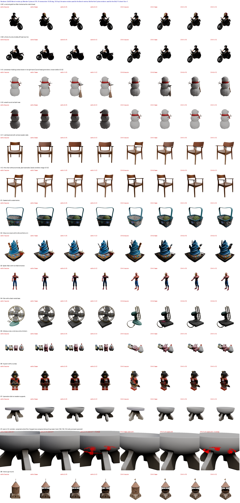

# 1. E2a 샘플러 스텝 수 축소 — 보고서 (a5000)

- 장비: a5000 (RTX A5000 24 GB). 브랜치 `item/01-E2a-a5000` (`item/01-port-a5000` `69e56a5` 에서 분기, main `bc4f0ae` 까지 병합)
- 기준: 0-1 이식본(25 스텝) — 0-1 종단 비교의 이식 r1–r3 결과를 재사용(재실행 없음)
- 결과 유형: **변경**. 토글 `VHL_E2A_STEPS_S1`, `VHL_E2A_STEPS_S2`(기본 25 = 꺼짐), CLI `--steps_s1/--steps_s2`(CLI 우선)
- 시나리오: 동결 14건(트랙 A 6 + 트랙 B 8), 입력 SLat 고정(W34), 동결 조건 이미지, seed 0, 설정마다 3회

## 요약 (고객사 판단용)

- **시간(실측, c15·c12):**
  - 구간 4–7 14건 평균이 base 86.2 s → **c15 59.8 s(−31%) / c12 53.1 s(−38%)** 다.
  - 분모 226.8 s 대비로는 −11.6% / −14.6% 다.
  - RSS 피크는 60–75 → 39–49 / 32–41 GiB 로 준다. GPU 피크는 그대로다.
- **R_keep(E18):**
  - 소실 0 이다.
  - 신규 합계는 8,806 → 6,129 / 4,291 로 줄어 합계 기준 통과다.
  - 시나리오별 상한 초과는 c15 2건, c12 5건이다.
  - 초과분은 대부분 마스크에서 떨어진 작은 덩어리라 9a 로 지워진다(§4a). 예외는 c12 B7 로, 마스크에 붙은 증가 360 셀이 9a 로도 상한을 넘는다.
- **원인(§7):** R_keep 변화는 전부 Stage 1 스텝 수에서 온다. s1-12 coords 는 c12 와, s2-12 coords 는 base 와 42/42 회차 모두 같다.
- **지표(§5):**
  - E18 문언(허용 범위 = base 3회 폭)대로면 악화 칸이 c15 22/60, c12 25/60 이다. 두 설정 모두 "통과 후보"가 아니다.
  - 다만 같은 폭으로 세면 개선 칸도 비슷하게 많다.
  - 일관되게 나빠지는 곳은 B6·B8 마스크 밖 지표와 CLIP-T(c15 8/14) 다.
- **효능·육안(§6):**
  - 효능 저하는 0건이다. A-S1 은 오히려 나아졌다.
  - 보이는 결함은 떨어진 작은 점(A-M2·A-C1)뿐이다.
- **꺼짐(§9):** coords 일치, 보존 셀 비트 동일, mean\|Δ\| ≤ 3.2e-3 로 통과다.
- **채택:** 고객사가 육안 비교 후 결정한다. 참고로 s2-12(25/12)는 R_keep 이 base 와 같은 후보다. 품질 지표는 미측정이다(§7).

## 1. 예상 (실행 전, 2026-10-25)

- **시간:** 구간 4(Stage 1, 25 스텝 42.0 s)와 구간 6(Stage 2, 15.6–50.9 s)은 스텝 수에 거의 비례.
  - c15: Stage 1 ≈ 25 s(−17 s), Stage 2 ≈ 0.6 배(−6 – −20 s). 4–7 합 14건 평균(이식본 ≈ 85 s) → ≈ 60 s(약 −25 s, −30%).
  - c12: Stage 1 ≈ 20 s(−22 s), Stage 2 ≈ 0.48 배. 4–7 합 → ≈ 52 s(약 −33 s, −39%). 분모 226.8 s(E8) 대비 c12 약 −15%, c15 약 −11%.
  - 구간 3·7·8 은 그대로(7 은 셀 수가 바뀌면 조금 달라질 수 있음).
- **메모리:** `ss_kv`(47.3 GB, 8,448 항목)·`slat_kv`(15.1 GB, 4,800 항목)는 스텝 수에 비례 → c15 ≈ 28.4 / 9.0 GB, c12 ≈ 22.7 / 7.2 GB. RSS 피크(60–75 GiB)가 c12 에서 30 GiB 대로 줄어든다. GPU alloc 피크(≈10–11.5 GiB)는 거의 그대로(디코딩·to_glb 가 피크).
- **품질:** inversion–denoising 왕복 오차가 커져 마스크 안 편집이 약해지거나 모양이 거칠어질 수 있고, 마스크 밖 렌더 지표(PSNR·SSIM·LPIPS)도 나빠질 수 있다. R_keep 소실은 Stage 1 voxel 병합 때문에 0 유지, R_keep 신규·편집량은 바뀔 수 있다. c15 는 base 와 육안 차이가 작고, c12 는 일부 건에서 효능이 약해질 것으로 본다.
- **결정성:** Stage 1 coords 는 설정마다 3회 같음(결정적), base 와는 다를 수 있다(변경 항목).

## 2. 변경 파일

| 파일 | 내용 |
|---|---|
| `editcore/sampler.py` | `InversionSampler(steps)` — 스텝 수를 샘플러마다. `t_seq` 인스턴스 메서드 |
| `editcore/pipeline.py` | `Editor(..., steps_s1, steps_s2)` → Stage 1·2 샘플러 분리(같은 stage 의 inversion·denoising 은 같은 샘플러) |
| `editcore/models.py` | `e2a_steps()` — CLI > `VHL_E2A_STEPS_S1/S2` > 25 |
| `editcore/cli.py` | `--steps_s1/--steps_s2`, 실제 스텝·캐시 항목 수 로그와 timing JSON 기록 |
| `tests/cpu/test_e2a_cpu.py` | 토글 우선순위, 스텝 12·15·25 × cfg 0·5 키 집합 일치·K/V 항목 수 공식, 스텝 불일치 KeyError |
| `tests/cpu/test_editcore_cpu.py` | `t_seq` 호출 형태만 수정 |
| `tests/gpu/run_e2a.sh` | 설정별 14건 × 3회 실행(`offcheck` 또는 `<cfg> <s1> <s2>`) |
| `tools/e2a_metrics.py` | 시간·메모리·R_keep(E18)·Bench 렌더·지표 집계 |
| `tests/gpu/b1_followup.py` | 부록 S-5(1) B1 면 수 원인 단계 |
| `tools/e2a_visual.py` | 육안 시트(§6) |
| `scenarios/track_a.json` | A-C2·A-S1 표시(E12) |

- 위 표의 `scenarios/track_a.json` 위까지는 PR #12 병합(`cc18a0d`)으로 이미 main 에 들어가 있다(토글 기본 25 = 결과 무영향, §9).
- 이 PR 에서 main 대비 새로 바뀌는 것: 보고서, 시트 이미지, `tools/e2a_visual.py`, `scenarios/track_a.json`.

## 3. 결과 — 시간·메모리 (실측, 14건 × 3회, 평균±표준편차)

base = 0-1 이식본 r1–r3(25/25, 재실행 없음). c15·c12 = 이 브랜치 `editcore.cli --steps_s1/--steps_s2`. 실행 로그에 실제 스텝 수와 캐시 항목 수가 찍힌다(`[e2a] steps s1=12 s2=12`, `[e2a] cache entries {'stage1': {'latent': 12, 'kv': 4224}, 'stage2': {'latent': 12, 'kv': 2304}}` 등). c12·c15 는 다른 GPU·CPU 작업 없이 측정했다.

### 3a. 설정별 요약

| 설정 | 스텝 S1/S2 | 4 Stage 1 평균 | 6 Stage 2 평균 | 4–7 합 14건 평균 | base 대비 4–7 (s, %) | 분모 226.8 s 대비 | ss_kv GB (항목) | slat_kv GB (항목) | RSS 피크 범위 GiB | alloc 피크 범위 GiB |
|---|---|---|---|---|---|---|---|---|---|---|
| base | 25/25 | 42.1 | 23.5 | 86.2 | +0.0 (+0%) | +0.0% | 47.3 (8448) | 16.8 (4800) | 60.1–74.7 | 9.92–11.49 |
| c15 | 15/15 | 25.3 | 14.2 | 59.8 | -26.4 (-31%) | -11.6% | 29.0 (5184) | 10.1 (2880) | 38.7–49.1 | 9.92–11.43 |
| c12 | 12/12 | 20.4 | 11.4 | 53.1 | -33.0 (-38%) | -14.6% | 23.7 (4224) | 8.1 (2304) | 32.3–40.9 | 9.92–11.29 |
| s1-12 † | 12/25 | 27.6 † | 34.0 † | 90.7 † | +4.6 † | – | 23.7 (4224) | 16.8 (4800) | 37.9–54.7 † | 9.92–11.29 |
| s2-12 † | 25/12 | 43.3 † | 11.8 † | 77.5 † | −8.7 † | – | 47.3 (8448) | 8.1 (2304) | 54.5–63.1 † | 9.92–11.49 |

**† s1-12·s2-12 의 시간·RSS 는 CPU 렌더와 겹친 참고값이다(원인 분리용, 재측정 안 함).**
- 두 설정은 지표용 Bench 렌더(CPU Cycles, nice 19)와 같은 시간에 돌았다.
- 그래서 스텝과 무관한 구간도 늘었다. s1-12 의 구간 8(로드)은 58.4 s 로 다른 설정의 33–34 s 보다 길고, 같은 25 스텝인 Stage 2 도 34.0 s 로 base 23.5 s 보다 길다.
- 이 두 설정은 R_keep 원인 분리(§7)에만 쓴다. 시간 판단에는 c15·c12 행만 쓴다.
- 캐시 항목 수·바이트와 GPU alloc 은 부하와 무관한 값이라 그대로 유효하다. s1-12 는 Stage 1 이 c12 와, Stage 2 가 base 와 같다. s2-12 는 그 반대다.

- **예상 대비:** Stage 1 은 스텝에 정확히 비례(42.1 → 25.3 → 20.4 s, 25:15:12 = 42.1:25.3:20.2). Stage 2 도 비례(23.5 → 14.2 → 11.4 s). 4–7 합 절감 c15 −26.4 s(−31%), c12 −33.0 s(−38%) — 예상(−30%·−39%)과 같다. 분모 226.8 s(E8) 대비 c15 −11.6%, c12 −14.6%.
- **메모리:** `ss_kv` 47.3 → 29.0 → 23.7 GB, `slat_kv` 도 스텝에 비례(A-M1 16.8 → 10.1 → 8.1 GB). **RSS 피크 60–75 GiB → c15 39–49 GiB → c12 32–41 GiB.** GPU alloc 피크(9.9–11.5 GiB)는 그대로(디코딩·to_glb 가 피크) — 예상대로.
- 캐시 항목 수 = 스텝 × order 2 × pos 수 × 24 층 × (self, cross) × (k, v): Stage 2(cfg 0, pos 1) 12 스텝 2,304 = 12×2×24×2×2, 15 스텝 2,880. Stage 1 은 CFG 구간 [0.5,1.0] 안 스텝에서 pos 2 라 4,224(12)·5,184(15).
- time_mem.json sha256 `6590062befa517c5…`(5 설정). base·c15·c12 값은 3 설정 판(`4d59ee87b412c880…`)과 같다.

### 3b. 시나리오별 시간·메모리

| ID | 설정 | 3 | 4 Stage 1 | 6 Stage 2 | 7 출력 | 8 로드 | 4–7 합 | alloc GiB | RSS GiB |
|---|---|---|---|---|---|---|---|---|---|
| A-M1 | base | 1.7 ± 0.0 | 42.1 ± 0.2 | 22.1 ± 0.2 | 17.6 ± 0.3 | 33.8 ± 0.3 | 81.8 ± 0.7 | 10.43 | 65.9 |
| A-M1 | c15 | 1.7 ± 0.1 | 25.2 ± 0.1 | 13.4 ± 0.1 | 19.1 ± 2.2 | 33.8 ± 0.1 | 57.7 ± 2.3 | 10.44 | 42.3 |
| A-M1 | c12 | 1.7 ± 0.1 | 20.4 ± 0.0 | 10.8 ± 0.0 | 17.0 ± 0.1 | 33.9 ± 0.3 | 48.2 ± 0.1 | 10.44 | 35.4 |
| A-M2 | base | 1.7 ± 0.1 | 42.3 ± 0.1 | 20.7 ± 0.0 | 17.5 ± 0.1 | 33.6 ± 0.3 | 80.4 ± 0.2 | 10.46 | 64.7 |
| A-M2 | c15 | 1.8 ± 0.1 | 25.5 ± 0.1 | 12.6 ± 0.0 | 19.2 ± 3.1 | 33.9 ± 0.5 | 57.2 ± 3.2 | 10.46 | 41.7 |
| A-M2 | c12 | 1.8 ± 0.1 | 20.6 ± 0.2 | 10.2 ± 0.0 | 17.4 ± 0.1 | 33.7 ± 0.3 | 48.2 ± 0.2 | 10.52 | 34.9 |
| A-S1 | base | 1.8 ± 0.1 | 42.1 ± 0.2 | 25.9 ± 0.1 | 22.9 ± 1.8 | 33.3 ± 0.2 | 91.0 ± 1.9 | 10.50 | 68.2 |
| A-S1 | c15 | 1.7 ± 0.1 | 25.3 ± 0.1 | 15.6 ± 0.1 | 22.5 ± 1.1 | 33.5 ± 0.2 | 63.3 ± 1.3 | 10.48 | 43.8 |
| A-S1 | c12 | 1.7 ± 0.1 | 20.4 ± 0.1 | 12.6 ± 0.1 | 24.1 ± 1.8 | 33.5 ± 0.6 | 57.1 ± 1.7 | 10.47 | 36.6 |
| A-S2 | base | 1.8 ± 0.0 | 42.1 ± 0.1 | 25.5 ± 0.1 | 21.1 ± 0.4 | 33.2 ± 0.1 | 88.7 ± 0.5 | 10.38 | 68.2 |
| A-S2 | c15 | 1.7 ± 0.0 | 25.3 ± 0.1 | 15.3 ± 0.0 | 21.9 ± 1.1 | 34.0 ± 0.4 | 62.5 ± 1.1 | 10.38 | 43.9 |
| A-S2 | c12 | 1.8 ± 0.1 | 20.5 ± 0.1 | 12.4 ± 0.1 | 23.8 ± 2.0 | 33.8 ± 0.5 | 56.8 ± 1.9 | 10.38 | 36.6 |
| A-C1 | base | 1.7 ± 0.1 | 42.1 ± 0.2 | 20.5 ± 0.1 | 19.2 ± 2.9 | 33.6 ± 0.2 | 81.8 ± 3.0 | 10.34 | 64.9 |
| A-C1 | c15 | 1.7 ± 0.0 | 25.3 ± 0.1 | 12.6 ± 0.1 | 19.1 ± 2.9 | 33.8 ± 0.4 | 56.9 ± 3.0 | 10.36 | 41.8 |
| A-C1 | c12 | 1.9 ± 0.1 | 20.5 ± 0.2 | 10.0 ± 0.1 | 18.0 ± 1.5 | 33.9 ± 0.3 | 48.5 ± 1.4 | 10.36 | 34.9 |
| A-C2 | base | 1.8 ± 0.0 | 42.1 ± 0.1 | 19.9 ± 0.1 | 16.6 ± 0.0 | 33.4 ± 0.1 | 78.6 ± 0.2 | 10.26 | 64.4 |
| A-C2 | c15 | 1.7 ± 0.0 | 25.3 ± 0.1 | 12.0 ± 0.0 | 16.7 ± 0.2 | 33.9 ± 0.4 | 54.0 ± 0.2 | 10.27 | 41.5 |
| A-C2 | c12 | 1.8 ± 0.0 | 20.3 ± 0.1 | 9.6 ± 0.0 | 19.1 ± 2.0 | 33.8 ± 0.6 | 49.1 ± 1.9 | 10.27 | 34.7 |
| B1 | base | 1.7 ± 0.0 | 42.1 ± 0.3 | 29.4 ± 0.2 | 28.7 ± 2.1 | 33.5 ± 0.1 | 100.2 ± 2.6 | 10.88 | 69.1 |
| B1 | c15 | 1.8 ± 0.0 | 25.3 ± 0.2 | 18.5 ± 0.1 | 29.1 ± 1.7 | 34.0 ± 0.7 | 72.9 ± 1.9 | 11.02 | 44.4 |
| B1 | c12 | 1.8 ± 0.0 | 20.4 ± 0.1 | 14.8 ± 0.1 | 29.1 ± 3.0 | 33.8 ± 0.4 | 64.3 ± 2.9 | 11.03 | 37.0 |
| B2 | base | 1.8 ± 0.0 | 42.1 ± 0.1 | 50.9 ± 1.2 | 29.1 ± 0.9 | 33.3 ± 0.2 | 122.1 ± 2.1 | 11.49 | 74.7 |
| B2 | c15 | 1.8 ± 0.0 | 25.4 ± 0.0 | 30.0 ± 0.1 | 30.0 ± 1.7 | 34.0 ± 0.4 | 85.4 ± 1.7 | 11.43 | 49.1 |
| B2 | c12 | 1.7 ± 0.0 | 20.4 ± 0.1 | 23.3 ± 0.1 | 28.4 ± 0.0 | 33.7 ± 0.2 | 72.0 ± 0.2 | 11.29 | 40.9 |
| B3 | base | 1.7 ± 0.1 | 42.0 ± 0.2 | 15.5 ± 0.1 | 14.7 ± 1.6 | 33.3 ± 0.4 | 72.1 ± 1.8 | 9.92 | 60.1 |
| B3 | c15 | 1.7 ± 0.1 | 25.3 ± 0.1 | 9.3 ± 0.1 | 13.7 ± 0.1 | 34.2 ± 0.2 | 48.4 ± 0.2 | 9.92 | 38.7 |
| B3 | c12 | 1.7 ± 0.0 | 20.3 ± 0.1 | 7.4 ± 0.1 | 17.3 ± 3.0 | 33.6 ± 0.4 | 45.0 ± 3.0 | 9.92 | 32.3 |
| B4 | base | 1.8 ± 0.0 | 42.1 ± 0.1 | 24.6 ± 0.1 | 23.4 ± 2.1 | 33.5 ± 0.4 | 90.1 ± 2.1 | 10.48 | 66.7 |
| B4 | c15 | 1.7 ± 0.0 | 25.3 ± 0.1 | 14.8 ± 0.0 | 23.0 ± 2.0 | 33.9 ± 0.5 | 63.0 ± 2.1 | 10.48 | 42.9 |
| B4 | c12 | 1.8 ± 0.0 | 20.4 ± 0.1 | 11.9 ± 0.0 | 22.3 ± 1.4 | 33.8 ± 0.3 | 54.6 ± 1.4 | 10.46 | 36.0 |
| B5 | base | 1.7 ± 0.0 | 42.1 ± 0.2 | 17.1 ± 0.2 | 17.6 ± 2.3 | 33.4 ± 0.2 | 76.7 ± 2.1 | 10.21 | 61.6 |
| B5 | c15 | 1.8 ± 0.0 | 25.3 ± 0.1 | 10.3 ± 0.0 | 15.8 ± 0.4 | 33.4 ± 0.3 | 51.3 ± 0.5 | 10.19 | 39.7 |
| B5 | c12 | 1.7 ± 0.0 | 20.4 ± 0.1 | 8.4 ± 0.2 | 18.8 ± 2.9 | 33.9 ± 0.5 | 47.5 ± 2.7 | 10.17 | 33.2 |
| B6 | base | 1.8 ± 0.0 | 42.2 ± 0.1 | 18.9 ± 0.1 | 19.6 ± 2.8 | 33.7 ± 0.2 | 80.7 ± 2.9 | 10.27 | 63.7 |
| B6 | c15 | 1.8 ± 0.0 | 25.3 ± 0.2 | 11.5 ± 0.2 | 16.7 ± 0.1 | 33.6 ± 0.5 | 53.6 ± 0.5 | 10.29 | 41.1 |
| B6 | c12 | 1.7 ± 0.1 | 20.4 ± 0.1 | 9.2 ± 0.0 | 17.0 ± 0.5 | 34.0 ± 0.4 | 46.6 ± 0.6 | 10.29 | 34.4 |
| B7 | base | 1.7 ± 0.1 | 42.3 ± 0.1 | 21.9 ± 0.0 | 20.6 ± 0.1 | 33.4 ± 0.0 | 84.7 ± 0.2 | 10.95 | 61.7 |
| B7 | c15 | 1.8 ± 0.1 | 25.4 ± 0.1 | 12.4 ± 0.0 | 20.5 ± 0.3 | 33.7 ± 0.3 | 58.3 ± 0.4 | 10.82 | 39.8 |
| B7 | c12 | 1.8 ± 0.0 | 20.4 ± 0.1 | 11.5 ± 0.1 | 27.3 ± 1.7 | 34.0 ± 0.3 | 59.2 ± 1.8 | 11.23 | 33.4 |
| B8 | base | 1.8 ± 0.2 | 42.1 ± 0.2 | 16.6 ± 0.2 | 18.4 ± 1.8 | 33.3 ± 0.1 | 77.2 ± 2.1 | 10.28 | 61.0 |
| B8 | c15 | 1.8 ± 0.1 | 25.3 ± 0.1 | 10.1 ± 0.0 | 17.2 ± 0.1 | 33.5 ± 0.4 | 52.6 ± 0.1 | 10.28 | 39.3 |
| B8 | c12 | 1.7 ± 0.0 | 20.3 ± 0.1 | 7.9 ± 0.1 | 18.4 ± 0.4 | 33.7 ± 0.4 | 46.5 ± 0.6 | 10.27 | 32.9 |

## 4. 결과 — R_keep 판정 (정오표 E18, 실측)

R_keep 은 coords 만 보므로 3회 표준편차 0(Stage 1 결정적)이고, Stage 2 스텝은 R_keep 에 영향이 없다(coords 는 Stage 1 이 정한다 — 코드확인 `pipeline.edit`: coords_tgt = Stage 1 voxel 병합 결과).

| ID | 표시(E12) | base 신규 | 상한 max(base×1.2, base+20) | c15 신규 | c15 판정 | c12 신규 | c12 판정 | 편집량 base / c15 / c12 | 효능 저하(<50%) | R_keep IoU base / c15 / c12 |
|---|---|---|---|---|---|---|---|---|---|---|
| A-M1 |  | 93 | 113.0 | 129 | **초과** | 142 | **초과** | 639 / 756 / 748 | – | 0.9911 / 0.9878 / 0.9865 |
| A-M2 |  | 43 | 63.0 | 44 | 통과 | 76 | **초과** | 2671 / 2748 / 3149 | – | 0.9948 / 0.9947 / 0.9908 |
| A-S1 | 마스크 밖 생성(알려진 결함) | 2037 | 2444.4 | 354 | 통과 | 272 | 통과 | 47 / 1367 / 1340 | – | 0.8323 / 0.9662 / 0.9738 |
| A-S2 |  | 1 | 21.0 | 6 | 통과 | 9 | 통과 | 189 / 216 / 220 | – | 0.9999 / 0.9994 / 0.9991 |
| A-C1 |  | 118 | 141.6 | 186 | **초과** | 299 | **초과** | 1495 / 1379 / 2622 | – | 0.9849 / 0.9763 / 0.9625 |
| A-C2 | 조건 이미지 약함 | 18 | 38.0 | 36 | 통과 | 45 | **초과** | 847 / 960 / 1005 | – | 0.9971 / 0.9943 / 0.9929 |
| B1 |  | 107 | 128.4 | 113 | 통과 | 107 | 통과 | 4324 / 6323 / 6604 | – | 0.9900 / 0.9894 / 0.9900 |
| B2 |  | 4830 | 5796.0 | 3999 | 통과 | 1849 | 통과 | 1173 / 1058 / 1227 | – | 0.8068 / 0.8345 / 0.9160 |
| B3 |  | 61 | 81.0 | 29 | 통과 | 36 | 통과 | 289 / 269 / 196 | – | 0.9819 / 0.9913 / 0.9892 |
| B4 |  | 989 | 1186.8 | 892 | 통과 | 856 | 통과 | 4712 / 4796 / 4724 | – | 0.8888 / 0.8986 / 0.9023 |
| B5 |  | 268 | 321.6 | 91 | 통과 | 28 | 통과 | 2273 / 2214 / 2336 | – | 0.9467 / 0.9812 / 0.9941 |
| B6 |  | 4 | 24.0 | 3 | 통과 | 8 | 통과 | 1355 / 1474 / 1459 | – | 0.9992 / 0.9994 / 0.9984 |
| B7 |  | 168 | 201.6 | 173 | 통과 | 517 | **초과** | 11809 / 11574 / 12933 | – | 0.9656 / 0.9646 / 0.9012 |
| B8 |  | 69 | 89.0 | 74 | 통과 | 47 | 통과 | 5223 / 5940 / 5138 | – | 0.9796 / 0.9781 / 0.9860 |
| **합계** | | **8806** | **9687** | **6129** | 통과 | **4291** | 통과 | | | |

- **(a) R_keep 소실 = 0:** c15·c12 의 14건 모두 0 — 통과.
- **(b) R_keep 신규:** 합계는 base 8,806 → c15 6,129 → c12 4,291 로 **줄어든다**(합계 기준 통과, 상한 9,687). 시나리오별 상한은 **c15 2건 초과(A-M1 129 > 113, A-C1 186 > 141.6), c12 5건 초과(A-M1, A-M2, A-C1, A-C2, B7 517 > 201.6)**. 반대로 A-S1(2,037 → 354 / 272)·B2(4,830 → 3,999 / 1,849)·B5(268 → 91 / 28)는 크게 줄었다.
- **(c) 효능 저하(마스크 안 편집량 < base 50%):** 해당 없음. A-S1 은 마스크 안 편집량이 47 → 1,367(c15)·1,340(c12)로 **크게 늘었다** — 25 스텝에서 마스크 밖에 생기던 덩어리(부록 S-5(2))가 스텝을 줄이면 마스크 안으로 들어온다(육안으로 확인 예정).
- c12 가 시나리오별 신규 상한을 넘으므로 지시서대로 s1-12(12/25)·s2-12(25/12)를 돌려 어느 stage 가 영향을 주는지 갈랐다. 결과는 §7 이다. R_keep 변화는 전부 Stage 1 스텝 수에서 온다.
- 원자료 `$RUNS_DIR/e2a_metrics/rkeep.json` sha256 `3bc56ace5fe508c3…`(5 설정). base·c15·c12 값은 3 설정 판(`290f5921325f972a…`)과 같다.

### 4a. 상한 초과 건의 증가분 위치 (CPU 계산, 실측 r1 coords)

**방법.** 증가 셀 = 설정의 R_keep 신규 셀(자식 점유 ∧ 원본 비어 있음 ∧ 마스크 ∪ halo 2 밖) 중 base(0-1 r1)에서는 신규가 아니던 셀. 이를 26-이웃 연결 성분으로 나누고, 성분마다 셀 수와 **마스크 ∪ halo 까지의 최단 거리**를 잰다(체비셰프 거리, 즉 26-이웃 걸음 수. 1 = 마스크 ∪ halo 에 맞닿음). coords 는 Stage 1 결정적이라 r1–r3 같다.

**9a 연결 성분 필터(E17)는 규칙 그대로 적용했다.**
1. 결과의 모든 새 셀(원본에서 비어 있던 셀, 마스크 안 포함)을 26-이웃 성분으로 나눈다.
2. 마스크 ∪ halo 에 맞닿지 않은 성분을 지운다.

그래서 떨어진 셀이라도 다른 새 셀을 거쳐 마스크에 이어지면 남는다.

| 설정 | ID | 신규 base → 설정 | 증가 셀 (base 에만 있던 셀) | 성분 수 | 붙음(거리 1): 성분/셀 | 떨어짐(거리 ≥ 2): 성분/셀 | 떨어진 성분의 거리 범위 | 9a 가 지우는 증가 셀 | 9a 뒤 신규 base → 설정 (상한) |
|---|---|---|---|---|---|---|---|---|---|
| c15 | A-M1 | 93 → 129 | 56 (20) | 28 | 0 / 0 | 28 / 56 | 3–33 | 56 / 56 | 0 → 0 (113) |
| c15 | A-C1 | 118 → 186 | 71 (3) | 9 | 0 / 0 | 9 / 71 | 7–24 | 71 / 71 | 0 → 0 (141.6) |
| c12 | A-M1 | 93 → 142 | 79 (30) | 47 | 1 / 1 | 46 / 78 | 3–34 | 78 / 79 | 0 → 1 (113) |
| c12 | A-M2 | 43 → 76 | 59 (26) | 31 | 3 / 5 | 28 / 54 | 7–33 | 54 / 59 | 24 → 9 (63) |
| c12 | A-C1 | 118 → 299 | 188 (7) | 25 | 0 / 0 | 25 / 188 | 7–32 | 188 / 188 | 0 → 0 (141.6) |
| c12 | A-C2 | 18 → 45 | 27 (0) | 17 | 8 / 18 | 9 / 9 | 2–20 | 9 / 27 | 16 → 34 (38) |
| c12 | B7 | 168 → 517 | 360 (11) | 20 | 16 / 353 | 4 / 7 | 2–4 | 4 / 360 | 168 → 513 (201.6) |

큰 성분(셀 수 순 상위, 셀 수 · 체비셰프 거리 · 중심 좌표 [x, y, z]):

| 설정 | ID | 상위 성분 |
|---|---|---|
| c15 | A-M1 | 17 셀 · 29 · [35.7, 41.3, 14.5]; 9 · 14 · [39.0, 36.1, 29.9]; 2 · 11 · [24.0, 16.0, 33.5] |
| c15 | A-C1 | 33 · 14 · [12.4, 23.6, 27.3]; 31 · 15 · [50.7, 23.2, 27.3]; 나머지 7 성분은 1 셀 |
| c12 | A-M1 | 18 · 29 · [35.7, 41.2, 14.5]; 9 · 14 · [39.0, 36.1, 29.9]; 3 · 28 · [35.0, 48.0, 17.0] (c15 와 같은 자리) |
| c12 | A-M2 | 17 · 14 · [46.5, 23.9, 43.2]; 6 · 14 · [14.5, 24.0, 43.0]; 4 · 22 · [24.0, 15.5, 34.0] |
| c12 | A-C1 | 45 · 15 · [50.6, 21.9, 27.3]; 44 · 13 · [12.5, 22.5, 27.4]; 20 · 26 · [53.2, 11.0, 50.9] |
| c12 | A-C2 | 4 · 1 · [18.5, 48.5, 51.0]; 4 · 1 · [44.5, 48.5, 51.0]; 3 · 1 · [13.0, 45.0, 30.0] |
| c12 | B7 | 108 · 1 · [20.4, 38.3, 29.9]; 106 · 1 · [21.2, 21.0, 30.1]; 102 · 1 · [41.6, 41.6, 29.9] |

**판단 근거(실측):**
- **A-M1·A-C1(c15·c12)·A-M2(c12): 증가분은 마스크에서 떨어져 생겼다.**
  - 증가 셀의 99% 이상이 거리 3–34 셀의 떨어진 덩어리다.
  - 9a 가 증가분을 모두 지운다(A-M1 c12 는 79 셀 중 78, A-M2 는 59 셀 중 54).
  - 9a 뒤 신규는 상한 안이다.
  - 이 세 건은 base 의 신규도 대부분 떨어진 덩어리다. 9a 뒤 base 신규는 A-M1 0, A-C1 0, A-M2 24 이다.
  - 즉 스텝을 줄이면 이미 있던 "떨어진 부스러기" 현상이 커질 뿐이고, 새로운 종류의 결함은 아니다(추론).
  - A-C1 의 두 큰 성분(33·31 셀, c12 45·44 셀)은 x ≈ 31.5 에 대해 좌우 대칭인 자리에 있다.
- **A-C2(c12): 섞여 있다.**
  - 증가 27 셀 중 18 셀(8 성분)은 마스크 ∪ halo 에 맞닿아 있다. 마스크 경계가 바깥으로 조금 번진 것이다.
  - 나머지 9 셀(1 셀짜리 9 개)은 떨어져 있다.
  - 9a 뒤 신규는 16 → 34 로 상한 38 안이다.
  - 맞닿은 성분도 좌우 대칭 쌍이다(x 18.5 / 44.5, 13 / 50).
- **B7(c12): 증가분은 마스크에 붙어 생겼다.**
  - 360 셀 중 353 셀이 마스크 ∪ halo 에 맞닿은 16 성분이다. 큰 성분 셋은 102–108 셀이고 z ≈ 30 높이에 있다.
  - 떨어진 4 성분(7 셀)도 거리 2–4 다. 그중 2 성분은 다른 새 셀을 거쳐 마스크에 이어져 9a 에서 남는다.
  - **9a 는 이 증가분을 지우지 못한다**(4/360). 9a 뒤 신규 513 은 상한 201.6 을 넘는다.
  - 이 건은 편집 결과가 마스크 경계 밖으로 이어 자란 것이다. 고객사 육안 판단 대상이다(육안 시트 B7 행).
- 정리:
  - c15 의 초과 2건은 모두 떨어진 덩어리라 9a 로 지워진다.
  - c12 의 초과 5건 중 4건(A-M1·A-M2·A-C1·A-C2)은 9a 뒤 상한 안이다.
  - B7 1건은 마스크에 붙은 증가라 9a 로 해결되지 않는다.
  - 9a 는 아직 구현되지 않은 항목이다. 위 수치는 규칙을 CPU 에서 coords 에 적용한 계산값이며, 결과 GLB 에 대한 효과는 미검증이다.
- 원자료 `$RUNS_DIR/e2a_metrics/rkeep_increase.json` sha256 `7c0c0db4730afeca…`.

## 5. 결과 — 렌더 지표·DINO-I·CLIP-T 판정 (정오표 E18, 실측)

**측정 조건.**
- 14건 × 3회를 Bench 16시점으로 렌더했다(`render.py render_images`, CPU Cycles).
- 지표는 `eval_main.py` 로 회차마다 따로 계산했다.
- 트랙 B 는 PSNR·SSIM·LPIPS(마스크 밖)·DINO-I·Chamfer·CLIP-T 를 쓴다(Bench 정답과 마스크).
- 트랙 A 는 DINO-I·CLIP-T 만 쓴다. 정답은 원본 GLB 의 같은 16시점 렌더이고, 마스크 밖 지표는 정답 마스크가 없어 쓰지 않는다.
- base 는 0-1 r1–r3 결과 GLB 를 같은 방식으로 렌더했다.

**판정 규칙(E18 을 그대로 적용).**
- 허용 범위는 base 3회의 폭(최댓값 − 최솟값)이다.
- 설정의 3회 평균이 base 평균보다 그 폭 이상 나쁘면 "악화"로 표시한다.
- 높을수록 좋은 지표는 PSNR·SSIM·DINO-I·CLIP-T, 낮을수록 좋은 지표는 LPIPS·Chamfer 다.

| ID | 지표 | base 평균 (3회 폭) | c15 평균 (Δ) | c15 | c12 평균 (Δ) | c12 |
|---|---|---|---|---|---|---|
| A-M1 | dino_i | 0.9808 (4.5e-05) | 0.9854 (+4.6e-03) | 통과 | 0.9843 (+3.6e-03) | 통과 |
| A-M1 | clip_t | 0.3157 (2.8e-04) | 0.3021 (-1.4e-02) | **악화** | 0.2994 (-1.6e-02) | **악화** |
| A-M2 | dino_i | 0.9850 (3.3e-04) | 0.9848 (-1.8e-04) | 통과 | 0.9816 (-3.4e-03) | **악화** |
| A-M2 | clip_t | 0.2374 (7.4e-04) | 0.2387 (+1.3e-03) | 통과 | 0.2377 (+2.9e-04) | 통과 |
| A-S1 | dino_i | 0.9277 (2.1e-03) | 0.9371 (+9.4e-03) | 통과 | 0.9509 (+2.3e-02) | 통과 |
| A-S1 | clip_t | 0.3392 (4.3e-04) | 0.3440 (+4.8e-03) | 통과 | 0.3468 (+7.6e-03) | 통과 |
| A-S2 | dino_i | 0.9958 (8.8e-05) | 0.9955 (-3.1e-04) | **악화** | 0.9951 (-7.2e-04) | **악화** |
| A-S2 | clip_t | 0.2651 (1.8e-04) | 0.2651 (+8.2e-05) | 통과 | 0.2651 (-1.6e-05) | 통과 |
| A-C1 | dino_i | 0.9733 (6.6e-04) | 0.9766 (+3.3e-03) | 통과 | 0.9689 (-4.4e-03) | **악화** |
| A-C1 | clip_t | 0.2917 (1.1e-04) | 0.2875 (-4.2e-03) | **악화** | 0.2861 (-5.6e-03) | **악화** |
| A-C2 | dino_i | 0.9941 (2.3e-04) | 0.9933 (-7.6e-04) | **악화** | 0.9940 (-1.2e-04) | 통과 |
| A-C2 | clip_t | 0.3091 (1.4e-04) | 0.3085 (-6.2e-04) | **악화** | 0.3084 (-7.8e-04) | **악화** |
| B1 | psnr | 25.47 (7.2e-03) | 25.49 (+1.9e-02) | 통과 | 25.45 (-2.4e-02) | **악화** |
| B1 | ssim | 0.9304 (1.6e-04) | 0.9306 (+2.0e-04) | 통과 | 0.9310 (+6.1e-04) | 통과 |
| B1 | lpips | 0.0321 (1.3e-04) | 0.0322 (+8.2e-05) | 통과 | 0.0323 (+2.2e-04) | **악화** |
| B1 | dino_i | 0.9293 (2.6e-04) | 0.9351 (+5.8e-03) | 통과 | 0.9321 (+2.8e-03) | 통과 |
| B1 | chamfer | 0.0091 (7.0e-04) | 0.0096 (+5.2e-04) | 통과 | 0.0093 (+1.5e-04) | 통과 |
| B1 | clip_t | 0.3274 (2.6e-04) | 0.3220 (-5.3e-03) | **악화** | 0.3157 (-1.2e-02) | **악화** |
| B2 | psnr | 25.08 (1.7e-03) | 24.76 (-3.2e-01) | **악화** | 28.67 (+3.6e+00) | 통과 |
| B2 | ssim | 0.9244 (3.4e-05) | 0.9221 (-2.3e-03) | **악화** | 0.9491 (+2.5e-02) | 통과 |
| B2 | lpips | 0.0651 (3.5e-05) | 0.0649 (-2.2e-04) | 통과 | 0.0370 (-2.8e-02) | 통과 |
| B2 | dino_i | 0.9140 (1.4e-03) | 0.9212 (+7.2e-03) | 통과 | 0.9109 (-3.2e-03) | **악화** |
| B2 | chamfer | 0.0102 (2.1e-04) | 0.0104 (+1.3e-04) | 통과 | 0.0098 (-4.3e-04) | 통과 |
| B2 | clip_t | 0.2887 (3.4e-04) | 0.2845 (-4.2e-03) | **악화** | 0.2937 (+5.0e-03) | 통과 |
| B3 | psnr | 33.33 (5.3e-02) | 33.51 (+1.8e-01) | 통과 | 33.37 (+4.1e-02) | 통과 |
| B3 | ssim | 0.9836 (2.0e-04) | 0.9839 (+2.8e-04) | 통과 | 0.9838 (+1.4e-04) | 통과 |
| B3 | lpips | 0.0112 (7.1e-05) | 0.0110 (-2.3e-04) | 통과 | 0.0106 (-5.4e-04) | 통과 |
| B3 | dino_i | 0.9873 (1.1e-03) | 0.9841 (-3.2e-03) | **악화** | 0.9840 (-3.3e-03) | **악화** |
| B3 | chamfer | 0.0042 (6.5e-05) | 0.0042 (-2.6e-05) | 통과 | 0.0042 (-6.2e-05) | 통과 |
| B3 | clip_t | 0.3223 (5.4e-04) | 0.3222 (-1.7e-04) | 통과 | 0.3236 (+1.2e-03) | 통과 |
| B4 | psnr | 23.26 (4.2e-03) | 23.92 (+6.6e-01) | 통과 | 23.80 (+5.4e-01) | 통과 |
| B4 | ssim | 0.9344 (3.9e-05) | 0.9385 (+4.2e-03) | 통과 | 0.9388 (+4.5e-03) | 통과 |
| B4 | lpips | 0.0505 (9.3e-05) | 0.0461 (-4.5e-03) | 통과 | 0.0456 (-4.9e-03) | 통과 |
| B4 | dino_i | 0.8594 (6.4e-04) | 0.8738 (+1.4e-02) | 통과 | 0.8771 (+1.8e-02) | 통과 |
| B4 | chamfer | 0.0209 (1.4e-04) | 0.0140 (-7.0e-03) | 통과 | 0.0137 (-7.2e-03) | 통과 |
| B4 | clip_t | 0.2682 (4.2e-04) | 0.2644 (-3.8e-03) | **악화** | 0.2649 (-3.2e-03) | **악화** |
| B5 | psnr | 30.79 (8.8e-03) | 32.07 (+1.3e+00) | 통과 | 32.59 (+1.8e+00) | 통과 |
| B5 | ssim | 0.9847 (6.4e-05) | 0.9870 (+2.4e-03) | 통과 | 0.9882 (+3.5e-03) | 통과 |
| B5 | lpips | 0.0221 (8.0e-05) | 0.0152 (-6.9e-03) | 통과 | 0.0133 (-8.8e-03) | 통과 |
| B5 | dino_i | 0.9575 (1.3e-03) | 0.9648 (+7.3e-03) | 통과 | 0.9667 (+9.2e-03) | 통과 |
| B5 | chamfer | 0.0057 (1.2e-04) | 0.0049 (-7.7e-04) | 통과 | 0.0048 (-9.4e-04) | 통과 |
| B5 | clip_t | 0.2922 (1.5e-04) | 0.2861 (-6.1e-03) | **악화** | 0.2854 (-6.7e-03) | **악화** |
| B6 | psnr | 30.70 (1.4e-02) | 30.27 (-4.4e-01) | **악화** | 30.26 (-4.4e-01) | **악화** |
| B6 | ssim | 0.9773 (7.7e-05) | 0.9764 (-8.9e-04) | **악화** | 0.9764 (-9.0e-04) | **악화** |
| B6 | lpips | 0.0187 (7.1e-05) | 0.0197 (+9.6e-04) | **악화** | 0.0198 (+1.1e-03) | **악화** |
| B6 | dino_i | 0.9709 (1.9e-04) | 0.9564 (-1.4e-02) | **악화** | 0.9607 (-1.0e-02) | **악화** |
| B6 | chamfer | 0.0070 (5.7e-05) | 0.0085 (+1.5e-03) | **악화** | 0.0083 (+1.4e-03) | **악화** |
| B6 | clip_t | 0.2566 (8.7e-05) | 0.2573 (+6.6e-04) | 통과 | 0.2582 (+1.6e-03) | 통과 |
| B7 | psnr | 28.37 (1.1e-03) | 28.53 (+1.6e-01) | 통과 | 28.51 (+1.4e-01) | 통과 |
| B7 | ssim | 0.9758 (2.0e-06) | 0.9762 (+4.4e-04) | 통과 | 0.9761 (+2.8e-04) | 통과 |
| B7 | lpips | 0.0235 (3.8e-05) | 0.0225 (-9.2e-04) | 통과 | 0.0239 (+4.4e-04) | **악화** |
| B7 | dino_i | 0.8196 (1.1e-03) | 0.8207 (+1.1e-03) | 통과 | 0.8812 (+6.2e-02) | 통과 |
| B7 | chamfer | 0.0126 (3.4e-04) | 0.0124 (-1.6e-04) | 통과 | 0.0141 (+1.5e-03) | **악화** |
| B7 | clip_t | 0.2663 (2.1e-04) | 0.2645 (-1.8e-03) | **악화** | 0.2740 (+7.7e-03) | 통과 |
| B8 | psnr | 35.15 (6.4e-02) | 34.85 (-3.0e-01) | **악화** | 34.56 (-5.9e-01) | **악화** |
| B8 | ssim | 0.9844 (3.4e-05) | 0.9835 (-9.6e-04) | **악화** | 0.9831 (-1.3e-03) | **악화** |
| B8 | lpips | 0.0229 (1.2e-04) | 0.0250 (+2.1e-03) | **악화** | 0.0260 (+3.0e-03) | **악화** |
| B8 | dino_i | 0.8382 (2.4e-04) | 0.8400 (+1.8e-03) | 통과 | 0.8367 (-1.4e-03) | **악화** |
| B8 | chamfer | 0.0055 (1.2e-05) | 0.0056 (+8.9e-05) | **악화** | 0.0059 (+4.3e-04) | **악화** |
| B8 | clip_t | 0.2289 (4.2e-04) | 0.2334 (+4.5e-03) | 통과 | 0.2399 (+1.1e-02) | 통과 |

**집계(실측).**
- 악화로 표시된 칸은 60칸 중 c15 22칸, c12 25칸이다.
- 따라서 **E18 문언대로라면 c15·c12 모두 "통과 후보"가 아니다.**

**같은 기준으로 "개선"도 세면 방향은 섞여 있다(지표별 악화 / 범위 안 / 개선):**

| 지표 | c15 | c12 |
|---|---|---|
| DINO-I (14) | 4 / 1 / 9 | 7 / 1 / 6 |
| CLIP-T (14) | 8 / 2 / 4 | 6 / 2 / 6 |
| PSNR (8) | 3 / 0 / 5 | 3 / 1 / 4 |
| SSIM (8) | 3 / 0 / 5 | 2 / 1 / 5 |
| LPIPS (8) | 2 / 1 / 5 | 4 / 0 / 4 |
| Chamfer (8) | 2 / 4 / 2 | 3 / 2 / 3 |

**원인 판단(추론).**
- base 3회의 폭은 Stage 2 실행 간 차이만 담는다. Stage 1 이 결정적이라 coords 가 같기 때문이다.
- 그래서 폭이 아주 좁다. 예를 들어 SSIM 은 1e-5–1e-4, CLIP-T 는 1e-4 수준이다.
- coords 가 달라지는 설정(스텝 변경)은 어느 쪽으로든 이 폭을 쉽게 넘는다. 개선도 악화만큼 자주 넘는다.
- 이 규칙만으로는 스텝 축소가 품질을 계통적으로 떨어뜨리는지 가를 수 없다.
- 판단에 도움이 될 수 있는 비교 기준: base 를 다른 seed 로 돌린 seed 간 폭을 쓰면, coords 변화를 포함한 허용 범위가 된다. 이번 지시서 범위가 아니므로 돌리지 않았다.

**일관된 경향(실측).**
- **B6·B8: 두 설정 모두 마스크 밖 렌더 지표가 함께 나빠진다.**
  - B6: PSNR −0.44 dB, LPIPS +1.0e-3, DINO-I −0.010–0.014
  - B8: PSNR −0.30 / −0.59 dB, LPIPS +2.1e-3 / +3.0e-3
  - §6 시트의 두 시점에서는 차이가 보이지 않는다.
- **CLIP-T: c15 에서 14건 중 8건이 내려간다.** 폭이 큰 곳은 A-M1 −0.014(c12 −0.016), B1 −0.005(c12 −0.012), B5 −0.006 이다.
- **B4·B5: 두 설정 모두 PSNR·SSIM·LPIPS·Chamfer·DINO-I 가 좋아진다.** B5 는 PSNR +1.3 / +1.8 dB 다. §4 에서 B5 R_keep 신규가 268 → 91 / 28 로 줄어든 것과 같은 방향이다.
- **B2 c12: 렌더 지표가 크게 좋아진다**(PSNR +3.6 dB, LPIPS −0.028). R_keep 신규 4,830 → 1,849 와 같은 방향이다.
- **B7 c12: DINO-I 가 크게 오른다**(+0.062, 0.820 → 0.881). 반면 LPIPS·Chamfer 는 범위를 넘어 나빠진다. §4a 에서 마스크에 붙어 늘어난 360 셀이 이 차이의 후보다(추론).

- 채택은 고객사가 육안 비교 후 결정한다(E18).
- 원자료 `$RUNS_DIR/e2a_metrics/eval.json` sha256 `590c710f5a460c39…`.

## 6. 육안 비교 (실측 렌더, r1)

**시트 구성.**
- 행은 14건이다. 열은 편집 시점의 원본 | base | c15 | c12, 3/4 시점의 원본 | base | c15 | c12 다.
- 렌더는 지표용 Bench 16시점 렌더(CPU Cycles, 512²)를 그대로 썼다. 열 이름은 영어로 표기했다.
- F-5 시점 번호 v 는 Bench 16시점 중 같은 고도 15°·같은 방위의 번호 {0:2, 1:1, 2:0, 3:7, 4:6} 으로 옮겼다. 원본 렌더끼리 실루엣 IoU 1.000 으로 대응을 확인했다(A-M1·B7, 5시점 모두).
- 시트는 `tools/e2a_visual.py` 로 만든다.

| ID | 편집 반영 base / c15 / c12 | 관찰 |
|---|---|---|
| A-M1 | 보임 / 보임 / 보임 | 세 설정 모두 빨강·금색 헬멧. 큰 차이 없음 |
| A-M2 | 보임 / 보임 / 보임 | 굵은 오프로드 뒷바퀴. c15·c12 3/4 시점에 핸들 위 작은 점(떨어진 성분, §4a — 9a 로 지워지는 쪽) |
| A-S1 | 부분 / 보임 / 보임 | base 는 빗자루가 몸 뒤·마스크 밖으로 나뉘어 생김(S-5(2)). c15·c12 는 오른손 쪽에 빗자루 하나가 선다. §4 편집량 47 → 1,367 / 1,340 과 맞다 |
| A-S2 | 보임 / 보임 / 보임 | 빨간 공 코 |
| A-C1 | 보임 / 보임 / 보임 | 높은 등받이. c12 3/4 시점 팔걸이 왼쪽에 작은 점(떨어진 성분) |
| A-C2 | 약함 / 약함 / 약함 | 세 설정 모두 팔걸이가 남는다. 조건 이미지 약함(E12) 그대로이고, 스텝 수와 무관 |
| B1 | 보임 / 보임 / 보임 | 바구니 안 수박 |
| B2 | 보임 / 보임 / 보임 | 나이프·포크 |
| B3 | 보임 / 보임 / 보임 | 아이언맨 헬멧 |
| B4 | 보임 / 보임 / 보임 | 검은 금속 받침. base 3/4 시점의 받침 위 붉은 얼룩이 c15·c12 에는 없다 |
| B5 | 보임 / 보임 / 보임 | 빨간 소 |
| B6 | 보임 / 보임 / 보임 | 흉갑 |
| B7 | 보임 / 보임 / 보임 | 그릇·받침. c12 의 마스크에 붙은 증가 360 셀(§4a)은 이 두 시점에서 뚜렷한 차이로 보이지 않는다. 고객사 뷰어(8083)에서 다른 각도로 확인 요청 |
| B8 | 보임 / 보임 / 보임 | 회전목마 지붕·기둥 |

- **효능:** c15·c12 모두 base 와 같은 12건에서 편집이 보인다. A-S1 은 base 의 "부분"에서 "보임"으로 나아졌고, A-C2 는 세 설정 모두 약하다. 예상과 같다.
- **눈에 띄는 결함:** 떨어진 작은 점(A-M2·A-C1)뿐이고, §4a 에서 9a 가 지우는 쪽으로 분류된 성분이다.
- 채택 판단은 고객사 육안 비교 몫이다(E18).

## 7. 원인 분리 — s1-12(12/25)·s2-12(25/12) (실측, 14건 × 3회)

**예상(실행 전, §4).**
- R_keep 은 coords 만 보고, coords 는 Stage 1 이 정한다.
- 그러므로 s1-12 는 c12 와, s2-12 는 base 와 같은 R_keep 이 나와야 한다.

**결과(실측).**

| 비교 | Stage 1 coords 일치 | R_keep 신규 합계 | 시나리오별 상한 초과 | 소실 |
|---|---|---|---|---|
| s1-12 vs c12 | **42/42 회차 일치** | 4,291 = c12 4,291 | A-M1·A-M2·A-C1·A-C2·B7 (c12 와 같음) | 0 |
| s2-12 vs base(0-1 r1–r3) | **42/42 회차 일치** | 8,806 = base 8,806 | 없음 | 0 |

- **예상과 같다.** coords 를 정렬해 바로 비교했고, 회차마다 완전히 일치한다.
- 판정: **R_keep 시나리오별 초과(§4·§4a)의 원인은 전부 Stage 1 스텝 축소다.** Stage 2 스텝 수는 R_keep 에 영향이 없다.
- 이 결과에서 나오는 설정 후보(추론, 지표로는 확인 안 함): s2-12(25/12)는 R_keep 이 base 와 비트 동일하면서 Stage 2 만 줄인다.
  - 절감은 시간 비례로 추정한다. Stage 2 가 23.5 s → 11.4 s 가 되므로 약 −12 s, 분모 226.8 s 의 약 5% 다.
  - 직접 잰 s2-12 의 시간(−8.7 s)은 † 참고값이다.
  - 마스크 안 Stage 2 feats 와 렌더 지표에 미치는 영향은 이번에 재지 않았다(미검증).
- 원자료: `$RUNS_DIR/2026-10-25/<시나리오>/e2a-{s1-12,s2-12}/r{1,2,3}`, `rkeep.json`(위 sha).

## 8. 예상 대비 결과

| 항목 | 예상(§1) | 결과 | 같음/다름 |
|---|---|---|---|
| 4–7 시간 | c15 ≈ −25 s(−30%), c12 ≈ −33 s(−39%) | c15 −26.4 s(−31%), c12 −33.0 s(−38%) | 같음 |
| 캐시 바이트 | ss_kv c15 ≈ 28.4, c12 ≈ 22.7 GB / slat_kv c15 ≈ 9.0, c12 ≈ 7.2 GB | ss_kv 29.0 / 23.7 GB, slat_kv(A-M1) 10.1 / 8.1 GB | 같음(slat_kv 예상은 15.1 GB 기준, 실제 base A-M1 은 16.8 GB) |
| RSS 피크 | c12 에서 30 GiB 대 | c12 32.3–40.9 GiB | 같음 |
| GPU alloc 피크 | 그대로 | 9.92–11.49 → 9.92–11.29 GiB | 같음 |
| R_keep 소실 | 0 | 0(전 설정) | 같음 |
| R_keep 신규 | 바뀔 수 있다 | 합계는 줄고(8,806 → 6,129 → 4,291), 시나리오별로는 늘어난 건 있음 | 다름(방향) |
| 효능 | c12 일부 건에서 약해짐 | 효능 저하 0건. A-S1 은 오히려 나아짐(편집량 47 → 1,367/1,340, 육안 "부분" → "보임") | **다름** |
| 마스크 밖 렌더 지표 | 나빠질 수 있다 | 섞임. B6·B8 은 두 설정 모두 악화, B2(c12)·B4·B5 는 개선 | 일부 다름 |
| Stage 1 결정성 | 설정마다 3회 같음 | 같음(R_keep 3회 표준편차 0, s1-12 = c12 coords 42/42) | 같음 |

**다른 점의 원인 가르기(추론).**
- 효능이 약해지지 않은 이유: 이 경로는 inversion 과 denoising 이 같은 시간표를 쓰고, 캐시 키가 같은 `t_latent` 로 맞물린다. 스텝을 줄여도 왕복 대칭이 깨지지 않아, 마스크 안 생성이 약해지는 현상은 보이지 않는다.
- R_keep 신규 합계가 준 것은 A-S1·B2·B5 처럼 base 에서 마스크 밖에 크게 생기던 건이 줄었기 때문이다. 시나리오별로 늘어난 것은 대부분 떨어진 작은 덩어리다(§4a).
- 둘 다 Stage 1 스텝 수가 정한다(§7).

## 9. 토글 꺼짐 동등성 (실측)

**방법.**
- 이 브랜치 코드로 꺼짐 상태(토글 미설정 → 25/25)를 실행했다: A-M1 1회, `$RUNS_DIR/2026-10-25/track_a-A-M1/e2a-off/r1`.
- 로그에 `[e2a] steps s1=25 s2=25`, `[e2a] cache entries {'stage1': {'latent': 25, 'kv': 8448}, 'stage2': {'latent': 25, 'kv': 4800}}` 가 찍혀, 실제로 25 스텝 경로가 돌았음을 확인했다.
- 이를 0-1 이식본 r1–r3 와 비교했다.

| 비교 | Stage 1 coords | 보존 셀 feats | 편집 셀 수 | 편집 셀 max\|Δ\| | 편집 셀 mean\|Δ\| |
|---|---|---|---|---|---|
| off r1 vs 0-1 r1 | 일치 | 비트 동일 | 1,066 | 1.589e-2 | 2.348e-3 |
| off r1 vs 0-1 r2 | 일치 | 비트 동일 | 1,066 | 1.331e-2 | 2.369e-3 |
| off r1 vs 0-1 r3 | 일치 | 비트 동일 | 1,066 | 1.546e-2 | 2.350e-3 |
| 바닥값 0-1 쌍(3쌍) | 일치 | 비트 동일 | 1,066 | 1.347–1.374e-2 | 2.356–2.391e-3 |

**판정.**
- 필수 항목(coords 일치, 보존 셀 비트 동일)은 통과다.
- 쌍별 mean\|Δ\| 2.35–2.37e-3 ≤ 3.2e-3(E15) 로 통과이고, 바닥값 범위 안이다.
- max\|Δ\| 1.589e-2 는 바닥값 최댓값 1.374e-2 보다 크다. E15 로 max 상한은 폐지됐고, 차이는 Stage 2 `scatter_reduce(mean)` 실행 간 차이로 설명된다.
- E14 합산 검정은 14건이 필요해 1건 확인으로는 적용하지 않았다.
- 코드 확인: 토글 미설정이면 `e2a_steps()` 가 25 를 돌려준다. 그러면 `InversionSampler(25).t_seq()` 는 0-1 의 시간표와 같다(`tests/cpu/test_e2a_cpu.py` 의 25 스텝 키 집합 일치). main 에 이미 들어간 PR #12 코드가 결과에 영향을 주지 않는다는 근거다.

## 10. 테스트 (실측, 커밋 `f53196f` 기준. 이후 커밋은 보고서·도구만 바뀜)

| 대상 | 결과 |
|---|---|
| CPU 테스트 `tests/cpu` | 26 passed (0-1 테스트 포함, E2a `test_e2a_cpu.py` 8건) |
| conformance | 53/53 |
| ai-ar-v3 서버 | 360 passed, 12 skipped (`venv-tests`) |

- 새 의존성 없음.
- 새 도구: `tools/e2a_metrics.py`(시간·R_keep·렌더·지표 집계), `tools/e2a_visual.py`(육안 시트), `tests/gpu/run_e2a.sh`.

## 부록 S-5 고객사 요청

### S-5(1) B1 GLB 면 수 차이의 원인 단계 (정오표 E13, 0-1 후속, 실측)

대상: 0-1 종단 비교의 B1 — 기준 F-5 r1–r3 vs 이식 r1–r3(25 스텝). 저장된 `slat_tgt` 를 mesh 디코더로 다시 디코딩해 `to_glb` 전 면·정점 수를 얻었다(편집 재실행 없음). 스크립트 `tests/gpu/b1_followup.py`.

| 회차 | SLat 셀 | 디코더 정점 | 디코더 면 | 단순화 후 면 | mincut 제거 면 | non-manifold 경고 | GLB 면 |
|---|---|---|---|---|---|---|---|
| ref-r1 | 18366 | 413,826 | 827,660 | 41,382 | 12,285 | – | 29,156 |
| ref-r2 | 18366 | 413,786 | 827,580 | 41,379 | 12,142 | – | 29,452 |
| ref-r3 | 18366 | 413,820 | 827,648 | 41,381 | 12,233 | – | 29,394 |
| port-r1 | 18366 | 413,868 | 827,744 | 41,387 | 12,222 | – | 29,394 |
| port-r2 | 18366 | 413,830 | 827,668 | 41,383 | 7,922 | 있음 | 33,505 |
| port-r3 | 18366 | 413,800 | 827,608 | 41,379 | 7,981 | 있음 | 33,446 |

- **판정: 차이는 mesh 디코더 출력 단계가 아니라 `to_glb` 단계에서 생긴다.** 디코딩 메시는 6회차가 같다(면 827,580–827,744, 차이 0.02%). `to_glb` 의 단순화(decimate) 후에도 41,379–41,387 면으로 같다.
- 갈리는 곳은 `to_glb` 후처리의 **보이지 않는 면 제거(mincut)** 한 단계다(`trellis/utils/postprocessing_utils.py:28-124`: 500 개 Hammersley 시점 가시성 → `igraph` mincut). 기준 3회·이식 r1 은 약 12,200 면을 제거하고, 이식 r2·r3 은 약 7,950 면만 제거하며 "Some cuts were necessary to cope with non manifold configuration" 경고가 함께 나온다(로그 실측).
- 이 두 갈래 결과는 **기준 구현에서도 생긴다**: 같은 경고가 F-5 기준에서 B4 r1·r3(r2 없음), B5 r1·r2(r3 없음), B6 r3 만 등 회차에 따라 나왔다가 안 나왔다가 한다. B1 은 기준 3회가 우연히 모두 한쪽, 이식 3회 중 2회가 다른 쪽으로 떨어진 것이다. Stage 2 편집 셀의 작은 차이(0-1 보고 5a 의 `SparseDownsample` 비결정성)가 정점 위치를 조금 바꾸고, mincut 이 그 차이에 민감해 두 해 사이를 오간다(추론).
- 따라서 면 수 차이는 이식본의 결함이 아니라 포크 `to_glb` 의 성질이다. 2번 R4(mesh 직행, to_glb 미사용)에서는 이 단계가 빠진다.

B1 Edit3D-Bench(트랙 B 판정 지표, 이식 r1–r3 vs 기준 F-5 r1–r3, 실측):

| 지표 | 이식 r1 / r2 / r3 | 기준 r1 / r2 / r3 | 판본 0 무편집 |
|---|---|---|---|
| PSNR | 25.478 / 25.471 / 25.472 | 25.479 / 25.470 / 25.472 | 25.880 |
| SSIM | 0.9305 / 0.9303 / 0.9304 | 0.9305 / 0.9304 / 0.9304 | 0.9333 |
| LPIPS | 0.0320 / 0.0322 / 0.0321 | 0.0320 / 0.0322 / 0.0321 | 0.0283 |
| DINO_I | 0.9292 / 0.9293 / 0.9294 | 0.9297 / 0.9292 / 0.9293 | 0.9813 |
| CLIP_T | 0.3272 / 0.3274 / 0.3275 | 0.3274 / 0.3276 / 0.3273 | 0.2529 |
| CHAMFER | 0.0086 / 0.0094 / 0.0095 | 0.0086 / 0.0086 / 0.0085 | 0.0071 |

- 렌더 지표(PSNR·SSIM·LPIPS·DINO-I·CLIP-T)는 이식과 기준이 1e-3 안에서 같다. Chamfer 만 이식 r2·r3 이 0.0094 로 기준(0.0086)보다 크다 — mincut 이 면을 덜 지워 남은 면이 마스크 밖 표면 점 샘플에 들어간 몫으로 본다(추론).
- 원자료 `$RUNS_DIR/01-port/b1_followup/{decode_counts,bench}.json` sha256 `e37bc5d0f550`·`7064ad939ec7`. 스크립트 `tests/gpu/b1_followup.py`.

### S-5(2) A-S1 마스크 밖 생성 위치 (정오표 E12, 실측)

대상: 00s2 F-5 기준(포크, 25 스텝, seed 0) A-S1 r1–r3 의 `slat_tgt` coords. "R_keep 신규" = 결과 점유 ∧ 원본 비어 있음 ∧ (마스크 ∪ halo 2) 밖(`deltacontract.dilate_cells(mask, 2)`).

- **몸통 x 중심 정의:** 원본 snowman SLat 점유 셀 중 팔 셀(z 36–51 에서 x < 16 또는 x > 47 — 00s2 F-1 의 팔 x 4–15·48–59, z 39–50)을 빼고 x ≤ 50 인 셀 10,497 개의 x 평균 = **31.66**.
- 원래 마스크 상자 (49,25,0)–(63,36,51), 중심 (56.0, 30.5, 25.5). **좌우 반전 상자**(x' = 2·31.66 − x): x 0.3–14.3, y 25–36, z 0–51, 중심 **(7.31, 30.5, 25.5)**.

| 회차 | R_keep 신규 셀 | 무게중심 (x, y, z) | 반전 중심까지 거리 | 원래 마스크 중심까지 거리 | 반전 상자 안 비율 |
|---|---|---|---|---|---|
| r1 | 2,037 | (32.0, 35.31, 14.55) | 27.43 | 26.82 | 0.2% |
| r2 | 2,037 | (32.0, 35.31, 14.55) | 27.43 | 26.82 | 0.2% |
| r3 | 2,037 | (32.0, 35.31, 14.55) | 27.43 | 26.82 | 0.2% |

(3회 같음 — Stage 1 coords 결정적.) r1 의 26-이웃 연결 성분 10개:

| 성분 | 셀 | 무게중심 | bbox | 반전 중심까지 | 반전 상자 안 |
|---|---|---|---|---|---|
| 1 | 1,186 | (32.1, 53.6, 14.2) | (27,46,1)–(37,58,39) | 35.7 | 0% |
| 2 | 839 | (32.0, 9.5, 14.8) | (29,5,1)–(36,17,39) | 34.1 | 0% |
| 3 | 4 | (3.5, 31.0, 44.5) | (3,31,44)–(4,31,45) | 19.4 | 100% |
| 4 | 2 | (31.5, 14.0, 19.0) | (31,14,19)–(32,14,19) | 30.0 | 0% |
| 5–10 | 각 1 (합 6) | – | – | – | 0% |

- **판정: 마스크를 좌우 반전한 위치가 아니다.** 신규 셀의 99% 는 두 덩어리로, 몸통 x 중심선(x ≈ 32) 위에서 **앞쪽(코 방향 +y 46–58, 1,186 셀)** 과 **뒤쪽(−y 5–17, 839 셀)** 에 아래 몸통 높이(z 1–39)로 생겼다. 반전 상자 안에 든 것은 왼팔 끝 근처 4 셀 성분 하나뿐이다.
- 00s2 육안 비교에서 "편집 시점(view 1, 방위 −45°) 화면 왼쪽"으로 보인 빗자루는 이 앞쪽 덩어리로 본다(추론 — 그 시점에서 +y 쪽이 화면 왼쪽에 투영된다). 조건 이미지(view 1)의 빗자루 위치와 3D 생성 위치가 어긋나는 원인은 가르지 않았다. Stage 1 은 마스크 밖 빈 칸에도 생성을 허용하므로(00s2 F-5 R_keep 절) 이 위치 어긋남이 그대로 남는다 — 정오표 E17 의 연결 성분 필터가 들어가면 두 덩어리(마스크 ∪ halo 와 닿지 않음)는 제거 대상이 된다.

**추가 1 — 편집 시점(view 1) 투영과 깊이 모호성 (실측):** 셀 중심을 동결 model.glb 와 같은 변환(복셀 → GLB(Y-up) → 정규화 → Blender(Z-up))으로 옮기고, 조건 렌더가 저장한 view 1 카메라(`meta.json` 의 transform_matrix, camera_angle_x 0.8576, 1024²)로 투영해 동결 `2d_mask`(= 포크 렌더 mask_0001, 130,001 px) 안에 드는지 셌다. 투영 검증: 원본 점유 셀 10,628 개 중 93.6% 가 view 1 렌더 알파 위에 떨어지고, A-S1 마스크 상자 셀은 100% 가 2d_mask 안에 든다.

| 성분 | 셀 | 무게중심 | view 1 2d_mask 안 비율 | 마스크 ∪ halo 2 와 26-이웃으로 닿는 셀 |
|---|---|---|---|---|
| 1 (앞쪽 +y) | 1,186 | (32.1, 53.6, 14.2) | **100.0%** | **0** |
| 2 (뒤쪽 −y) | 839 | (32.0, 9.5, 14.8) | **0.0%** | **0** |
| 3 (왼팔 끝) | 4 | (3.5, 31.0, 44.5) | 0.0% | 0 |
| 4 | 2 | (31.5, 14.0, 19.0) | 0.0% | 0 |

- 앞쪽 성분은 **전부 view 1 의 2D 마스크 안으로 투영된다** — 마스크와 같은 시선 위에서 카메라 쪽(앞)에 생긴 것이다. 단일 시점 조건의 **깊이 모호성**으로 본다(추론: 조건 이미지는 그 시선 위 어느 깊이든 같은 2D 위치로 보이게 하면 만족되고, Stage 1 은 마스크 밖 빈 칸에도 생성을 허용한다).
- 뒤쪽 성분은 2D 마스크와 겹치지 않는다(0%) — 조건 이미지로는 설명되지 않는 생성이다(원인 미확인).

**추가 2 — 마스크 ∪ halo 2 와의 접촉 (실측):** 네 성분 모두 마스크 ∪ halo 2(`dilate_cells(mask, 2)`, 26-이웃) 셀과 **닿는 셀이 0** 이다(마스크 ∪ halo 를 26-이웃으로 한 겹 팽창한 집합과의 교집합 0). 따라서 정오표 E17(9a) 연결 성분 필터("마스크 ∪ halo 와 만나지 않는 새 셀 성분 제거")는 **두 큰 덩어리를 모두 제거한다**(코드확인 규칙 적용 결과, 실제 필터 실행은 9a 에서).

### S-5(3) 시나리오 표시 (정오표 E12)

`scenarios/track_a.json` 의 두 시나리오에 `note` 필드를 넣었다. 동결 해시·마스크·조건 이미지·시드·시점 필드는 바꾸지 않았다(스크립트로 note 외 필드 동일 확인).
- A-C2: "조건 이미지 약함(한쪽 팔걸이만 제거)" — R9·E4 평가의 비교 사례
- A-S1: "마스크 밖 생성(알려진 결함)" — 위치 분석은 위 S-5(2)
