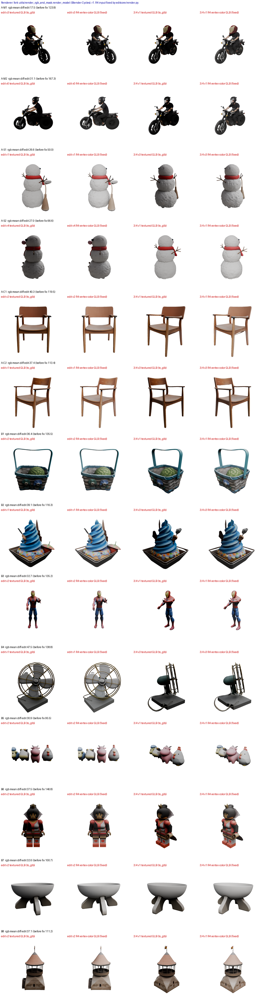

# 2. R4 mesh 만 디코딩 → `.cbin` 직행 + 렌더 입력 교체 — 보고서 (a5000)

- 장비: a5000 (RTX A5000 24 GB). 브랜치 `item/02-R4-a5000` (main `ce7bd2b` 에서 분기)
- 비교 기준: E2a 채택 상태(editcore 15/15, 정오표 E20). 바닥값은 E2a c15 r1–r3.
  - PR #16(기본 15) 병합 전이라 실행 스크립트는 `VHL_E2A_STEPS_S1/S2=15` 를 명시한다.
  - 끔(기존 GLB) 대조는 E2a c15 r1–r3 를 재사용한다. 같은 장비·같은 15 스텝이고, 다른 작업 없이 쟀다.
- 결과 유형: **SLat 동일, 표시 변경.** 토글 `VHL_R4=1`(기본 꺼짐 = 기존 GLB 출력).
- **E15 상한은 정오표 E21 로 확정됐다**: 상한 = 현재 채택 기준의 기준–기준 편집 셀 mean|Δ| 최댓값 × 1.2 = 3.38e-3(A-S2, E2a c15 r1–r3) × 1.2 = **4.06e-3**. 원문 고정값 3.2e-3 은 참고로만 적는다.
- **판정 원칙(정오표 E22):**
  - 비트 비교 판정은 한 프로세스 안의 끔/켬 비교만 쓴다.
  - R4 주 판정은 R-3(같은 저장 slat_tgt 를 기존 경로와 R4 경로로 디코딩한 mesh 디코더 출력 동일성, 3-4)이다.
  - 한 프로세스 안 Stage 2 비트 비교(DS, 3-7)는 디코딩 앞단을 건드리지 않았다는 보조 증거다.
  - 프로세스가 다른 비교(3-6)는 E14·E15(E21) 분포 판정이다.
- Unity 육안 비교·`unity_inplace_check.sh`·Unity 프레임 시간은 **보류**다(사용자 2026-10-25: 나중에 App 서버와 함께). 대체 확인 화면은 T1 뷰어 V-5 청크 보기다.
- **비트 비교 운용 규칙(chief 2026-10-26, DS §3-4):** spconv `SparseConv3d` 가 프로세스마다 갈린다. 그래서 다음처럼 판정한다.
  - **한 프로세스 안에서 돌린 비교**만 비트 동일로 판정한다: R-3.2 디코더 검사, R11 재조립.
  - 프로세스가 다른 실행끼리(켬 CLI vs 끔 c15)는 E14·E15 로 판정한다.
- **R11 규칙 정정(chief 2026-10-26, 요구사항 4.4 0번 R11 "점유 비교"):**
  - 변경 청크 = **부기(마스크 ∪ halo) ∪ 점유 변경 청크(청크 안 SLat 점유 셀 집합이 부모와 다른 청크)** 다. 나머지는 부모 바이트를 승계한다.
  - 이미 돈 켬 실행(부기만 쓴 원래 규칙)은 다시 돌리지 않는다. 변경 집합은 저장된 slat_tgt 로 CPU 에서 다시 계산한다(`tools/r4_rechunk.py sets`).
  - 점유 변경으로 새로 들어오는 청크의 바이트는 저장된 slat_tgt 를 한 프로세스에서 mesh 만 다시 디코딩해 정정 규칙으로 조립한다(`rebuild` → `cbin_r11/`, `output_r11.glb`, 계측 구간 밖).
  - 구간 7 시간은 원래 규칙으로 쟀다. 점유 비교는 셀 집합 대칭차 한 번이라 비용이 무시할 만하다(추론, 따로 잰다).

## 1. 예상 (실행 전, 2026-10-25)

- **구간 7:**
  - c15 의 구간 7 은 평균 20.3 s(13.7–30.0 s)이고, 대부분 `to_glb` 다(A-M1 r1: decode_slat 0.50 s, to_glb 17.85 s, glb_export 0.39 s).
  - R4 는 Gaussian 디코딩과 `to_glb` 가 빠지고, mesh 디코딩(≈ 0.3–0.5 s)과 청크 분할·인코딩이 더해진다.
  - 분할·인코딩은 정점 수에 비례한다(고객사 CPU 실험: 16만 정점 1.4–1.6 s). 디코더 메시는 정점 20–35만이므로 2–4 s 로 본다.
  - 그래서 **구간 7 ≈ 3–6 s(−14–17 s)** 로 본다(추론).
  - 정점색 GLB 조립(`glbbuild`)은 렌더·뷰어 입력이라 구간 7 밖에 따로 적는다. 1–3 s 로 본다.
- **면 수:**
  - 단순화(0.95)와 가려진 면 제거(mincut)가 빠진다. 트랙 A 디코더 메시와 `model.glb` 를 비교하면 moto 430k 대 14.8k(×29), chair 420k 대 14.0k(×30) 다.
  - 그래서 `.cbin` 전체 면 수는 기존 GLB 의 **약 20–30배**로 본다. E13 의 B1 면 수 두 갈래(mincut)는 R4 경로에서 사라질 것이다.
- **mesh 디코더 동일성:**
  - `["mesh"]` 단독과 `["gaussian","mesh"]` 의 mesh 출력은 비트 동일일 것이다. 두 디코더는 독립된 모델이고, 같은 입력을 따로 받는다.
  - 같은 호출 2회도 같을 것이다. mesh 디코더에는 `SparseDownsample` 이 없고 `SparseSubdivide`·conv 뿐이다(추론, 코드확인 필요).
- **slat_tgt:** 디코딩 앞단은 바뀌지 않는다. 켬과 끔의 coords 는 완전 일치하고, 보존 셀은 비트 동일, 편집 셀은 c15 바닥값 분포 안에 든다(E14·E15).
- **청크:**
  - 부기 밖 청크는 정의상 부모 바이트와 같다.
  - 변경 청크 수는 마스크 ∪ halo 를 청크(4³ 셀)로 접은 것 ∩ 실제 기하가 있는 청크다.
  - 변경 청크 바이트는 면 수에 비례해 커진다.
- **렌더 입력 교체:**
  - 위험: Blender glTF 가져오기는 재질 없는 COLOR_0 를 기본 재질에 연결하지 않을 수 있다. 그러면 (b) 정점색 GLB 가 회색으로 렌더된다.
  - 그 경우 지시대로 멈추고 보고한다. 래퍼(`editcore/render.py`)에서 재질을 붙이는 방법을 제안한다.

## 2. 구현 (코드확인)

- **`editcore/export.py`:**
  - `mesh_to_chunks`(계산, 파일 입출력 없음):
    1. `decode_slat(slat, ["mesh"])`
    2. `split_trellis_vertex_attrs(normal_encoding="0_1")`
    3. `albedo_to_rgba8`
    4. `partition_mesh(voxel_cells = slat coords)`
    5. `chunkbin.encode`
    - 좌표는 디코더 native NORMALIZED 공간 그대로(`assert_in_normalized_bounds` 통과)이고, `to_glb` 회전을 걸지 않는다(D9-b).
  - `bookkeeping`: 마스크 ∪ halo 2 셀을 `affected_chunks` 로 접는다(`legacy/a5000/edit_service/api/ops.py:mask_rows` 와 같은 규칙). 해시로 변경 청크를 정하지 않는다.
    - **R11 정정 반영(`fb3809a`·`96b54c9`):** 변경 청크 = 부기 ∪ 점유 변경(`occupancy_changed_chunks`, 부모 = 입력 SLat) ∪ 신규(부모에 기하 없음 ∧ 결과에 기하 있음, `new_outside`).
    - 부기는 편집 시작 때 별도 스레드로 선행 계산한다(`bookkeeping_async`, 결과 무영향, 3-1).
  - `write_cbin`(쓰기):
    - 변경 집합 밖이면서 부모에 있는 청크는 부모 바이트를 그대로 쓴다(R11 승계). 부모에만 있고 새 디코딩에 없는 청크도 부모 바이트로 남긴다.
    - 변경 집합 안 청크와 신규 청크는 새 바이트로 쓴다.
    - 변경 집합 안에서 기하가 사라진 부모 청크는 `removed` 로 적는다(계약 3.4.3).
    - manifest 는 `deltacontract.schemas.ChunkManifest` 로 쓴다(hash = `blob_hash`, uri = `chunk_uri`).
  - `decode_to_cbin`: 위 세 단계에 더해 `glbbuild.build_glb` 로 정점색 GLB 를 조립한다(렌더·뷰어 입력, 구간 밖 span `r4_glb`).
  - 계측 span(구간 7): `decode_mesh` · `chunk_partition` · `cbin_encode` · `bookkeeping` · `cbin_write`.
  - legacy 의 경계 스냅(`seam.snap_boundary`)은 지시서 범위가 아니라 넣지 않았다.
- **`editcore/models.py:r4_enabled`:** `VHL_R4 == "1"` 일 때만 켬.
- **`editcore/cli.py`:**
  - 토글이 켜지면 `decode_to_cbin` 을 부른다(`--parent_cbin`, `--cbin_out`). `--out` 위치에는 `.cbin` 에서 조립한 정점색 GLB 를 쓴다.
  - **두 디코더에 forward hook 을 걸어 호출 수를 로그와 timing JSON 에 남긴다**(`[r4] decoder calls {'slat_decoder_gs': 0, 'slat_decoder_mesh': 1}`). Gaussian 디코더를 부르지 않았다는 근거다.
- **부모 `.cbin`:**
  - 트랙 A 는 생성 때 만든 `gen/chunks` 를 쓴다(458·… 청크).
  - 트랙 B 는 부모 `.cbin` 이 없다. 판본 0 SLat(입력 SLat)을 같은 mesh-only 경로로 한 번 디코딩·분할해 만든다(`tests/gpu/r4_checks.py parents`, 구간 밖).
- **CPU 테스트 `tests/cpu/test_r4_cpu.py`(5건, 가짜 파이프라인 + 합성 메시):**
  - 토글 기본 꺼짐
  - `["mesh"]` 만 호출
  - 분할의 삼각형 합 = 원본, 계약 디코더 왕복, 단위 법선
  - 부기 규칙
  - 부기 밖 부모 바이트 승계, manifest ↔ 바이트 ↔ 계약 디코더 일치
  - removed, 부모 전용 청크 보존

## 3. 결과

### 3-1. 시간 — 구간 7 (실측, A5000, 장비가 빈 상태, 정정 규칙 = 부기 ∪ 점유 변경 ∪ 신규)

**14건 × 3회 실측 — 보고서의 R4 시간 효과는 이 값이다:**

| ID | 끔 c15 구간 7 | **R4 구간 7 (정정 규칙)** | 단축 | (참고) 원래 규칙(부기만, 전체 편집 실행) |
|---|---|---|---|---|
| A-M1 | 19.13 s | **1.88 ± 0.34 s** | −17.3 s | 1.98 s |
| A-M2 | 19.18 s | **1.80 ± 0.02 s** | −17.4 s | 2.09 s |
| A-S1 | 22.46 s | **2.60 ± 0.06 s** | −19.9 s | 2.85 s |
| A-S2 | 21.89 s | **2.36 ± 0.00 s** | −19.5 s | 2.59 s |
| A-C1 | 19.07 s | **1.71 ± 0.03 s** | −17.4 s | 1.95 s |
| A-C2 | 16.67 s | **1.50 ± 0.01 s** | −15.2 s | 1.68 s |
| B1 | 29.06 s | **3.44 ± 0.03 s** | −25.6 s | 3.85 s |
| B2 | 30.05 s | **4.71 ± 0.07 s** | −25.3 s | 5.45 s |
| B3 | 13.75 s | **0.73 ± 0.04 s** | −13.0 s | 0.83 s |
| B4 | 22.98 s | **2.45 ± 0.02 s** | −20.5 s | 2.70 s |
| B5 | 15.80 s | **1.50 ± 0.02 s** | −14.3 s | 1.70 s |
| B6 | 16.70 s | **1.85 ± 0.08 s** | −14.9 s | 2.09 s |
| B7 | 20.47 s | **3.13 ± 0.07 s** | −17.3 s | 3.46 s |
| B8 | 17.16 s | **1.65 ± 0.02 s** | −15.5 s | 1.84 s |
| **14건 평균** | **20.31 s** | **2.24 s** | **−18.1 s (분모 226.8 s 의 8.0%)** | 2.50 s |

- **측정 방식:** 전체 편집 실행이 아니라, 저장된 E2a c15 r1–r3 slat_tgt 를 한 프로세스에서 `decode_to_cbin`(정정 규칙)으로 다시 디코딩하며 구간 7 span 을 쟀다(`tests/gpu/r4_seg7.py`, 구간 경계 synchronize).
  - 끔(c15)과 원래 규칙 값은 전체 편집 실행에서 쟀다.
- **구간 7 세부(14건 평균 범위):** decode_mesh 0.12–0.45 s, **chunk_partition 0.57–4.05 s(대부분)**, bookkeeping 0.01–0.05 s, cbin_encode ≤ 0.01 s, cbin_write 0.03–0.14 s.
  - 분할 안의 `canonicalize`(정점 정렬)가 인코딩 몫까지 대부분을 차지한다.
- **부기 선행 계산(채택, 결과 무영향):**
  - 부기(마스크 dilate·청크 접기)를 편집 시작 때 별도 스레드로 계산한다(`bookkeeping_async`). 구간 7 의 bookkeeping 에는 점유 비교와 결과 받기만 남는다(0.01–0.05 s).
  - 선행 계산 자체는 0.08–9.80 s(B7 이 가장 큼, 마스크 64,840 셀)로, 실제 편집에서는 구간 4–6(≥ 40 s) 동안 끝난다.
  - **14건 모두 선행 계산 결과가 동기 계산과 같다.** 부기 집합, 새로 쓴/승계/신규/removed 청크 집합 모두 같다(r1 대조, 실측).
  - `dilate_cells` 호출은 E2 그대로다.
- 앞선 전체 편집 실행의 정정 규칙 측정(A-M1·B2·B6, 선행 계산 전, 참고): 2.51 / 6.80 / 3.34 s. 그때는 부기 계산이 구간 7 안이었다(0.6–1.6 s).
- **구간 4–7:** 끔 59.8 s(14건 평균) → 원래 규칙 전체 실행 42.2 s(실측). 정정 규칙은 구간 7 이 0.26 s 더 짧으므로 약 42 s 다(추론).
- **구간 밖 — 정점색 GLB 조립(`glbbuild`, 렌더·뷰어 입력):** 0.14–0.32 s(실측). 렌더 입력 보정(`vertex_color_render_glb`)은 따로 잰다.
- **메모리:** GPU alloc 피크(구간 7)는 끔과 같다(9.92–11.43 GiB). RSS 피크는 끔보다 약 2.7 GiB 작다(Gaussian 디코딩·`to_glb` 없음).
- **경로가 실제로 돌았다는 근거:** 전체 편집 실행 42 + 9 회 모두 로그에 `[r4] decoder calls {'slat_decoder_gs': 0, 'slat_decoder_mesh': 1}` 가 찍혔다.
- 원자료: `$RUNS_DIR/02-r4/metrics/seg7_r11.json`(14×3) sha256 `a597ee4005e4c016…`, `time.json`(전체 실행) `b2f5368f7683decc…`, `time_r11.json` `170668ad99305da8…`.

### 3-2. R11 승계 — 변경 청크 = 부기 ∪ 점유 변경 ∪ 신규 (실측, r1, `cbin_r11`)

- 규칙(chief 2026-10-26): **변경 청크 = 부기(마스크 ∪ halo 가 닿는 청크) ∪ 점유 변경(청크 안 SLat 점유 셀 집합이 부모와 다름) ∪ 신규(부모에 기하 없음 ∧ 결과에 기하 있음).**
  - 변경 청크는 새 바이트로 쓰고, 나머지는 부모 바이트를 승계한다(부모에만 있는 청크 포함).

| ID | 부모 청크 | 결과 청크 | 승계 | **부기** | **점유 변경으로만** | **신규(부모 없음, 변경 집합 밖)** | removed | 변경 계(새 바이트) | 승계 바이트 동일 | **변경 청크 바이트 합** | **전체 .cbin 바이트** | **기존 GLB 바이트** |
|---|---|---|---|---|---|---|---|---|---|---|---|---|
| A-M1 | 458 | 483 | 372 | 73 | 38 | 0 | 0 | 111 | 372/372 | 2,995,300 | 12,578,172 | 1,823,040 |
| A-M2 | 458 | 515 | 319 | 179 | 19 | 0 | 2 | 196 | 319/319 | 5,380,484 | 13,278,672 | 1,788,480 |
| A-S1 | 610 | 677 | 519 | 129 | 28 | **2** | 1 | 158 | 519/519 | 3,934,740 | 18,882,132 | 2,045,284 |
| A-S2 | 610 | 616 | 582 | 29 | 5 | 0 | 0 | 34 | 582/582 | 1,141,700 | 17,715,264 | 1,928,724 |
| A-C1 | 467 | 514 | 367 | 116 | 35 | 0 | 4 | 147 | 367/367 | 3,731,540 | 13,129,648 | 1,555,740 |
| A-C2 | 467 | 466 | 321 | 156 | 15 | 0 | 26 | 145 | 321/321 | 3,889,264 | 11,563,692 | 1,494,464 |
| B1 | 636 | 894 | 392 | 477 | 25 | 0 | 0 | 502 | 392/392 | 14,903,948 | 23,805,988 | 2,058,828 |
| B2 | 1,011 | 1,134 | 661 | 181 | 311 | **2** | 21 | 473 | 661/661 | 12,014,912 | 30,710,088 | 2,513,708 |
| B3 | 216 | 217 | 166 | 38 | 13 | 0 | 0 | 51 | 166/166 | 1,589,076 | 5,869,064 | 1,364,256 |
| B4 | 726 | 837 | 517 | 275 | 70 | **1** | 26 | 320 | 517/517 | 8,244,436 | 17,521,552 | 1,918,064 |
| B5 | 399 | 456 | 251 | 185 | 23 | **2** | 5 | 205 | 251/251 | 4,507,140 | 11,875,708 | 1,355,804 |
| B6 | 436 | 469 | 241 | 233 | 1 | 0 | 6 | 228 | 241/241 | 7,124,584 | 14,049,096 | 1,433,040 |
| B7 | 726 | 862 | 291 | 691 | 28 | 0 | 148 | 571 | 291/291 | 14,684,936 | 22,185,856 | 1,416,880 |
| B8 | 486 | 478 | 126 | 413 | 6 | 0 | 67 | 352 | 126/126 | 9,356,880 | 12,764,892 | 1,703,652 |

- **산술 확인(14건 모두 맞음, 실측):**
  - **결과 청크 = 승계 + 변경 계**: 14/14.
  - **변경 계 = 부기 + 점유 변경으로만 + 신규 − removed**: 14/14.
  - 부기·점유 변경은 부모나 결과에 기하가 있는 청크만 센다. removed 는 변경 집합 안에서 결과 기하가 없어진 부모 청크다.
- **신규 7청크(키 · 삼각형 수):**

| ID | 청크 키 | 삼각형 | 부모 | 결과 기하 | 부기 | 점유 변경 |
|---|---|---|---|---|---|---|
| A-S1 | 10_11_10 | 4 | 없음 | 있음 | 아니오 | 아니오 |
| A-S1 | 10_8_9 | 1 | 없음 | 있음 | 아니오 | 아니오 |
| B2 | 7_9_7 | 2 | 없음 | 있음 | 아니오 | 아니오 |
| B2 | 9_6_8 | 4 | 없음 | 있음 | 아니오 | 아니오 |
| B4 | 13_9_7 | 1 | 없음 | 있음 | 아니오 | 아니오 |
| B5 | 14_5_8 | 1 | 없음 | 있음 | 아니오 | 아니오 |
| B5 | 15_9_9 | 1 | 없음 | 있음 | 아니오 | 아니오 |

  - **원인:** `partition_mesh` 는 삼각형을 무게중심이 속한 청크에 배정한다. 그래서 점유 셀이 없는 이웃 청크에도 정점이 조금 밀리면 삼각형 1–4 개가 생긴다. 부모에는 그 청크가 없어 승계할 바이트가 없다.
  - 처음에는 이 청크를 쓰지 않는 수정(`56753bb`, `omitted_outside`)을 넣었다. 그러나 결과 메시의 일부가 빠져 청크 경계에 구멍이 생기므로, chief 결정에 따라 "신규"로 변경 청크에 넣어 새 바이트로 쓴다(`96b54c9`, `new_outside`).
- 승계 청크는 14건 모두 부모 `.cbin` 과 바이트 동일이다(직접 대조). 새 청크 바이트는 비트 비교하지 않는다(E22, 3-4).
- `.cbin` 왕복: manifest 의 정점·인덱스 수가 계약 디코더로 읽은 값과 14건 모두 일치한다. 단위 법선 비율은 100% 다.
- 바이트는 기록만 한다(`.cbin` 크기 축소 작업은 하지 않음, 사용자 지시).
  - 변경 청크 바이트 합은 기존 GLB 의 0.6–10.4배다(B3 1.2배, B7 10.4배).
  - 원래 규칙(부기만)의 변경 청크 바이트(참고): B2 5,576,736 → 12,014,912, A-M1 1,694,408 → 2,995,300.
- 원자료: `chunks.json` `85bd2d2be479468f…`, `r11_rebuild.json` `c94469d784b26df2…`, `r11_sets.json`.

### 3-3. 메시 밀도 (실측, r1)

| ID | .cbin 면 수 | 기존 GLB 면 수(to_glb) | 배수 |
|---|---|---|---|
| A-M1 | 446,020 | 15,194 | 29.4 |
| A-M2 | 471,239 | 14,921 | 31.6 |
| A-S1 | 674,860 | 33,296 | 20.3 |
| A-S2 | 633,122 | 31,390 | 20.2 |
| A-C1 | 460,290 | 16,086 | 28.6 |
| A-C2 | 404,834 | 14,324 | 28.3 |
| B1 | 843,182 | 34,282 | 24.6 |
| B2 | 1,088,873 | 53,186 | 20.5 |
| B3 | 207,390 | 4,634 | 44.8 |
| B4 | 620,032 | 23,178 | 26.8 |
| B5 | 420,616 | 8,424 | 49.9 |
| B6 | 497,155 | 10,816 | 46.0 |
| B7 | 783,131 | 15,318 | 51.1 |
| B8 | 455,383 | 19,442 | 23.4 |

- 배수는 20–51배다. 예상(20–30배)보다 큰 건(B3·B5·B6·B7 45–51배)은 `to_glb` 의 가려진 면 제거(mincut)가 많이 깎던 물체다.
- **E13 의 B1 면 수 두 갈래(mincut)는 R4 경로에서 사라진다.** `.cbin` 에는 단순화와 mincut 이 없다(코드확인).
  - 다만 새 청크의 정점 위치는 FlexiCubes `index_add_` 반올림으로 1e-7 수준에서 달라진다(3-4). 면 수는 회차 사이의 slat_tgt 차이만 따른다.

### 3-4. 주 판정(R-3, E22) — mesh 디코더 동일성 (R-3.2, 실측, 한 프로세스 안)

**주 판정(R-3, E22):** 같은 저장 slat_tgt 를 기존 경로(`["gaussian","mesh"]`)와 R4 경로(`["mesh"]`)로 디코딩해 mesh 디코더 출력이 같은지 본다. **14건 모두 동일 — 통과.**

- 판정 기준(chief 2026-10-26): 위상(면) 동일 + 정점·속성 |Δ| ≤ 1e-6 이면 동일.

| 비교(같은 c15 r1 slat_tgt, 14건) | 면 동일 | 정점 max\|Δ\| | 속성 max\|Δ\| | 판정 |
|---|---|---|---|---|
| `["mesh"]` 2회 | 14/14 | ≤ 1.5e-7 | ≤ 3.0e-7 | **동일** (비트 동일은 0/14) |
| `["mesh"]` vs `["gaussian","mesh"]` | 14/14 | ≤ 1.5e-7 | ≤ 3.0e-7 | **동일** |

- 원인(코드확인 + 실측):
  - 디코더 신경망(165개 모듈)은 2회 모두 해시가 같다.
  - 차이는 메시 추출 FlexiCubes 의 `index_add_`(`trellis/representations/mesh/flexicubes/flexicubes.py:116, 321-331`, 이중 정점 위치·색 누적)에서 GPU 원자적 덧셈 순서가 바뀌어 생긴다. 면(위상)은 같다.
- 그래서 새 청크 바이트는 비트 비교하지 않고, 승계 청크만 부모와 바이트 비교한다(3-2).
- 원자료 `checks/decode2.json` `554d8fc20b80e0cd…`.

### 3-5. 렌더 입력 교체 (R-2, 실측, 포크 Cycles 렌더러, r1)

**1차(보정 전): 실패 → 지시대로 멈춤.**
- `glbbuild` 정점색 GLB 는 COLOR_0 만 있고 **재질이 없다.** Blender 4.0 glTF 가져오기는 재질 없는 메시에 정점색을 연결하지 않아 14건 모두 회색으로 렌더됐다.
- 기존 텍스처 렌더 대비 RGB 평균 차이는 44–168 이었다.

**2차(보정, chief 승인): `editcore/render.py:vertex_color_render_glb`.** 포크·`glbbuild` 는 고치지 않았다.
1. 재질 없는 프리미티브에 흰 비금속 기본 재질을 붙인다(baseColor 1, metallic 0, roughness 1). glTF 규격상 COLOR_0 이 baseColor 에 곱해진다.
2. COLOR_0 RGB 를 **sRGB → 선형**으로 바꿔 float32 로 쓴다.
   - **변환 방향의 근거:** glTF 2.0 은 정점 색 COLOR_0 을 **선형**으로 정의한다. TRELLIS 디코더 albedo 는 `to_glb` 가 굽는 base color 텍스처(sRGB 로 읽힘)와 같은 값의 영역이라 sRGB 로 다룬다(`.cbin` 에는 `albedo_to_rgba8` 로 그대로 양자화).
   - 그대로 넣으면 Blender 가 sRGB 값을 선형으로 읽어 밝고 옅게 나온다(A-M1 시험: 재질만 붙이면 차이 48.7, 선형 변환까지 하면 17.5).
   - uint8 로 두면 어두운 색이 뭉개져(sRGB 0.04 → 선형 0.003 < 1/255) float32 로 쓴다.
- 기하·면은 바뀌지 않는다(CPU 테스트 `test_vertex_color_render_glb`, 실제 GLB 대조).

| ID | 편집 시점 RGB max / mean (보정 전 mean) | 3/4 시점 RGB max / mean (보정 전 mean) | 2D 마스크(알파) 보정 전·후 비트 동일 | 알파 IoU 기존 텍스처 vs 보정 |
|---|---|---|---|---|
| A-M1 | 191 / 17.5 (123.8) | 182 / 34.9 (164.3) | 예 / 예 | 0.993 / 0.994 |
| A-M2 | 176 / 31.1 (167.3) | 194 / 34.9 (168.0) | 예 / 예 | 0.996 / 0.995 |
| A-S1 | 171 / 26.6 (50.0) | 189 / 28.5 (62.8) | 예 / 예 | 0.997 / 0.998 |
| A-S2 | 171 / 27.0 (66.6) | 175 / 24.0 (44.0) | 예 / 예 | 0.999 / 0.998 |
| A-C1 | 161 / 40.3 (119.5) | 181 / 40.5 (114.3) | 예 / 예 | 0.996 / 0.992 |
| A-C2 | 167 / 37.4 (113.4) | 185 / 30.3 (109.7) | 예 / 예 | 0.995 / 0.995 |
| B1 | 204 / 36.4 (135.5) | 179 / 40.7 (126.8) | 예 / 예 | 0.998 / 0.998 |
| B2 | 215 / 39.1 (116.3) | 209 / 29.4 (109.3) | 예 / 예 | 0.988 / 0.986 |
| B3 | 185 / 32.7 (135.2) | 190 / 36.6 (135.6) | 예 / 예 | 0.995 / 0.993 |
| B4 | 200 / 47.5 (138.8) | 193 / 27.9 (123.7) | 예 / 예 | 0.991 / 0.988 |
| B5 | 153 / 30.9 (95.5) | 163 / 32.2 (83.4) | 예 / 예 | 0.996 / 0.995 |
| B6 | 159 / 37.5 (146.8) | 215 / 39.0 (145.7) | 예 / 예 | 0.999 / 0.998 |
| B7 | 171 / 32.6 (100.7) | 142 / 31.6 (93.1) | 예 / 예 | 0.998 / 0.999 |
| B8 | 163 / 37.1 (111.2) | 179 / 37.4 (107.0) | 예 / 예 | 0.992 / 0.994 |

- **2D 마스크(렌더 알파)는 보정 전·후 14건 × 2시점 모두 비트 동일이다.** 기하가 같고 재질만 바뀌기 때문이다.
- 기존 텍스처 GLB 와의 알파 IoU 는 0.986–0.999 다. 기하가 다르기 때문이다(단순화·mincut 있는 to_glb 메시 vs 디코더 전체 메시).
- 보정 뒤 RGB 평균 차이는 17.5–47.5 다(보정 전 44–168). 남는 차이는 색의 출처가 다른 데서 온다(추론). 기존은 Gaussian 렌더에서 구운 텍스처, R4 는 mesh 디코더 albedo 다. max 는 경계·하이라이트 화소다.
- 시트(편집 시점·3/4 시점: 기존 텍스처 | 보정 정점색):

- 원자료 `checks/render2.json` `cad6c4b28da6ecfa…`, 렌더 `checks/render/<ID>/{a,b,b1}/`.

### 3-6. slat_tgt 동등성 — R-3a, E14·E15 (E21)

- **E15 상한(정오표 E21) = 현재 채택 기준의 기준–기준 편집 셀 mean|Δ| 최댓값 × 1.2 = 3.38e-3(A-S2, E2a c15 r1–r3) × 1.2 = 4.06e-3.** 원문 고정값 3.2e-3 은 참고로 같이 적는다.
- 비교: 켬(R4, 원래 규칙 실행의 slat_tgt) rK vs 끔(c15) rK 3쌍, 기준–기준 = c15 3쌍. 프로세스가 다르므로 비트 비교가 아니라 E14·E15 로 판정한다(운용 규칙).

| ID | 편집 셀 수 | R4–기준 mean\|Δ\| (3쌍) | 기준–기준 mean\|Δ\| (3쌍) | 필수(coords·보존 셀) |
|---|---|---|---|---|
| A-M1 | 1,130 | 2.76 · 2.79 · 2.82e-3 | 2.73 · 2.75 · 2.77e-3 | 통과 |
| A-M2 | 3,204 | 2.87 · 2.82 · 2.88e-3 | 2.82 · 2.84 · 2.84e-3 | 통과 |
| A-S1 | 1,922 | 2.89 · 2.87 · 2.89e-3 | 2.87 · 2.88 · 2.90e-3 | 통과 |
| **A-S2** | **287** | **3.63** · 2.64 · 2.81e-3 | **3.31 · 3.38** · 2.74e-3 | 통과 |
| A-C1 | 2,758 | 2.74 · 2.82 · 2.75e-3 | 2.73 · 2.75 · 2.76e-3 | 통과 |
| A-C2 | 1,652 | 2.63 · 2.65 · 2.63e-3 | 2.64 · 2.63 · 2.62e-3 | 통과 |
| B1 | 7,904 | 2.42 · 2.41 · 2.39e-3 | 2.40 · 2.40 · 2.41e-3 | 통과 |
| B2 | 5,423 | 2.48 · 2.51 · 2.50e-3 | 2.48 · 2.50 · 2.50e-3 | 통과 |
| B3 | 433 | 2.63 · 2.61 · 2.59e-3 | 2.59 · 2.54 · 2.50e-3 | 통과 |
| B4 | 4,203 | 2.55 · 2.54 · 2.63e-3 | 2.57 · 2.65 · 2.57e-3 | 통과 |
| B5 | 2,828 | 2.55 · 2.60 · 2.54e-3 | 2.60 · 2.56 · 2.59e-3 | 통과 |
| B6 | 3,363 | 2.59 · 2.60 · 2.61e-3 | 2.61 · 2.60 · 2.65e-3 | 통과 |
| B7 | 12,402 | 2.88 · 2.88 · 2.96e-3 | 2.87 · 2.95 · 2.87e-3 | 통과 |
| B8 | 5,390 | 2.53 · 2.54 · 2.53e-3 | 2.52 · 2.50 · 2.51e-3 | 통과 |

- **두 분포는 시나리오마다 같은 범위다.** R4 는 샘플링을 바꾸지 않으므로 예상과 같다. 차이는 Stage 2 `SparseDownsample` 실행 간 차이(DS 보고서)다.
- **3.2e-3 을 넘은 쌍이 있는 시나리오: A-S2 하나다(편집 셀 287 개, 14건 중 가장 적음).**
  - R4–기준 1쌍(3.63e-3), 기준–기준 2쌍(3.31e-3·3.38e-3)이 넘는다.
  - 편집 셀이 적어 셀 몇 개의 차이가 평균을 크게 흔든다(추론).
  - 기준끼리도 넘으므로 R4 때문이 아니다.
- **합산 판정(14건 × 3쌍 = 42 / 42):**

| 판정 | max\|Δ\| | mean\|Δ\| |
|---|---|---|
| 단측 순위 검정 p (≥ 0.05) | 0.239 | 0.438 |
| 중앙값 비 (≤ 1.1) | 1.010 | 0.996 |
| P(R4–기준 > 기준–기준) (≤ 0.6) | 0.545 | 0.510 |
| **E14** | **통과** | **통과** |
| **E15 (E21 공식 4.06e-3)** | – | **통과** (최대 3.63e-3, 초과 0) |
| (참고) 원문 3.2e-3 | – | 초과 1쌍(A-S2 3.63e-3) |

- 원자료 `$RUNS_DIR/02-r4/metrics/equiv.json` sha256 `cb1824585592b45c…`.

### 3-7. 보조 증거(디코딩 앞단 무변경) — DS 로 Stage 2 비트 비교 (R-3a, E22, 한 프로세스 안)

- **E22: 이 비교는 보조 증거(디코딩 앞단 무변경)다. 주 판정은 3-4(R-3)다.**
- 방법(`tests/gpu/r4_ds_bits.py`):
  - `apply_ds` 로 그 프로세스 안에서만 DS 를 켠다(운영 기본값 꺼짐 그대로).
  - 시나리오마다 R4 끔 1회(`decode_to_glb`) → R4 켬 1회(`decode_to_cbin`, 정정 규칙)를 같은 프로세스에서 돈다. editcore 기준 15/15, seed 0.
- **결과: 14건 모두 비트 동일(실측).**

| 비교 항목 (끔 vs 켬) | 14건 결과 |
|---|---|
| slat_tgt coords 전체 | 14/14 동일 |
| slat_tgt feats 전체 | 14/14 동일 |
| Stage 1 noise · voxel_tgt · coords_tgt · 출발 잡음 | 14/14 동일 |
| Stage 1 잠재 15/15 · K/V 5,184/5,184 | 14/14 |
| Stage 2 잠재 15/15 · K/V 2,880/2,880 | 14/14 |
| 결정적 연산 호출(끔/켬 각각) | 60 / 60 |

- slat_tgt 셀 수는 3,910(B3) – 26,602(B2)다.
- 실행 메모: 14건을 한 프로세스에서 이어 돌리다가 B8 에서 메모리가 쌓여 OOM 으로 종료됐다(02:59, RSS 124 GB). 13건은 그 전에 저장됐다.
  - B8 은 새 프로세스에서 다시 돌렸다(301 s, 최대 RSS 49 GiB).
  - B8 도 끔·켬이 같은 프로세스 안이라 E22 의 "한 프로세스 안 비교" 조건에 맞는다.
- 원자료 `$RUNS_DIR/02-r4/metrics/ds_bits.json` sha256 `898fabbff3a73724…`.

### 3-8. 출력 품질 확인 (사용자 지시 2026-10-26, PR #18 판정 절과 별도)

**예상(실행 전):**
- **색:** 기존 시트에서 R4 정점색 렌더가 밝고 대비가 낮은 주원인은 **재질**로 본다.
  - 코드확인: `to_glb` 재질은 `trimesh PBRMaterial(roughnessFactor=1.0, baseColorTexture=…)` 이고 `metallicFactor` 를 지정하지 않는다(`trellis/utils/postprocessing_utils.py:458-462`). 실제 GLB 에도 `metallicFactor` 가 없다 → **glTF 기본값 1.0(완전 금속)**.
  - 그래서 기존 텍스처 GLB 는 원본 `model.glb` 와 결과 모두 금속·거칠기 1 로 렌더된다. 확산광 없이 환경 반사만 남아 어둡고 진하다.
  - 지금 보정(비금속 metallic 0)은 확산광이 더해져 밝고 옅게 나온다.
- **텍스처 굽기 경로는 어둡게 만들지 않는다(코드확인):** `bake_texture(mode='opt')` 는 Gaussian 다시점 렌더(RGB)를 그대로 맞춰 uint8 로 저장한다(`:339`, `:388`). 감마·선형 변환이 없다.
- 그래서 지시한 세 방식에 넷째를 더한다: **(iv) R4 정점색 + to_glb 와 같은 재질(metallicFactor 생략 = 1.0, roughness 1) + COLOR_0 sRGB→선형.** 2d_edit·2d_render 에 가장 가까울 것으로 본다.
  - (iii) 재질만(비금속, 변환 없음)이 가장 밝을 것이다. (ii) 현재 보정은 그 사이일 것이다.
- **E19 지표:** 마스크 밖 PSNR·SSIM·LPIPS 는 형상이 더 세밀해진 만큼(면 20–51배) 기존과 비슷하거나 조금 좋아지고, 색 차이 몫만큼 흔들릴 것이다. DINO-I·CLIP-T 는 허용치 안으로 본다. Chamfer 는 단순화가 없어 같거나 좋아진다.
- **세부:** 디코더 정점색(정점당 1색, 정점 간격 ≈ 1/256)은 1024² 텍스처보다 해상도가 낮을 수 있다. 그래서 무늬(B1 짜임, A-C1 나뭇결)가 조금 흐려질 수 있다.

(결과는 실행 뒤 기입)

## 4. 알려진 한계 (정오표 E22)

- **같은 seed 결과의 비트 재현은 한 프로세스 안에서만 보장된다.**
  - spconv `SparseConv3d`(`ConvAlgo.Native`, spconv 2.3.8)의 커널 선택이 프로세스마다 다를 수 있다(DS 보고서 §3-4).
  - mesh 추출의 FlexiCubes `index_add_` 는 같은 프로세스 안에서도 정점 위치·속성을 1e-7 수준에서 바꾼다(3-4). 그래서 새 청크 바이트는 회차마다 다르다. 승계 청크는 부모 바이트 그대로다.
- **R8a 상주 워커:** 재기동 전까지는 같은 입력이면 같은 결과를 낸다. 재기동 뒤에는 편집 셀이 E14 분포 범위 안에서 달라질 수 있다.
- **프로세스가 다른 실행끼리의 비교**(종단 3회 등)는 E14·E15(E21) 분포 판정을 쓴다.
- 렌더 입력 정점색 GLB 는 보정(`editcore/render.py`)해도 기존 텍스처 렌더와 색이 같지 않다(RGB 평균 차이 17.5–47.5, 3-5). 색의 출처가 다르기 때문이다(디코더 albedo vs Gaussian 구운 텍스처). 다음 편집의 조건 렌더·인페인팅 입력에 주는 영향은 R10a·R8a 단계에서 본다(미검증).

## 5. 예상 대비 결과

| 항목 | 예상(1절) | 결과 | 같음/다름 |
|---|---|---|---|
| 구간 7 | 3–6 s (−14–17 s) | 14건 평균 2.24 s (−18.1 s, 분모의 8.0%) | 더 좋음. 분할·인코딩이 예상보다 빠름(B2 4.1 s) |
| 정점색 GLB 조립(구간 밖) | 1–3 s | 0.14–0.32 s | 더 빠름 |
| 면 수 | 기존 GLB 의 20–30배 | 20–51배 | 일부 다름. mincut 이 많이 깎던 물체(B3·B5·B6·B7)가 45–51배 |
| mesh 디코더 `["mesh"]` vs `["gaussian","mesh"]` | 비트 동일 | 위상 동일 + \|Δ\| ≤ 3e-7 → E22 기준 동일. 비트 동일은 아님 | **다름**: FlexiCubes `index_add_` 반올림(3-4) |
| slat_tgt | 바뀌지 않음 | DS 한 프로세스 비교 14/14 비트 동일. 프로세스 간 E14 통과·E15(E21) 통과 | 같음 |
| 청크 | 부기 밖 = 부모 바이트 | 승계 청크 14/14 바이트 동일 | 같음. 단 R11 정정(점유 변경·신규)으로 변경 청크가 늘었다 |
| 렌더 입력 교체 | 회색 위험 | 1차 회색(실패) → 래퍼 보정 후 색 복원, 마스크 비트 동일 | 예상한 위험이 실제로 일어났고 보정으로 해결(3-5) |

## 6. 변경 파일·테스트

| 파일 | 내용 |
|---|---|
| `editcore/export.py` | `mesh_to_chunks`·`bookkeeping`·`bookkeeping_async`·`occupancy_changed_chunks`·`write_cbin`·`decode_to_cbin` (R4 경로, R11 정정 규칙) |
| `editcore/models.py` | `r4_enabled`(`VHL_R4`, 기본 꺼짐) |
| `editcore/cli.py` | R4 분기, `--parent_cbin`·`--cbin_out`, 디코더 호출 수 로그, 부기 선행 계산 |
| `editcore/render.py` | `vertex_color_render_glb`(렌더 입력 보정: 흰 비금속 재질 + COLOR_0 sRGB→선형 float32) |
| `tests/cpu/test_r4_cpu.py` | 9건: 토글, mesh 만 호출, 분할·왕복·단위 법선, 부기 규칙, 승계·manifest, removed, 점유 변경, 신규, 선행 계산 결과 같음, 렌더 입력 보정 |
| `tests/gpu/r4_checks.py`, `run_r4.sh`, `r4_seg7.py`, `r4_ds_bits.py` | 부모 생성·디코더 검사·렌더 비교, 켬 실행, 구간 7 실측, DS 한 프로세스 비트 비교 |
| `tools/r4_metrics.py`, `tools/r4_rechunk.py`, `tools/e14.py` | 집계, R11 재계산·재조립, E14·E15(E21) 판정 |

- **테스트(실측, 이 커밋 기준):** CPU 44 passed, conformance 53/53, ai-ar-v3 서버 360 passed·12 skipped.
- 새 의존성은 없다(ai-ar-v3 `contract`·`server/glbbuild.py` 읽기 전용 import, trimesh·scipy 는 기존).
- `.cbin` 포맷·계약은 바꾸지 않았다.
- **뷰어:** T1 V-5 청크 보기(`item/T1-viewer-a5000`)에서 R4 결과를 청크 단위로 확인할 수 있다. 신규 청크는 청록이다.
  - 주소: `http://117.16.244.35:8083/scenario/<ID>` → `r4` 칸 → "청크".
