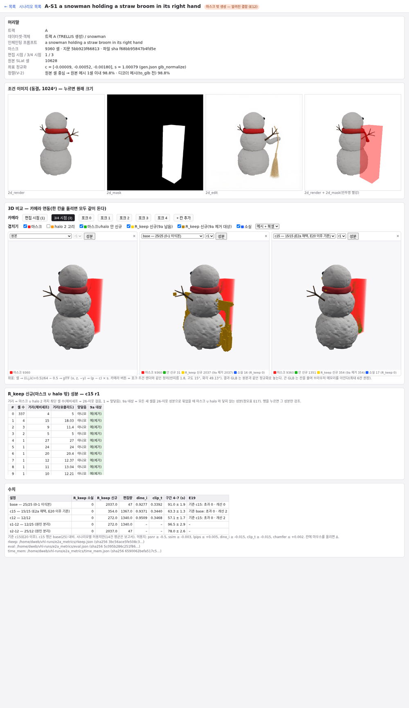
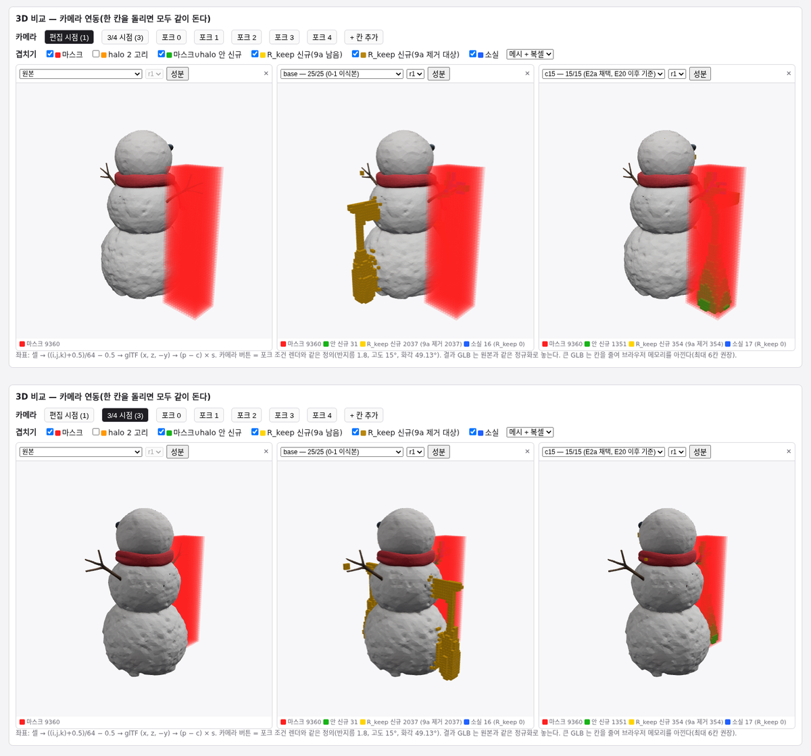
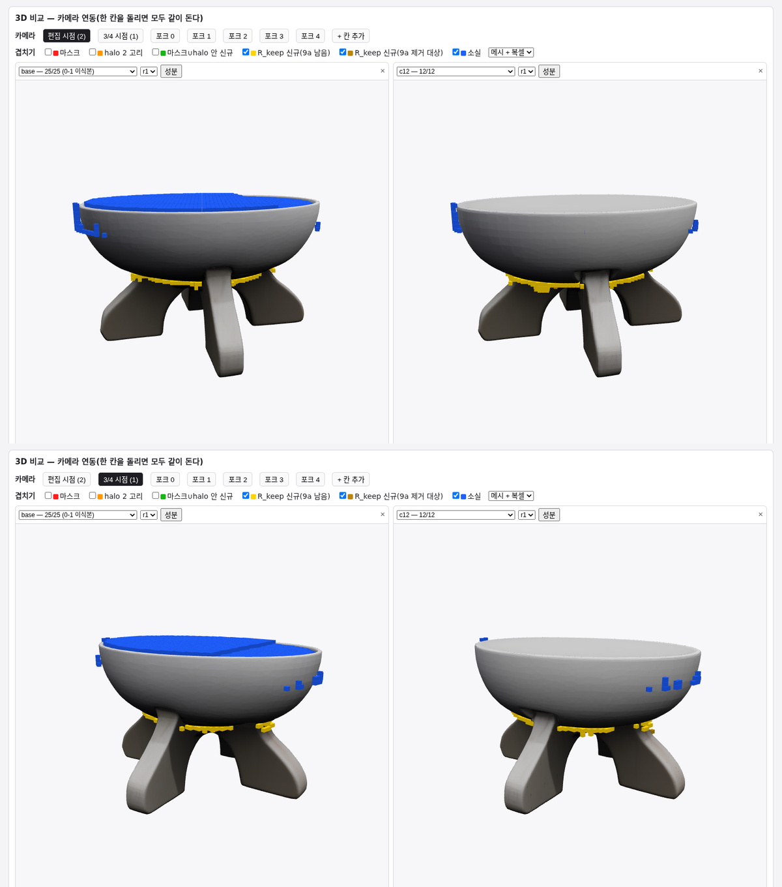
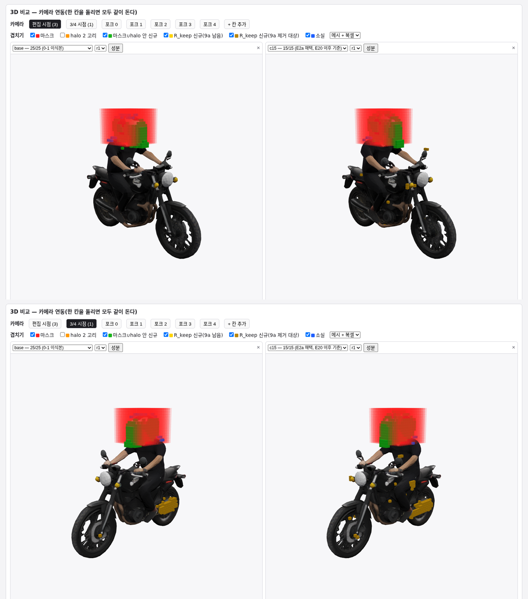

# T1 시나리오 비교 뷰어 — 보고서 (a5000)

> **사용자가 열 주소:** `http://117.16.244.35:8083/scenario/A-S1` (다른 시나리오는 끝의 ID 를 바꾼다: A-M1 … B8, moto-b-rider-head, moto-b-rear-wheel). 16건 목록은 `http://117.16.244.35:8083/?tab=scenarios`.

- 장비: a5000. 브랜치 `item/T1-viewer-a5000`(main `e3f78f9` 에서 분기).
- 근거: 사용자 지시(2026-10-25 21:47), 지시서 `ops/tasks/T1-viewer.md`. 도구 항목이다. 편집 코드·계측·결과는 바뀌지 않는다.
- **GPU 를 쓰지 않는다.** 미리 계산은 CPU 로, 화면은 브라우저가 그린다. 입력 파일은 읽기만 한다. 캐시는 `RUNS_DIR/.viewer_cache/scenario/` 에만 쓴다.
- **새 의존성 없음.** 서버는 표준 라이브러리, three.js 는 기존과 같은 CDN 이다.
  - 미리 계산은 기존 VoxHammer venv(numpy·scipy·safetensors·trimesh)를 쓴다.
  - 캡처는 기존 Node v23 의 내장 WebSocket 과 google-chrome 을 쓴다.
- 인증은 없다(기존 8083 과 같음).

## 1. 화면 구성 (V-1)

위에서 아래로 다섯 부분이다.

1. **머리말:** ID, 데이터셋·객체, 편집 프롬프트, 마스크 셀 수·지문·파일 sha, 편집·3/4 시점, E12 표시, 좌표 정규화 값, V-2 정렬 비율.
2. **조건 이미지:** 동결 `2d_render` | `2d_mask` | `2d_edit` 와, `2d_render` 위에 `2d_mask` 를 반투명 빨강으로 겹친 그림. 누르면 1024² 원래 크기로 연다.
3. **3D 비교:**
   - 칸마다 설정(원본·base·c15·c12·s1-12·s2-12)과 회차(r1–r3)를 고른다.
   - 모든 칸이 카메라 객체 하나와 OrbitControls target 하나를 공유한다. 한 칸을 돌리면 다 같이 돈다.
   - 카메라 버튼: 편집 시점, 3/4 시점, 포크 0–4.
   - 결과 GLB 는 원본과 같은 정규화로 놓는다.
4. **복셀 겹치기(체크박스):** 마스크(빨강 반투명), halo 2 고리(주황 테두리, 큰 마스크에서 화면을 덮어 기본 꺼짐), 마스크∪halo 안 신규(초록), R_keep 신규(노랑 = 9a 뒤 남음 / 진한 금색 = 9a 제거 대상), 소실(파랑). 범례에 셀 수를 적고, 메시만 / 복셀만 / 둘 다로 바꿀 수 있다.
   - **R_keep 신규 성분 표:** 26-이웃 성분별로 셀 수, 마스크∪halo 까지 최단 거리(체비셰프·유클리드), 맞닿음, 9a 대상을 적는다. 행을 누르면 그 성분만 자홍으로 강조한다. 계산은 E2a §4a 와 같다.
5. **수치 표:** 설정별 R_keep(소실·신규·편집량), 렌더 지표(트랙 B), DINO-I·CLIP-T, 구간 4–7 시간, E19 판정. 넘은 칸은 빨강이고, 칸에 마우스를 올리면 Δ 가 보인다. 출처 JSON 경로와 sha256 을 표 아래에 적는다.
   - E19 기준은 c15(E20 이후)다. c15 행만 base(25) 대비로 판정한다.

## 2. 정렬 정확성 (V-2, 실측)

변환은 한 곳에서만 한다: `common.js:voxelToWorld`.
- 식: 셀 → ((i,j,k)+0.5)/64 − 0.5 → glTF (x, z, −y) → (p − c) × s.
- 정규화 값의 출처: 트랙 A = gen.json `glb_normalize`, moto-b = prepare.json `model.normalize`, 트랙 B = 항등(Bench 프레임, 00s2 S-8).
- `scenario_prep.py:cells_to_world` 는 같은 식을 정렬 검사에만 쓴다.
- 카메라도 한 곳이다: `common.js:forkCamera`.
  - 포크 `utils/render_rgb_and_mask.py` 와 같은 정의: 반지름 1.8, 고도 15°, 방위 [90,45,0,315,270] − 90, 원점 주시.
  - 화각은 bpyrenderer `add_camera` 기본값(센서 32 mm·렌즈 35 mm)에서 세로 49.13° 다.
  - Blender (x,y,z) → three (x, z, −y).

### 2a. 복셀–메시 정렬 (16건, 원본 SLat 셀 중심 → 원본 메시 표면 거리, 1셀 = s/64)

- 방법: 표면을 200만 점으로 고르게 샘플링하고, 셀 중심에서 가장 가까운 점까지의 거리를 잰다(`scipy.cKDTree`).
  - 이유: trimesh 정확 최근접은 `rtree` 가 필요한데 venv 에 없다.
  - 샘플 간격은 0.04–0.11 셀이다. 거리를 그 이하만큼 크게 잡는 근사다.

| ID | 셀 | `model.glb` 1셀 이내 | 중앙값(셀) | 디코더 메시(to_glb 전) 1셀 이내 | 면적 비 glb/디코더 |
|---|---|---|---|---|---|
| A-M1·A-M2 (moto) | 11,396 | **84.3%** | 0.42 | **97.1%** | 0.74 |
| A-S1·A-S2 (snowman) | 10,628 | 98.8% | 0.30 | 98.8% | 1.00 |
| A-C1·A-C2 (chair) | – | 99.7% | 0.27 | 100.0% | 0.82 |
| B1 | – | 99.6% | 0.28 | – | – |
| B2–B8 | – | 100.0% | 0.26–0.36 | – | – |
| moto-b rider-head·rear-wheel | 9,150 | 98.5% | 0.33 | – | – |

- **목표 ≥ 95%: moto 두 건만 `model.glb` 기준으로 못 미친다(84.3%).**
- 원인은 변환이 아니다. 같은 변환으로 TRELLIS 디코더 메시(cbin 청크, `to_glb` 이전)와 재면 97.1% 로 목표를 넘는다.
  - `model.glb` 는 `to_glb`(단순화 0.95 + 보이지 않는 면 mincut 제거, E13)를 거친다.
  - moto 는 표면적이 26% 줄었다(면 430k → 14.8k). 운전자와 차체 사이처럼 가려진 면이 지워진 것이다.
  - 그 자리 셀은 남은 표면에서 1–4 셀 떨어진다. 실제 형태이지 정렬 오류가 아니다.
- 그래서 변환은 고치지 않았다. 뷰어는 결과와 같은 `model.glb` 를 그대로 보여 준다.
- 원자료 `RUNS_DIR/.viewer_cache/scenario/alignment.json`.

### 2b. 카메라 정합·마스크 투영 정합 (편집 시점, 1024², headless Chrome)

- 방법: `capture.mjs` 로 `capture=edit` 화면을 찍었다(한 칸, 초록 배경, 겹치기 끔). 초록이 아닌 픽셀을 실루엣으로 보고, 동결 `2d_render` 의 알파와 IoU 를 쟀다.
- 마스크는 `mode=voxel&ov=mask&solid=1`(마스크 셀만 흰 상자)로 찍어 동결 `2d_mask`(흰색)와 IoU 를 쟀다.

| ID | 편집 시점 | 실루엣 IoU (목표 ≥ 0.95) | 마스크 투영 IoU | 픽셀 동결 / 뷰어 |
|---|---|---|---|---|
| A-S1 | 1 | **0.9996** | 0.9955 | 130,001 / 129,571 |
| B7 | 2 | **0.9996** | 0.9180 | 196,000 / 213,511 |
| moto-b rider-head | 0 | **0.9993** | 0.9889 | 10,712 / 10,617 |

- 카메라 정합은 세 건 모두 목표를 넘는다.
- B7 마스크 투영 IoU 0.918:
  - 동결 `2d_mask` 에만 있는 픽셀은 0 이다. 동결 마스크가 뷰어 투영 안에 100% 들어간다.
  - 남는 것은 둘레의 고른 약 1셀 띠다.
  - 원인: 트랙 B 의 `2d_mask` 는 데이터셋의 편집 영역 메시(`3d_edit_region`)를 렌더한 것이다. 뷰어가 보여 주는 셀 마스크는 그 영역을 64³ 로 덮은 것(E10)이라 한 셀까지 바깥으로 나온다.
  - 트랙 A·moto-b 의 `2d_mask` 는 셀 마스크 자체를 렌더한 것이라 0.99 대로 맞는다.
- moto-b 는 편집 시점 번호가 메타에 없다. 인페인팅에 쓴 `2d_render` 와 5시점 조건 렌더의 알파 일치(IoU > 0.99)로 찾았다(rider-head·rear-wheel 모두 0).

## 3. 캡처 (겹치기 켬, 위 = 편집 시점, 아래 = 3/4 시점)

**A-S1** — 원본 | base(25) r1 | c15 r1:

- base: 마스크(빨강) 밖에 R_keep 신규 2,037 셀이 진한 금색으로 보인다. 모두 9a 제거 대상이다.
  - 앞쪽(몸 앞, 편집 시점 마스크 실루엣과 겹치는 깊이)과 뒤쪽(몸 뒤) 덩어리가 각각 보인다. E2a S-5(2) 의 1,186·839 셀 두 성분이다.
- c15: 빗자루가 마스크 안(초록)에 서고, 마스크 밖은 354 셀로 줄었다.

**B7** — base(25) r1 | c12 r1(마스크 상자는 그릇 전체를 덮어 끔. 신규·소실만):

- c12: 그릇 밑면이 다리와 만나는 자리에 R_keep 신규(노랑)가 붙어 늘었다. E2a §4a 의 마스크 접촉 3성분이다.
- 9a 뒤에도 남는 색(노랑)으로 표시된다. base 의 파랑은 마스크∪halo 안 소실이다(그릇 윗면 편집).

**A-M1** — base(25) r1 | c15 r1:

- c15: 오토바이 주변에 마스크에서 떨어진 작은 덩어리(진한 금색 = 9a 제거 대상)가 보인다. E2a §4a 의 떨어진 성분이다.

## 4. 데이터 캐시

- `tools/viewer/scenario_prep.py`(CPU, nice):
  - 만드는 것: 복셀 차이 JSON 216 개(14건 × 설정 5 × 회차 3 + moto-b 2건 × 회차 3), 메타 16, 정렬 검사.
  - 걸린 시간: **전체 78–80 s**(정렬 검사 포함, 건당 2.3–13.8 s), 캐시 15 MB.
- `slat_tgt` 가 캐시보다 새로우면 그 회차만 다시 만든다. 새 설정은 `CONFIGS`·`run_dirs` 에 한 줄 더한다.
- 서버는 meta.json 에 오른 파일만 내준다(`/sfile?key=cond:…|src_glb|glb:<설정>:<회차>`). 다른 경로는 404 다(확인함).

## 5. 변경 파일

| 파일 | 내용 |
|---|---|
| `tools/viewer/scenario_prep.py` | 새 파일. 미리 계산(복셀 차이·성분·거리·9a, 지표 표·E19, V-2 정렬) |
| `tools/viewer/scenario.html`, `scenario.js` | 새 파일. 시나리오 페이지 |
| `tools/viewer/capture.mjs` | 새 파일. headless Chrome 캡처(CDP, 의존성 없음) |
| `tools/viewer/common.js` | `voxelToWorld`·`placeNormalized`·`forkCamera` 추가(기존 함수 그대로) |
| `tools/viewer/server.py` | `/scenario/<ID>`, `/api/scenarios`, `/api/scenario`, `/api/scenario_vox`, `/sfile` 추가(기존 경로 그대로) |
| `tools/viewer/index.html` | "시나리오" 탭 추가(기존 목록 그대로) |
| `tools/viewer/README.md` | 실행·접속·URL 인자 |

- 기존 목록·단일 GLB 보기 기능은 그대로다.
- 시나리오 페이지만 GLB 재질을 비금속으로 바꿔 그린다. TRELLIS 재질이 금속성이라 환경맵 없이 검게 보이기 때문이다. 형태 비교용이고, 기존 `view.html` 은 바꾸지 않았다.
