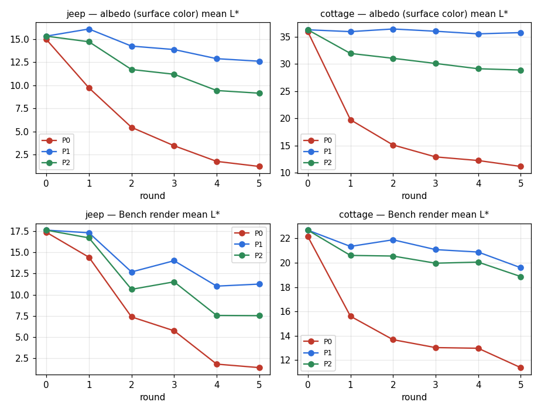
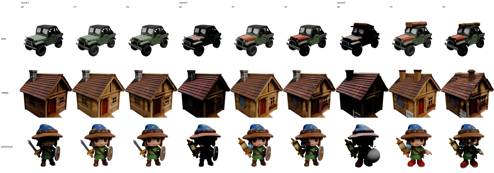
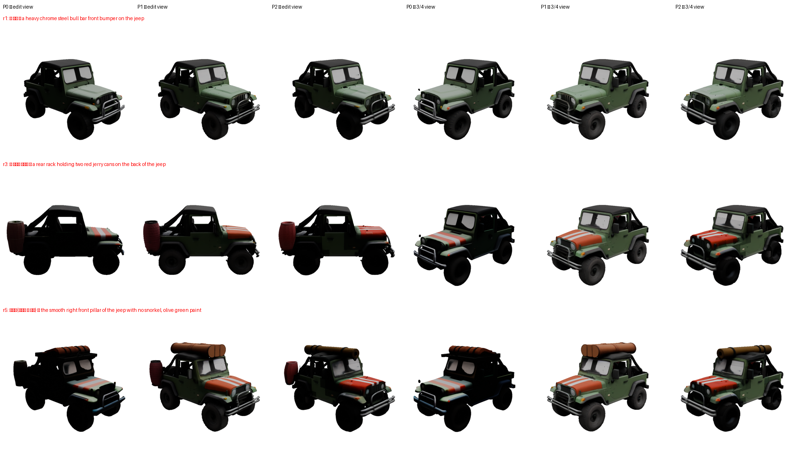
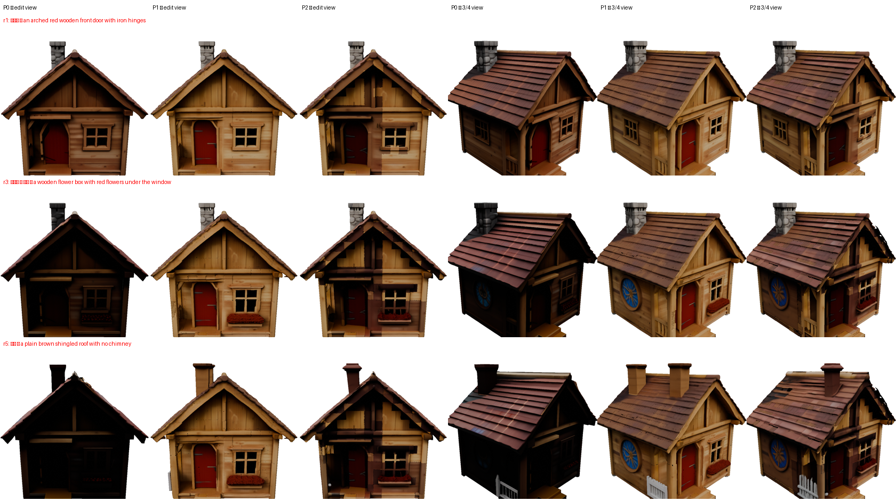
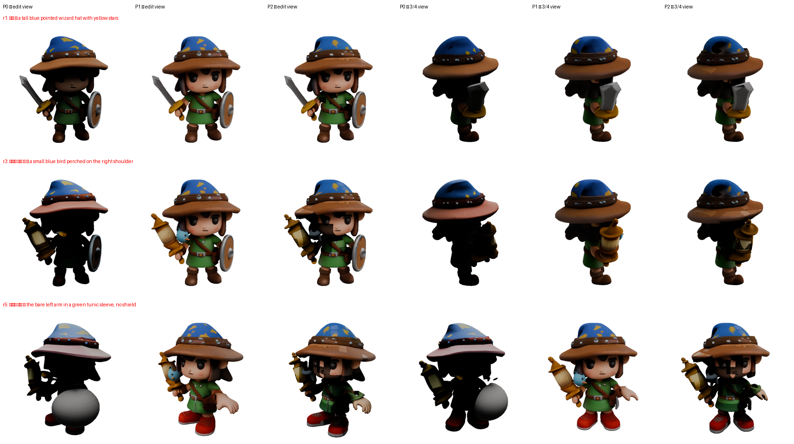
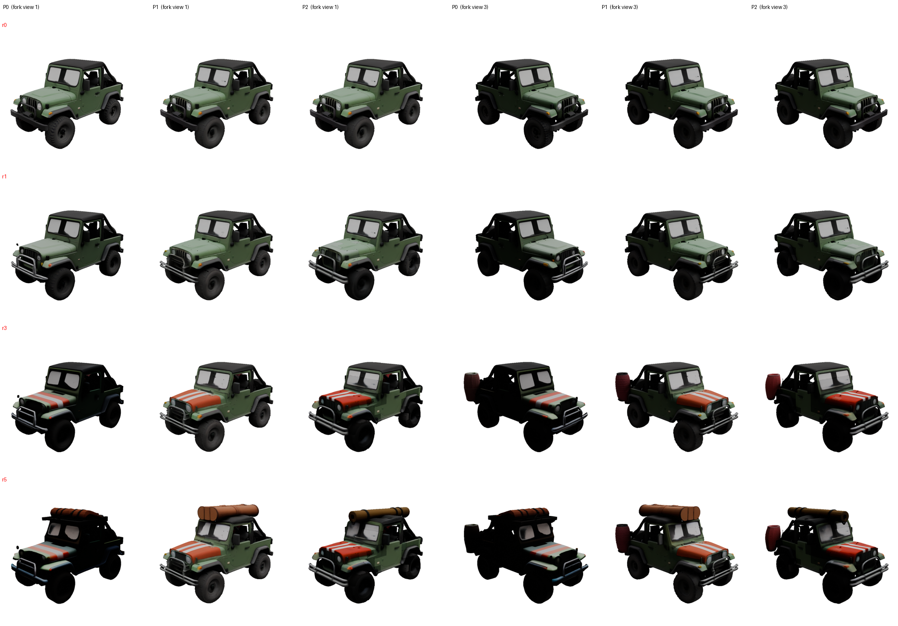
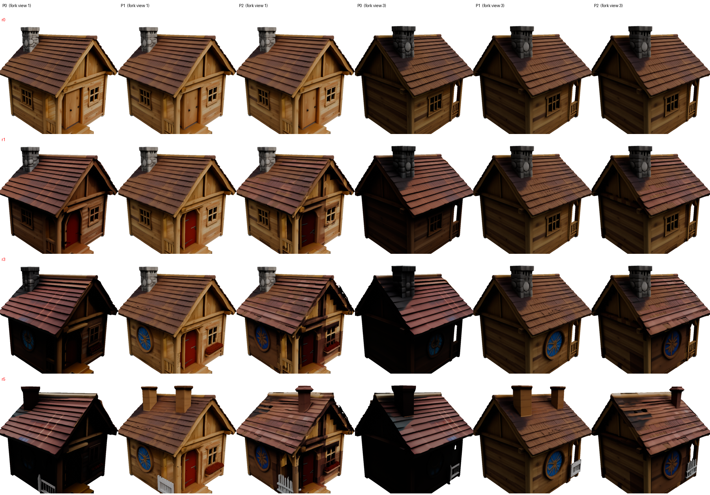
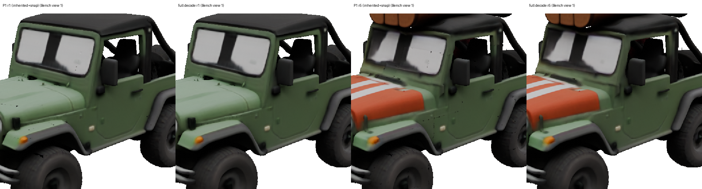
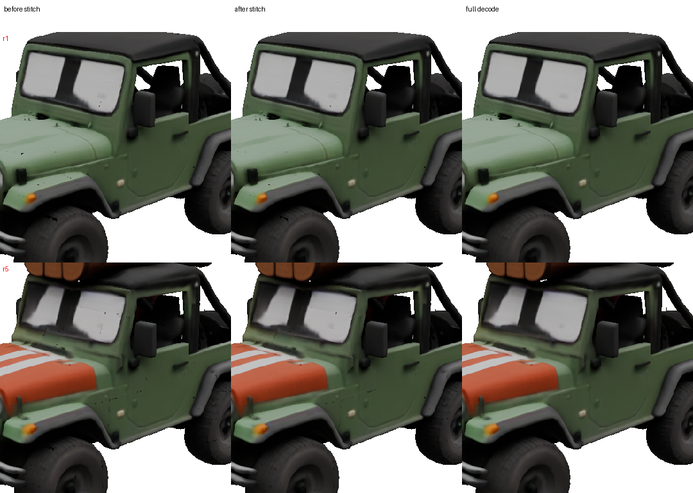
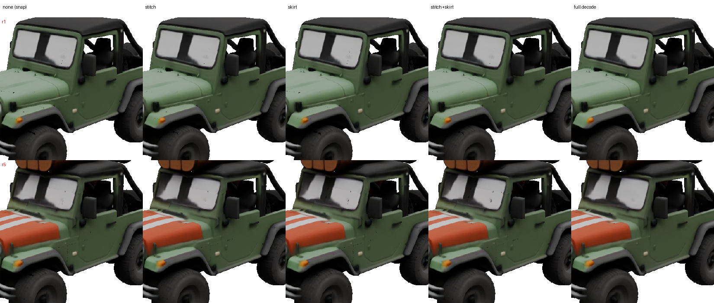

# X. 논문 실험 — a5000 보고서

- 장비: a5000 (RTX A5000 24 GB). 브랜치 `item/X-paper-a5000`(`item/02-R4-a5000` `60c951d` = 경계 스냅 포함에서 분기, main 병합).
- 지시: `ops/tasks/X-paper.md`(계획 원문 `ops/paper/PLAN.md`, 지시서 우선). 편집 시간은 재지 않는다(품질만).
- 경로: **P0** 원저자(재등록 + 25 스텝 + `to_glb`, 인페인팅 A5000 bf16). **P1** 우리(W34 + editcore 15/15 + R4 `.cbin`, 인페인팅 3090 INT4).
  **P2** = P1 + 매 편집 전 150시점 재등록(`X_REREG=1`, 인페인팅 3090 INT4).
- 결과 원자료: `$RUNS_DIR/paper/<실험>/`. 보고서에 sha256.

<!-- summary:start -->
## 결과 요약 (논문용 표)

모든 수치는 실측이고, 원자료·정의는 아래 각 절에 있다. 생성 `tools/paper/summary.py`. **사용자 지시(10-27 01:4x)로 추가 계산(보이는 표면·고정 영역)은 하지 않았고, 예정된 채점(X0 r1–r3, X4 11자산, X2-A·X2-B, X2-A 비열등성 검정)은 모두 마쳤다(03:38).** 각 표에 건수·회차를 적는다.

### S1. X3 연속 5회 편집 (P1·P2 = 봉합본)

**지프(jeep)**

| 경로 | 회차 | CD 보이는 표면 ↓ | F1 보이는 표면 ↑ | PSNR(M) ↑ | LPIPS(M) ↓ | 표면 셀 IoU(원본 표면 2M 점이 닿는 셀) ↑ | DINO-I ↑ | CLIP-T ↑ | 고정 영역 PSNR(M) / LPIPS(M) / 렌더 L* | 참고: 전체 표면 CD / F1 | 참고: 봉합 전 CD / PSNR(M) |
|---|---|---|---|---|---|---|---|---|---|---|---|
| P0 | 1 | 채점 중 | 채점 중 | 24.59 | 0.0725 | 0.9208 | 0.830 | 0.246 | 채점 중 | 0.0049 / 0.946 | – |
| P0 | 2 | 채점 중 | 채점 중 | 21.03 | 0.1313 | 0.8803 | 0.841 | 0.259 | 채점 중 | 0.0059 / 0.909 | – |
| P0 | 3 | 채점 중 | 채점 중 | 17.64 | 0.2003 | 0.8417 | 0.813 | 0.235 | 채점 중 | 0.0082 / 0.895 | – |
| P0 | 4 | 채점 중 | 채점 중 | 16.67 | 0.2713 | 0.8140 | 0.841 | 0.289 | 채점 중 | 0.0096 / 0.859 | – |
| P0 | 5 | 채점 중 | 채점 중 | 16.39 | 0.2896 | 0.8204 | 0.849 | 0.250 | 채점 중 | 0.0098 / 0.853 | – |
| P1 | 1 | 채점 중 | 채점 중 | 40.75 | 0.0071 | 0.9978 | 0.876 | 0.264 | 채점 중 | 0.0036 / 0.993 | 0.0036 / 40.58 |
| P1 | 2 | 채점 중 | 채점 중 | 37.94 | 0.0088 | 0.9966 | 0.881 | 0.257 | 채점 중 | 0.0036 / 0.994 | 0.0036 / 37.88 |
| P1 | 3 | 채점 중 | 채점 중 | 28.12 | 0.0524 | 0.9957 | 0.861 | 0.231 | 채점 중 | 0.0047 / 0.984 | 0.0047 / 28.09 |
| P1 | 4 | 채점 중 | 채점 중 | 23.35 | 0.0806 | 0.9951 | 0.874 | 0.290 | 채점 중 | 0.0073 / 0.960 | 0.0073 / 23.34 |
| P1 | 5 | 채점 중 | 채점 중 | 23.55 | 0.0741 | 0.9946 | 0.892 | 0.276 | 채점 중 | 0.0074 / 0.957 | 0.0074 / 23.54 |
| P2 | 1 | 채점 중 | 채점 중 | 31.49 | 0.0256 | 0.9508 | 0.863 | 0.256 | 채점 중 | 0.0040 / 0.966 | 0.0040 / 31.41 |
| P2 | 2 | 채점 중 | 채점 중 | 23.67 | 0.0592 | 0.9499 | 0.859 | 0.263 | 채점 중 | 0.0044 / 0.948 | 0.0043 / 23.66 |
| P2 | 3 | 채점 중 | 채점 중 | 21.25 | 0.0940 | 0.9397 | 0.841 | 0.258 | 채점 중 | 0.0052 / 0.943 | 0.0052 / 21.26 |
| P2 | 4 | 채점 중 | 채점 중 | 16.26 | 0.1683 | 0.9404 | 0.880 | 0.277 | 채점 중 | 0.0093 / 0.901 | 0.0096 / 16.26 |
| P2 | 5 | 채점 중 | 채점 중 | 16.31 | 0.1609 | 0.9406 | 0.899 | 0.261 | 채점 중 | 0.0095 / 0.899 | 0.0097 / 16.30 |

설정: P0 = 원저자 경로(매 회차 150시점 재등록 + 25 스텝 + `to_glb`), 인페인팅 A5000 bf16. P1 = W34 SLat 재사용 + editcore 15/15 + R4 `.cbin`(R11 승계, 경계 스냅 + 봉합 띠), 인페인팅 3090 INT4. P2 = P1 + 매 회차 150시점 재등록, 인페인팅 3090 INT4. 각 경로 자기 직전 결과에서 다음 회차, 반복 없음(표본 1). 비교 기준 = 자기 출발점(P0 생성 텍스처 GLB, P1·P2 A_origin R4 `.cbin`). 주 열의 영역 = 그 회차 누적 마스크 ∪ halo 2 밖. **고정 영역** = 5회차 누적 마스크 ∪ halo 2 밖을 모든 회차에 같게(회차–지표 곡선용). **보이는 표면** = Bench 16시점 레이캐스팅 첫 교차점 100k 점(`.cbin` 의 가려진 내부 면 제외). DINO-I·CLIP-T = 편집 시점 1장(자기 2d_edit·프롬프트). 표면 셀 IoU(원본 표면 2M 점이 닿는 셀) = A_origin 표면 2M 점이 닿는 셀만(R_keep IoU 는 4절 참고 열).

**오두막(cottage)**

| 경로 | 회차 | CD 보이는 표면 ↓ | F1 보이는 표면 ↑ | PSNR(M) ↑ | LPIPS(M) ↓ | 표면 셀 IoU(원본 표면 2M 점이 닿는 셀) ↑ | DINO-I ↑ | CLIP-T ↑ | 고정 영역 PSNR(M) / LPIPS(M) / 렌더 L* | 참고: 전체 표면 CD / F1 | 참고: 봉합 전 CD / PSNR(M) |
|---|---|---|---|---|---|---|---|---|---|---|---|
| P0 | 1 | 채점 중 | 채점 중 | 21.50 | 0.1280 | 0.9502 | 0.925 | 0.205 | 채점 중 | 0.0040 / 0.995 | – |
| P0 | 2 | 채점 중 | 채점 중 | 18.62 | 0.2141 | 0.9336 | 0.977 | 0.125 | 채점 중 | 0.0044 / 0.989 | – |
| P0 | 3 | 채점 중 | 채점 중 | 17.66 | 0.2571 | 0.9267 | 0.943 | 0.220 | 채점 중 | 0.0048 / 0.980 | – |
| P0 | 4 | 채점 중 | 채점 중 | 17.08 | 0.2809 | 0.9205 | 0.959 | 0.212 | 채점 중 | 0.0051 / 0.966 | – |
| P0 | 5 | 채점 중 | 채점 중 | 16.75 | 0.3085 | 0.9166 | 0.925 | 0.300 | 채점 중 | 0.0054 / 0.959 | – |
| P1 | 1 | 채점 중 | 채점 중 | 34.37 | 0.0206 | 0.9993 | 0.928 | 0.214 | 채점 중 | 0.0057 / 0.944 | 0.0057 / 34.27 |
| P1 | 2 | 채점 중 | 채점 중 | 32.58 | 0.0284 | 0.9990 | 0.964 | 0.150 | 채점 중 | 0.0061 / 0.932 | 0.0060 / 32.45 |
| P1 | 3 | 채점 중 | 채점 중 | 31.52 | 0.0331 | 0.9988 | 0.930 | 0.238 | 채점 중 | 0.0062 / 0.928 | 0.0060 / 31.34 |
| P1 | 4 | 채점 중 | 채점 중 | 31.37 | 0.0336 | 0.9986 | 0.960 | 0.204 | 채점 중 | 0.0063 / 0.924 | 0.0062 / 31.22 |
| P1 | 5 | 채점 중 | 채점 중 | 26.26 | 0.0599 | 0.9988 | 0.944 | 0.281 | 채점 중 | 0.0069 / 0.917 | 0.0068 / 26.19 |
| P2 | 1 | 채점 중 | 채점 중 | 28.19 | 0.0555 | 0.9914 | 0.918 | 0.212 | 채점 중 | 0.0054 / 0.930 | 0.0054 / 28.11 |
| P2 | 2 | 채점 중 | 채점 중 | 24.76 | 0.0758 | 0.9834 | 0.954 | 0.146 | 채점 중 | 0.0058 / 0.919 | 0.0058 / 24.78 |
| P2 | 3 | 채점 중 | 채점 중 | 23.76 | 0.0929 | 0.9822 | 0.925 | 0.229 | 채점 중 | 0.0060 / 0.910 | 0.0059 / 23.75 |
| P2 | 4 | 채점 중 | 채점 중 | 22.58 | 0.1068 | 0.9783 | 0.963 | 0.207 | 채점 중 | 0.0062 / 0.898 | 0.0062 / 22.49 |
| P2 | 5 | 채점 중 | 채점 중 | 21.44 | 0.1283 | 0.9781 | 0.937 | 0.294 | 채점 중 | 0.0076 / 0.889 | 0.0077 / 21.43 |

설정: P0 = 원저자 경로(매 회차 150시점 재등록 + 25 스텝 + `to_glb`), 인페인팅 A5000 bf16. P1 = W34 SLat 재사용 + editcore 15/15 + R4 `.cbin`(R11 승계, 경계 스냅 + 봉합 띠), 인페인팅 3090 INT4. P2 = P1 + 매 회차 150시점 재등록, 인페인팅 3090 INT4. 각 경로 자기 직전 결과에서 다음 회차, 반복 없음(표본 1). 비교 기준 = 자기 출발점(P0 생성 텍스처 GLB, P1·P2 A_origin R4 `.cbin`). 주 열의 영역 = 그 회차 누적 마스크 ∪ halo 2 밖. **고정 영역** = 5회차 누적 마스크 ∪ halo 2 밖을 모든 회차에 같게(회차–지표 곡선용). **보이는 표면** = Bench 16시점 레이캐스팅 첫 교차점 100k 점(`.cbin` 의 가려진 내부 면 제외). DINO-I·CLIP-T = 편집 시점 1장(자기 2d_edit·프롬프트). 표면 셀 IoU(원본 표면 2M 점이 닿는 셀) = A_origin 표면 2M 점이 닿는 셀만(R_keep IoU 는 4절 참고 열).

**모험가(adventurer)**

| 경로 | 회차 | CD 보이는 표면 ↓ | F1 보이는 표면 ↑ | PSNR(M) ↑ | LPIPS(M) ↓ | 표면 셀 IoU(원본 표면 2M 점이 닿는 셀) ↑ | DINO-I ↑ | CLIP-T ↑ | 고정 영역 PSNR(M) / LPIPS(M) / 렌더 L* | 참고: 전체 표면 CD / F1 | 참고: 봉합 전 CD / PSNR(M) |
|---|---|---|---|---|---|---|---|---|---|---|---|
| P0 | 1 | 채점 중 | 채점 중 | 20.09 | 0.1544 | 0.9155 | 0.850 | 0.254 | 채점 중 | 0.0030 / 0.996 | – |
| P0 | 2 | 채점 중 | 채점 중 | 17.60 | 0.2214 | 0.9013 | 0.806 | 0.257 | 채점 중 | 0.0052 / 0.970 | – |
| P0 | 3 | 채점 중 | 채점 중 | 15.99 | 0.2528 | 0.8747 | 0.755 | 0.205 | 채점 중 | 0.0059 / 0.965 | – |
| P0 | 4 | 채점 중 | 채점 중 | 14.83 | 0.2630 | 0.8736 | 0.783 | 0.166 | 채점 중 | 0.0067 / 0.959 | – |
| P0 | 5 | 채점 중 | 채점 중 | 13.83 | 0.2815 | 0.8618 | 0.781 | 0.219 | 채점 중 | 0.0217 / 0.882 | – |
| P1 | 1 | 채점 중 | 채점 중 | 44.38 | 0.0080 | 0.9990 | 0.832 | 0.241 | 채점 중 | 0.0036 / 0.991 | 0.0036 / 43.67 |
| P1 | 2 | 채점 중 | 채점 중 | 50.52 | 0.0119 | 0.9995 | 0.806 | 0.201 | 채점 중 | 0.0037 / 0.990 | 0.0037 / 49.23 |
| P1 | 3 | 채점 중 | 채점 중 | 48.56 | 0.0133 | 0.9995 | 0.821 | 0.216 | 채점 중 | 0.0040 / 0.987 | 0.0039 / 47.43 |
| P1 | 4 | 채점 중 | 채점 중 | 46.93 | 0.0194 | 0.9994 | 0.829 | 0.157 | 채점 중 | 0.0041 / 0.984 | 0.0041 / 45.75 |
| P1 | 5 | 채점 중 | 채점 중 | 47.41 | 0.0260 | 0.9993 | 0.797 | 0.229 | 채점 중 | 0.0043 / 0.980 | 0.0042 / 46.57 |
| P2 | 1 | 채점 중 | 채점 중 | 35.65 | 0.0244 | 0.9887 | 0.830 | 0.243 | 채점 중 | 0.0036 / 0.989 | 0.0036 / 35.55 |
| P2 | 2 | 채점 중 | 채점 중 | 34.22 | 0.0399 | 0.9895 | 0.796 | 0.216 | 채점 중 | 0.0038 / 0.980 | 0.0038 / 34.13 |
| P2 | 3 | 채점 중 | 채점 중 | 32.92 | 0.0470 | 0.9887 | 0.834 | 0.200 | 채점 중 | 0.0039 / 0.979 | 0.0038 / 32.84 |
| P2 | 4 | 채점 중 | 채점 중 | 30.58 | 0.0713 | 0.9889 | 0.839 | 0.152 | 채점 중 | 0.0040 / 0.975 | 0.0040 / 30.51 |
| P2 | 5 | 채점 중 | 채점 중 | 29.62 | 0.1073 | 0.9877 | 0.841 | 0.227 | 채점 중 | 0.0041 / 0.966 | 0.0041 / 29.56 |

설정: P0 = 원저자 경로(매 회차 150시점 재등록 + 25 스텝 + `to_glb`), 인페인팅 A5000 bf16. P1 = W34 SLat 재사용 + editcore 15/15 + R4 `.cbin`(R11 승계, 경계 스냅 + 봉합 띠), 인페인팅 3090 INT4. P2 = P1 + 매 회차 150시점 재등록, 인페인팅 3090 INT4. 각 경로 자기 직전 결과에서 다음 회차, 반복 없음(표본 1). 비교 기준 = 자기 출발점(P0 생성 텍스처 GLB, P1·P2 A_origin R4 `.cbin`). 주 열의 영역 = 그 회차 누적 마스크 ∪ halo 2 밖. **고정 영역** = 5회차 누적 마스크 ∪ halo 2 밖을 모든 회차에 같게(회차–지표 곡선용). **보이는 표면** = Bench 16시점 레이캐스팅 첫 교차점 100k 점(`.cbin` 의 가려진 내부 면 제외). DINO-I·CLIP-T = 편집 시점 1장(자기 2d_edit·프롬프트). 표면 셀 IoU(원본 표면 2M 점이 닿는 셀) = A_origin 표면 2M 점이 닿는 셀만(R_keep IoU 는 4절 참고 열).

### S2. C4 색 표류 (보존 영역 표면 색, A_origin 대비)

| 자산 | 경로 | ΔL* r1 | r2 | r3 | r4 | r5 | ΔE r5 | 렌더 L* r0 → r5 |
|---|---|---|---|---|---|---|---|---|
| 지프 | P0 | -5.8 | -8.3 | -10.1 | -10.6 | -10.9 | 11.6 | 17.4 → 1.3 (참고) |
| 지프 | P1 | +0.6 | +0.6 | +0.4 | +0.6 | +0.6 | 3.6 | 17.7 → 11.3 (참고) |
| 지프 | P2 | -0.7 | -2.0 | -2.3 | -2.9 | -2.9 | 5.8 | 17.7 → 7.5 (참고) |
| 오두막 | P0 | -15.6 | -20.7 | -22.5 | -22.7 | -24.0 | 35.0 | 22.1 → 11.4 (참고) |
| 오두막 | P1 | +0.6 | +0.5 | +0.6 | +0.6 | +0.6 | 7.1 | 22.7 → 19.6 (참고) |
| 오두막 | P2 | -3.4 | -4.8 | -5.3 | -5.8 | -6.3 | 15.1 | 22.7 → 18.9 (참고) |
| 모험가 | P0 | -18.0 | -20.5 | -21.4 | -20.2 | -17.8 | 31.7 | 22.0 → 32.4 (참고) |
| 모험가 | P1 | +0.4 | +0.3 | +0.3 | +0.3 | +0.5 | 4.4 | 22.4 → 27.1 (참고) |
| 모험가 | P2 | -0.6 | -1.7 | -1.9 | -3.9 | -5.5 | 11.0 | 22.4 → 26.9 (참고) |

렌더 L*: **참고(영역이 회차마다 다름)** — 누적 마스크가 커지며 비교 화소가 바뀐다. 고정 영역 값은 채점 중이다. 색 표류의 주 지표는 같은 점 비교인 ΔL*.

설정: 표면 색 = A_origin(생성 텍스처 GLB) 보존 영역 표면 100k 점마다 결과의 최근접 점(2셀 이내) 색 — P0 텍스처 UV, P1·P2 정점색(sRGB). CIELAB(D65). 렌더 L* = Bench 16시점 보존 영역 화소 평균. 인페인팅·회차 설정은 S1 과 같다.

**논문 그림 후보 — 1·3·5회차, 같은 시점(포크 시점 1), P0 | P1 | P2(P1·P2 봉합본):**

### S3. 사람 평가 (X3, 15 항목 × 2 질문)

| 질문 | P0 | P1 | P2 | 응답 |
|---|---|---|---|---|
| 보존 상태가 가장 좋은 것 | 0 | **15** | 0 | 15 |
| 편집이 프롬프트대로 된 것 | 0 | **15** | 0 | 15 |

한계:
1. 평가자 1명, 반복 없음 — 통계 검정은 쓰지 않는다.
2. 경로 이름은 가렸지만 P0·P2 는 회차가 지날수록 어두워져(C4) 그림만으로 P1 과 구별될 수 있다 — 블라인드가 완전하지 않을 수 있다.
3. 편집 반영 판단은 사람 선택 하나로 정하지 않고 S1 의 CLIP-T·DINO-I 와 함께 본다.

### S4. X0 기존 14건 재채점(25 vs 15, P1-glb·P1-cbin)

| 설정 | 시나리오 | 회차(합) | CD ↓ | F1 ↑ | PSNR(M) ↑ | SSIM(M) ↑ | LPIPS(M) ↓ | DINO-I(편집 시점) ↑ | CLIP-T(편집 시점) ↑ | CLIP-T 6시점 ↑ | DINO-I 16시점 ↑ |
|---|---|---|---|---|---|---|---|---|---|---|---|
| base(25 스텝, `to_glb`) | 14 | 42 | 0.0042 | 0.976 | 25.38 | 0.8256 | 0.0740 | 0.809 | 0.287 | 0.2863 | 0.9377 |
| P1-glb(15 스텝, `to_glb`) | 14 | 42 | 0.0034 | 0.985 | 25.59 | 0.8368 | 0.0639 | 0.811 | 0.284 | 0.2844 | 0.9403 |
| P1-cbin(15 스텝, R4 + 봉합) | 14 | 42 | 0.0045 | 0.942 | 24.49 | 0.8225 | 0.0763 | 0.808 | 0.286 | 0.2841 | 0.9383 |
| 참고: P1-cbin 봉합 전 | 14 | 42 | 0.0045 | 0.942 | 24.49 | 0.8223 | 0.0763 | 0.807 | 0.286 | 0.2841 | 0.9383 |

값 = 시나리오별 회차 평균의 14건 평균(회차 수는 표의 '회차(합)', 채점된 회차만). 기준 = 원본 v0, 마스크 ∪ halo 2 밖. 인페인팅 = 동결 조건 이미지(A5000 bf16, 00s2). 전체 표면 형상 지표(보이는 표면 변형은 하지 않았다).

### S5. X4 무편집 재등록 체인(P0 vs P1, 5회)

| 경로 | 회차 | CD ↓ | F1 ↑ | PSNR(M) ↑ | LPIPS(M) ↓ | R_keep IoU(원본 SLat 대비) ↑ |
|---|---|---|---|---|---|---|
| P0 | 1 | 0.0028 | 0.994 | 21.26 | 0.0806 | 0.9536 |
| P0 | 2 | 0.0032 | 0.986 | 17.07 | 0.1559 | 0.9086 |
| P0 | 3 | 0.0034 | 0.980 | 15.13 | 0.2150 | 0.8789 |
| P0 | 4 | 0.0036 | 0.975 | 14.06 | 0.2600 | 0.8553 |
| P0 | 5 | 0.0038 | 0.969 | 13.41 | 0.2928 | 0.8370 |
| P1(자기 출발점 대비) | 1 | ≈0 | 1.000 | 78–83(같은 SLat 재디코딩) | ≈0 | 1.0000 |
| P1(자기 출발점 대비) | 2 | ≈0 | 1.000 | 78–83(같은 SLat 재디코딩) | ≈0 | 1.0000 |
| P1(자기 출발점 대비) | 3 | ≈0 | 1.000 | 78–83(같은 SLat 재디코딩) | ≈0 | 1.0000 |
| P1(자기 출발점 대비) | 4 | ≈0 | 1.000 | 78–83(같은 SLat 재디코딩) | ≈0 | 1.0000 |
| P1(자기 출발점 대비) | 5 | ≈0 | 1.000 | 78–83(같은 SLat 재디코딩) | ≈0 | 1.0000 |
| P1(공통 기준 대비) | 1 | 0.0037 | 0.955 | 24.73 | 0.0705 | 1.0000 |
| P1(공통 기준 대비) | 2 | 0.0037 | 0.955 | 24.73 | 0.0705 | 1.0000 |
| P1(공통 기준 대비) | 3 | 0.0037 | 0.955 | 24.73 | 0.0705 | 1.0000 |
| P1(공통 기준 대비) | 4 | 0.0037 | 0.955 | 24.73 | 0.0705 | 1.0000 |
| P1(공통 기준 대비) | 5 | 0.0037 | 0.955 | 24.73 | 0.0705 | 1.0000 |

채점된 자산 11/11 평균. 기준 = 자기 출발점(P0 = 생성·원본 GLB = 공통 기준, P1 = 원본 SLat 의 R4 `.cbin`) 또는 공통 기준(원본 GLB), 편집 없음, 전체 영역. P1 은 같은 SLat 을 다시 디코딩할 뿐이라 디코더 비결정성(1e-7)으로 바이트는 다르지만 지표는 소수 넷째 자리까지 같고(자기 출발점 대비 PSNR 78–83 dB), 공통 기준 대비 값은 회차와 무관하게 R4 메시 표현 차이만 남는다. P1 공통 기준 행의 PSNR(M) 차이는 R4 정점색 메시 대 텍스처 GLB 렌더 차이(전체 표면 형상 지표 — 가려진 내부 면 포함).

### S6. X2-A 3D 만 비교(동결 14건, P0 vs P1)

| 시나리오 | P0 회차 | P0 PSNR(M) | P1-glb PSNR(M) | P1-cbin(봉합) PSNR(M) | P0 CD | P1-glb CD | P1-cbin CD | P0 DINO-I | P1-glb DINO-I | P0 CLIP-T | P1-glb CLIP-T |
|---|---|---|---|---|---|---|---|---|---|---|---|
| A-M1 | 2 | 23.02 | 32.14 | 28.98 | 0.0031 | 0.0024 | 0.0046 | 0.766 | 0.779 | 0.289 | 0.271 |
| A-M2 | 2 | 19.23 | 29.42 | 27.55 | 0.0036 | 0.0023 | 0.0048 | 0.807 | 0.833 | 0.244 | 0.249 |
| A-S1 | 2 | 17.77 | 34.01 | 31.88 | 0.0059 | 0.0033 | 0.0033 | 0.608 | 0.741 | 0.322 | 0.354 |
| A-S2 | 2 | 20.13 | 43.81 | 38.15 | 0.0032 | 0.0025 | 0.0026 | 0.781 | 0.878 | 0.271 | 0.264 |
| A-C1 | 2 | 20.32 | 28.27 | 27.24 | 0.0035 | 0.0027 | 0.0032 | 0.820 | 0.856 | 0.294 | 0.291 |
| A-C2 | 2 | 21.76 | 39.17 | 36.93 | 0.0031 | 0.0024 | 0.0030 | 0.859 | 0.895 | 0.303 | 0.307 |
| B1 | 2 | 19.27 | 18.15 | 18.27 | 0.0035 | 0.0041 | 0.0044 | 0.858 | 0.845 | 0.293 | 0.324 |
| B2 | 2 | 18.25 | 17.70 | 17.82 | 0.0066 | 0.0066 | 0.0066 | 0.807 | 0.768 | 0.274 | 0.262 |
| B3 | 2 | 21.01 | 21.04 | 21.03 | 0.0019 | 0.0020 | 0.0036 | 0.653 | 0.655 | 0.331 | 0.337 |
| B4 | 2 | 15.52 | 15.92 | 16.12 | 0.0127 | 0.0086 | 0.0118 | 0.936 | 0.941 | 0.273 | 0.272 |
| B5 | 2 | 17.58 | 20.15 | 20.26 | 0.0029 | 0.0022 | 0.0039 | 0.763 | 0.761 | 0.299 | 0.294 |
| B6 | 2 | 20.30 | 20.06 | 20.27 | 0.0023 | 0.0023 | 0.0033 | 0.815 | 0.813 | 0.237 | 0.246 |
| B7 | 2 | 15.87 | 16.08 | 15.95 | 0.0031 | 0.0031 | 0.0045 | 0.853 | 0.852 | 0.263 | 0.268 |
| B8 | 2 | 23.07 | 22.40 | 22.39 | 0.0030 | 0.0028 | 0.0033 | 0.731 | 0.729 | 0.225 | 0.238 |
| **평균(14건)** | | 19.51 | 25.59 | 24.49 | 0.0042 | 0.0034 | 0.0045 | 0.790 | 0.811 | 0.280 | 0.284 |

P0 = 원저자 경로(재등록 + 25 스텝 + `to_glb`), 채점된 시나리오 14/14 · 시나리오당 r1·r2 중 채점된 회차 평균. P1 = E2a c15(W34 재사용 + 15/15) r1–r3 중 채점된 회차 평균 — P1-glb(`to_glb`)·P1-cbin(R4 + 봉합). 조건 이미지 = 동결본(A5000 bf16). 기준 = 원본 v0, 마스크 ∪ halo 2 밖.

**단측 비열등성 검정(chief 보정 7):** 시나리오 평균 쌍 차이 d = P1 − P0(P0 2회, P1 3회), H0: 좋은 방향 기준 d ≤ −한계(E19), n = 14, α = 0.05. 우위 p = H0: 좋은 방향 기준 d ≤ 0.

| P1 | 지표 | 한계 | P0 평균 | P1 평균 | d | 비열등 p | 비열등 | 우위 p | P1 이 한계 넘게 좋은/나쁜 시나리오 |
|---|---|---|---|---|---|---|---|---|---|
| P1-glb | PSNR(M) | 0.5 | 19.51 | 25.59 | +6.09 | 0.005 | **예** | 0.0077 | 7 / 3 |
| P1-glb | SSIM(M) | 0.003 | 0.7415 | 0.8368 | +0.0953 | 0.0066 | **예** | 0.0078 | 8 / 6 |
| P1-glb | LPIPS(M) | 0.005 | 0.1083 | 0.0639 | -0.0444 | 0.0032 | **예** | 0.0061 | 9 / 2 |
| P1-glb | DINO-I | 0.015 | 0.790 | 0.811 | +0.021 | 0.0053 | **예** | 0.053 | 5 / 1 |
| P1-glb | CLIP-T | 0.015 | 0.280 | 0.284 | +0.004 | 0.00011 | **예** | 0.14 | 2 / 1 |
| P1-glb | CD | 0.002 | 0.0042 | 0.0034 | -0.0008 | 7.1e-07 | **예** | 0.018 | 2 / 0 |
| P1-cbin(봉합) | PSNR(M) | 0.5 | 19.51 | 24.49 | +4.98 | 0.0042 | **예** | 0.0072 | 8 / 2 |
| P1-cbin(봉합) | SSIM(M) | 0.003 | 0.7415 | 0.8225 | +0.0810 | 0.0091 | **예** | 0.011 | 9 / 5 |
| P1-cbin(봉합) | LPIPS(M) | 0.005 | 0.1083 | 0.0763 | -0.0320 | 0.015 | **예** | 0.027 | 7 / 5 |
| P1-cbin(봉합) | DINO-I | 0.015 | 0.790 | 0.808 | +0.018 | 0.0027 | **예** | 0.046 | 6 / 3 |
| P1-cbin(봉합) | CLIP-T | 0.015 | 0.280 | 0.286 | +0.006 | 0.00013 | **예** | 0.087 | 3 / 1 |
| P1-cbin(봉합) | CD | 0.002 | 0.0042 | 0.0045 | +0.0003 | 8e-05 | **예** | 0.84 | 1 / 0 |

### S7. X2-B Edit3D-Bench 3건(P0·P1 각 1회)

| 건 | 모델 · 프롬프트 | 경로 | CD ↓ | F1 ↑ | PSNR(M) ↑ | SSIM(M) ↑ | LPIPS(M) ↓ | DINO-I ↑ | CLIP-T ↑ |
|---|---|---|---|---|---|---|---|---|---|
| X2B-1 | 3D_Dollhouse_Happy_Broth · A dog. | P0 | 0.0020 | 1.000 | 21.76 | 0.8244 | 0.0633 | 0.667 | 0.240 |
| X2B-1 | 3D_Dollhouse_Happy_Broth · A dog. | P1 | 0.0037 | 0.948 | 21.66 | 0.8214 | 0.0721 | 0.670 | 0.247 |
| X2B-2 | 3D_Dollhouse_Lamp · A lamp with a carrot pillar. | P0 | 0.0014 | 1.000 | 24.60 | 0.8439 | 0.0637 | 0.740 | 0.299 |
| X2B-2 | 3D_Dollhouse_Lamp · A lamp with a carrot pillar. | P1 | 0.0034 | 0.911 | 23.89 | 0.8209 | 0.0711 | 0.736 | 0.305 |
| X2B-3 | 00200996b8f34f55a2dd2f44 · A man with a fox on his shoulder. | P0 | 0.0027 | 0.996 | 21.86 | 0.7326 | 0.0842 | 0.738 | 0.241 |
| X2B-3 | 00200996b8f34f55a2dd2f44 · A man with a fox on his shoulder. | P1 | 0.0043 | 0.931 | 22.08 | 0.7374 | 0.0975 | 0.744 | 0.260 |

P0 = 원저자 경로 1회, P1 = 원 VoxHammer 인코딩 1회로 만든 SLat → editcore 15/15 + R4 + 봉합 1회. 조건 이미지 = 데이터셋 2D(X2B-1·3, 편집 시점 마스크 IoU 1.000) / 포크 렌더 + A5000 bf16 FLUX(X2B-2, 데이터셋 2D IoU 0.859). 기준 = 데이터셋 원본 GLB, 마스크 ∪ halo 2 밖. FID·FVD·검정 없음.
<!-- summary:end -->

## 0. 준비 상태 (2026-10-26)

- **연결:**
  - 3090 → A5000:8082 는 성공했다(3090 이 04L 워커로 트랙 A 종단 요청 20건을 보냈다, 10:5x–11:18).
  - A5000 → 3090 은 3090 임시 리스너를 기다린다(X3 P1·P2 인페인팅을 A5000 이 직접 부를 수 있는지가 여기에 달렸다).
- **X2-B 데이터(실측):** A5000 `ASSETS_DIR/Edit3D-Bench/data` 에 다음이 있다. **내려받을 것은 없다.**
  - GSO 50 모델 · PartObjaverse-Tiny 50 모델
  - 모델마다 원본 GLB(`source_model/model.glb`)와 프롬프트 3개
  - 프롬프트마다 `3d_edit_region.glb`(3D 마스크)·`2d_render`·`2d_mask`·`2d_edit`. 텍스트는 `metadata.json`(source_prompt, prompt_1–3).
- **04L 워커:** 3090 종단 요청이 11:18 에 끝난 뒤, GPU 를 X4 에 쓰려고 11:29 에 내렸다. 04L 코드(assets_track_a.json·인증 끔·e2e 복제 자산)는 병행한다.
- **채점 일시정지(사용자 지시 16:2x):** X3 회차가 CPU 경합으로 늘어(지프 P1 1회차 328 s 중 조건 렌더 85 s·editcore 211 s, 부하 평균 61 — X0·X4 채점의 Bench Blender 렌더 2개가 32코어 중 약 28개 사용, 실측) X0·X4 채점을 **2026-10-26 16:23:27 에 SIGSTOP** 했다.
  - PGID 4039842 = `tools/paper/x4_score.py`(PID 4039842, Blender 자식 4134352)
  - PGID 4064024 = `x0_r23.sh` → `tools/paper/x0.py`(PID 4064024·4064025, Blender 자식 4134529)
  - X3 45회차가 끝나 2026-10-26 21:25:06 에 재개했다(감시 스크립트는 모험가 채점까지 기다리게 되어 있어 수동 SIGCONT).
  - **X2-A 동안 다시 정지(chief 21:4x):** 2026-10-26 21:47 SIGSTOP, 같은 PGID(4039842·4064024). X2-A 가 끝나면(`x2a.log` 의 `X2A_P0_DONE`) 재개한다. 모험가 X3 채점·C4·캡처·x3-eval 준비·봉합 재채점은 계속 돈다. 그 사이에도 X3 자산 하나(P0·P1·P2 5회차)가 끝날 때마다 그 자산의 X3 채점(`tools/paper/x3_score.py <자산>`)은 돌린다. 기록 `$RUNS_DIR/paper/paused.json`, `/paper` 상단 표시.

## 1. 채점 도구 `tools/paper_metrics.py` (코드확인, CPU 테스트 통과)

정의는 코드 상단 주석과 같다.

- **좌표:** 자산마다 v0 메시 bbox 로 정한 변환 하나(중심 원점, 최대 변 1) = N 좌표다. 포크 `normalize_scene` 과 같은 식이다.
  - P0 출력은 이미 N 이다(원저자 경로가 입력을 normalize_scene 해서 인코딩).
  - editcore·R4 출력(raw 프레임)은 raw → v0 저장 좌표(트랙 A `glb_normalize`, 트랙 B 항등) → N 으로 옮긴다.
  - 64³ 셀은 raw 프레임 기준이고, T1 뷰어 `voxelToWorld` 와 같은 식이다.
- **표면 샘플:** 면적 비례 100,000점, 면 법선, seed 0.
- **보존 점:** 점의 64³ 셀이 `dilate_cells(제외 셀, 2)` 밖이다.
- **지표 식:**
  - CD = ½(mean_R min_G + mean_G min_R)
  - NC = 최근접 쌍 |n·n| 양방향 평균
  - F1@0.01 = 정밀도(R→G)·재현율(G→R) 조화평균
- **점유:** `eval/rkeep.py`(E18).
- **PSNR·SSIM·LPIPS(M):** Bench `render.py` 16시점(N 좌표 메시, 정점색은 (iv) 보정)으로 렌더한다.
  - 제외 마스크 = 제외 셀 ∪ halo 2 를 같은 카메라로 투영한 실루엣이다.
  - 비교 화소 = (참조 알파 ∪ 결과 알파) − 제외 마스크다.
  - 계산은 Bench `eval_modules/image_metrics.py` 메서드 그대로다(회색 127 합성, 512², LPIPS alex spatial — Bench 와 같게 [0,1] 입력).
- **DINO-I·CLIP-T:** 편집 시점(포크 v → Bench {0:2,1:1,2:0,3:7,4:6}) 결과 렌더 vs 2d_edit·프롬프트. Bench 모델(DINOv2-base, CLIP ViT-B/32)을 쓴다.
- **CPU 테스트 `tests/cpu/test_paper_metrics_cpu.py` 4 passed:**
  - 같은 메시는 CD 0·NC 1·F1 1
  - 평면 평행이동 t = 0.004 는 CD ≈ t·F1 1, 0.02 는 F1 0
  - 셀 ↔ N 왕복, 보존 마스크
  - **A-S1 마스크 셀 실루엣(포크 v1) vs 동결 2d_mask IoU ≥ 0.9**
- **실데이터 1건 확인(A-M1 c15 r1 P1-glb vs v0, 1 m 40 s):**
  - 보존 CD 0.0024, NC 0.941, F1 0.989
  - PSNR(M) 32.2, SSIM 0.965, LPIPS 0.022, DINO-I 0.778, CLIP-T 0.269
  - 정렬 확인(v0 셀 → v0 메시 1셀 이내) 0.843 — T1 V-2 moto 값과 같다(to_glb mincut 이 가려진 면을 지움).

## 2. X4 무편집 재등록 체인

**예상(실행 전):**
- **P0 1회차:** 점유 IoU 가 원문의 0.800–0.959 범위로 떨어진다. 회차마다 150시점 렌더·`to_glb`(단순화 0.95 + mincut)를 다시 거치므로 셀이 조금씩 줄고, CD 가 커지고 PSNR(M) 이 떨어질 것이다.
  - 다만 2회차부터는 입력이 이미 `to_glb` 메시라 손실 폭이 1회차보다 작을 수 있다(포화).
- **P1:** 회차와 무관하게 일정하다. 디코더 1e-7 차이만 있고, 지표는 같은 값이 5번 나온다.
- 빈 마스크 editcore 는 거절될 가능성이 크다(마스크 셀 0 → 편집 컨텍스트 생성 단계). 거절되면 사유를 적는다.

(결과는 실행 뒤 기입)

## 3. X0 재채점

**예상(실행 전):**
- 25 대 15(editcore W34 경로): 보존 영역 CD·NC·F1 은 거의 같다. 보존 셀은 비트 동일이라 차이는 경계·마스크 밖 신규 셀 몫이다.
- PSNR(M)·DINO-I·CLIP-T 차이는 E2a §5·E19 재판정과 같은 방향일 것이다(c15 허용치 안).
- `P1-cbin` 은 `P1-glb` 보다 보존 CD·F1 이 나쁘게 나올 수 있다(가려진 내부 면, R4 3-8 B4 Chamfer).

**결과(실측, a5000 CPU, 14건 r1, `tools/paper/x0.py`·`x0_cbin.py`, 커밋 4c430b2):**

- 입력: base = 0-1 이식본 25 스텝 port-r1(`to_glb`), c15-glb = E2a c15 r1(`to_glb`), c15-cbin = **같은 c15 r1 slat_tgt** 를 R4(R11 + 경계 스냅)로 다시 디코딩한 정점색 GLB(chief 검토 1a, 14건 모두 스냅 뒤 정점 틈 중앙값 0). 참조 = v0(생성 텍스처 GLB / 데이터셋 GLB).
- 원자료 `$RUNS_DIR/paper/x0/x0.json` sha256 `bc6978850eda1072dfa3820a89000e120167f2290961b7a411e8ad3cc58d2ec7`.

| 시나리오 | 설정 | 보존 CD | NC | F1 | PSNR(M) | SSIM(M) | LPIPS(M) | DINO-I 1 | CLIP-T 1 | DINO-I 16 | CLIP-T 6 | 신규(R_keep) |
|---|---|---|---|---|---|---|---|---|---|---|---|---|
| A-M1 | base | 0.0023 | 0.945 | 0.991 | 33.89 | 0.9698 | 0.0178 | 0.7819 | 0.3299 | 0.9808 | 0.3159 | 93 |
| A-M1 | c15-glb | 0.0024 | 0.941 | 0.989 | 32.18 | 0.9651 | 0.0218 | 0.7775 | 0.2694 | 0.9857 | 0.3020 | 129 |
| A-M1 | c15-cbin | 0.0046 | 0.916 | 0.879 | 28.98 | 0.9138 | 0.0456 | 0.7574 | 0.2724 | 0.9806 | 0.2986 | 129 |
| A-M2 | base | 0.0022 | 0.946 | 0.998 | 35.90 | 0.9853 | 0.0076 | 0.8464 | 0.2483 | 0.9850 | 0.2379 | 43 |
| A-M2 | c15-glb | 0.0023 | 0.946 | 0.997 | 29.41 | 0.9748 | 0.0170 | 0.8329 | 0.2489 | 0.9850 | 0.2386 | 44 |
| A-M2 | c15-cbin | 0.0048 | 0.922 | 0.866 | 27.55 | 0.9291 | 0.0338 | 0.8209 | 0.2438 | 0.9824 | 0.2395 | 44 |
| A-S1 | base | 0.0068 | 0.955 | 0.944 | 22.21 | 0.8734 | 0.1252 | 0.6647 | 0.3310 | 0.9283 | 0.3394 | 2037 |
| A-S1 | c15-glb | 0.0033 | 0.978 | 0.992 | 33.96 | 0.9657 | 0.0246 | 0.7398 | 0.3544 | 0.9373 | 0.3438 | 354 |
| A-S1 | c15-cbin | 0.0033 | 0.978 | 0.992 | 31.88 | 0.9538 | 0.0369 | 0.6926 | 0.3498 | 0.9443 | 0.3430 | 354 |
| A-S2 | base | 0.0025 | 0.983 | 1.000 | 44.37 | 0.9874 | 0.0046 | 0.8803 | 0.2628 | 0.9958 | 0.2650 | 1 |
| A-S2 | c15-glb | 0.0025 | 0.984 | 1.000 | 43.91 | 0.9863 | 0.0046 | 0.8758 | 0.2635 | 0.9955 | 0.2652 | 6 |
| A-S2 | c15-cbin | 0.0026 | 0.984 | 1.000 | 38.16 | 0.9726 | 0.0160 | 0.8715 | 0.2635 | 0.9927 | 0.2662 | 6 |
| A-C1 | base | 0.0026 | 0.976 | 0.994 | 29.85 | 0.9721 | 0.0207 | 0.8358 | 0.2940 | 0.9737 | 0.2918 | 118 |
| A-C1 | c15-glb | 0.0027 | 0.970 | 0.989 | 28.28 | 0.9619 | 0.0197 | 0.8563 | 0.2913 | 0.9769 | 0.2877 | 186 |
| A-C1 | c15-cbin | 0.0032 | 0.960 | 0.962 | 27.23 | 0.9405 | 0.0290 | 0.8655 | 0.2888 | 0.9762 | 0.2884 | 186 |
| A-C2 | base | 0.0024 | 0.982 | 1.000 | 40.70 | 0.9903 | 0.0050 | 0.8867 | 0.3067 | 0.9940 | 0.3092 | 18 |
| A-C2 | c15-glb | 0.0024 | 0.983 | 1.000 | 39.20 | 0.9881 | 0.0070 | 0.8951 | 0.3072 | 0.9935 | 0.3085 | 36 |
| A-C2 | c15-cbin | 0.0030 | 0.970 | 0.970 | 36.93 | 0.9681 | 0.0187 | 0.8954 | 0.3067 | 0.9850 | 0.3081 | 36 |
| B1 | base | 0.0041 | 0.958 | 0.993 | 18.19 | 0.6709 | 0.0881 | 0.8488 | 0.3366 | 0.9268 | 0.3272 | 107 |
| B1 | c15-glb | 0.0041 | 0.958 | 0.995 | 18.14 | 0.6697 | 0.0896 | 0.8426 | 0.3244 | 0.9328 | 0.3227 | 113 |
| B1 | c15-cbin | 0.0044 | 0.948 | 0.979 | 18.27 | 0.6670 | 0.1004 | 0.8383 | 0.3399 | 0.9292 | 0.3205 | 113 |
| B2 | base | 0.0064 | 0.930 | 0.915 | 18.08 | 0.6645 | 0.1466 | 0.7872 | 0.2620 | 0.9147 | 0.2905 | 4830 |
| B2 | c15-glb | 0.0066 | 0.927 | 0.915 | 17.70 | 0.6449 | 0.1596 | 0.7662 | 0.2631 | 0.9197 | 0.2842 | 3999 |
| B2 | c15-cbin | 0.0066 | 0.925 | 0.914 | 17.82 | 0.6447 | 0.1672 | 0.7767 | 0.2707 | 0.9189 | 0.2825 | 3999 |
| B3 | base | 0.0021 | 0.972 | 0.999 | 20.81 | 0.7438 | 0.0775 | 0.6595 | 0.3317 | 0.9873 | 0.3228 | 61 |
| B3 | c15-glb | 0.0020 | 0.974 | 1.000 | 21.00 | 0.7495 | 0.0741 | 0.6546 | 0.3376 | 0.9844 | 0.3227 | 29 |
| B3 | c15-cbin | 0.0036 | 0.955 | 0.918 | 21.03 | 0.7354 | 0.0838 | 0.6559 | 0.3379 | 0.9791 | 0.3216 | 29 |
| B4 | base | 0.0168 | 0.870 | 0.869 | 15.24 | 0.6526 | 0.1115 | 0.9466 | 0.2781 | 0.8575 | 0.2682 | 989 |
| B4 | c15-glb | 0.0085 | 0.898 | 0.935 | 15.92 | 0.6700 | 0.1030 | 0.9406 | 0.2722 | 0.8723 | 0.2640 | 892 |
| B4 | c15-cbin | 0.0118 | 0.889 | 0.891 | 16.12 | 0.6789 | 0.1040 | 0.9535 | 0.2833 | 0.8707 | 0.2665 | 892 |
| B5 | base | 0.0029 | 0.969 | 0.969 | 17.31 | 0.7310 | 0.1212 | 0.7649 | 0.2988 | 0.9590 | 0.2924 | 268 |
| B5 | c15-glb | 0.0022 | 0.983 | 0.990 | 20.17 | 0.8253 | 0.0595 | 0.7630 | 0.2940 | 0.9652 | 0.2859 | 91 |
| B5 | c15-cbin | 0.0039 | 0.974 | 0.934 | 20.26 | 0.8271 | 0.0676 | 0.7467 | 0.2962 | 0.9601 | 0.2865 | 91 |
| B6 | base | 0.0023 | 0.978 | 1.000 | 20.38 | 0.8262 | 0.0824 | 0.8206 | 0.2459 | 0.9701 | 0.2564 | 4 |
| B6 | c15-glb | 0.0023 | 0.978 | 1.000 | 20.06 | 0.8190 | 0.0854 | 0.8136 | 0.2457 | 0.9558 | 0.2569 | 3 |
| B6 | c15-cbin | 0.0033 | 0.965 | 0.960 | 20.27 | 0.8156 | 0.0970 | 0.8248 | 0.2419 | 0.9560 | 0.2586 | 3 |
| B7 | base | 0.0031 | 0.986 | 0.988 | 15.90 | 0.6835 | 0.1150 | 0.8511 | 0.2637 | 0.8201 | 0.2657 | 168 |
| B7 | c15-glb | 0.0031 | 0.987 | 0.992 | 16.08 | 0.6902 | 0.1126 | 0.8509 | 0.2683 | 0.8223 | 0.2647 | 173 |
| B7 | c15-cbin | 0.0046 | 0.973 | 0.926 | 15.95 | 0.6829 | 0.1156 | 0.8522 | 0.2654 | 0.8256 | 0.2653 | 173 |
| B8 | base | 0.0028 | 0.974 | 0.998 | 22.61 | 0.8064 | 0.1128 | 0.7330 | 0.2275 | 0.8358 | 0.2276 | 69 |
| B8 | c15-glb | 0.0028 | 0.974 | 0.999 | 22.37 | 0.8007 | 0.1162 | 0.7294 | 0.2381 | 0.8393 | 0.2342 | 74 |
| B8 | c15-cbin | 0.0033 | 0.972 | 0.994 | 22.39 | 0.7828 | 0.1534 | 0.7517 | 0.2423 | 0.8363 | 0.2321 | 74 |
| **평균** | base | 0.0042 | 0.959 | 0.976 | 25.39 | 0.8255 | 0.0740 | 0.8077 | 0.2869 | 0.9378 | 0.2864 | 8806 |
| **평균** | c15-glb | 0.0034 | 0.963 | 0.985 | 25.60 | 0.8365 | 0.0639 | 0.8099 | 0.2842 | 0.9404 | 0.2844 | 6129 |
| **평균** | c15-cbin | 0.0045 | 0.952 | 0.942 | 24.49 | 0.8223 | 0.0764 | 0.8074 | 0.2859 | 0.9384 | 0.2841 | 6129 |

정의(표 아래, chief 지시 1):
- 보존 CD·NC·F1@0.01: 마스크 ∪ halo 2 밖 표면 점(각 100,000점 중), N 좌표(v0 bbox 변환 하나).
- PSNR·SSIM·LPIPS(M): Bench 16시점, 비교 화소 = (참조 ∪ 결과 알파) − 마스크 ∪ halo 2 실루엣.
- **DINO-I 1·CLIP-T 1 = 지시서 정의:** 편집 시점 결과 렌더 1장 vs 2d_edit / 프롬프트.
- **DINO-I 16·CLIP-T 6 = E2a(Bench eval_main) 정의:** DINO-I = 결과 16시점 vs 참조(v0) 16시점 평균, CLIP-T = 정면 6시점(0,1,7,8,9,15) 평균.
- 신규(R_keep) = 마스크 ∪ halo 2 밖에서 새로 점유된 64³ 셀(E18). 소실은 세 설정 모두 0.

**1b 원인 확인(chief 검토 1b, 실측):** A-M1 CLIP-T base 0.330 → c15 0.269 는 **정의 차이**다. 같은 GLB 의 paper_metrics 렌더와 e2a_metrics 렌더는 화소 동일(평균 |차| 0.0, 시점 0·7)이고, 같은 렌더에 E2a 정의를 걸면 0.3159 / 0.3020 로 E2a 값(0.3159 / 0.3021)과 4자리 일치한다. 단일 시점 값은 1장이라 흔들림이 크다. E2a r1–r3 표준편차는 1e-4 수준이라 회차 차이는 원인이 아니다. 고친 것: 두 정의를 모두 기록(위 표).

**해석:**
- c15-glb 대 base(14건 평균): 보존 CD 0.0042 → 0.0034, F1 0.976 → 0.985, PSNR(M) 25.39 → 25.60, 신규 셀 8806 → 6129. 예상("거의 같다")보다 c15 가 좋게 나온 것은 base 쪽 A-S1(마스크 밖 생성, E12 표시)·B4 단발 값이 크기 때문이다(시나리오별 표). 단발 1회라 base·c15 의 run 잡음을 가를 수 없다(추론).
- E19 절대 허용치를 넘는 칸(c15-glb − base): PSNR 4, SSIM 6, LPIPS 2, CD 0, CLIP-T 6 0, DINO-I 16 0, CLIP-T 1 1, DINO-I 1 1.
- c15-cbin 대 c15-glb: 같은 SLat 인데 보존 CD 0.0034 → 0.0045, F1 0.985 → 0.942, NC 0.963 → 0.952, PSNR(M) −1.1 dB. 예상대로 R4 메시의 가려진 내부 면(`to_glb` 가 지우던 면)과 정점색 렌더 차이 몫이다. E19 넘는 칸(c15-cbin − base): PSNR 5, SSIM 10, LPIPS 10, CD 2, CLIP-T 6 1, DINO-I 1 3. 논문에 어느 메시를 쓸지는 사용자 결정(지시서 보정 1).
- 정렬 확인(v0 셀 → v0 메시 1셀 이내) 평균 0.975.

## 4. X3 연속 5회 편집 (자산 3 × P0·P1·P2 × 5회차)

**예상(실행 전): 적지 않았다.** X3 실행(15:0x 시작) 전에 예상을 쓰지 않았다 — 규칙 위반이라 그대로 적는다. 아래는 결과만이다.

- 실행: 2026-10-26 15:0x–21:23, GPU 45/45 회차 완료(`tools/paper/x3.py`). 마스크 = 사용자 승인본(14:52). 인페인팅 P0 = A5000 bf16, P1·P2 = 3090 INT4.
- 중단·복구: 오두막 P1 r4(18:01)·P2 r1(19:04) 은 편집 프로세스가 메시 디코딩에서 GPU 메모리 부족 → 저장된 slat_tgt 를 새 프로세스에서 디코딩만 함(`round.json` note). 오두막 P2 r1 재등록 특징 추출은 복셀 묶음 분할(포크와 비트 동일, 15k 복셀 확인). 오두막 P1 r4 의 `wall_s` 50 s 는 복구분만이다(실제 약 4분 20초).
- 채점: `tools/paper/x3_score.py`, 표 생성 `tools/paper/x3_table.py`. 원자료 `$RUNS_DIR/paper/x3/score/x3_score.json`(이 시점 sha256 `f1474d8e27c766d5e0be9c3784ae1caa46d16eaaa3ea61f639d0ccb7b7d64ff8`, 모험가 채점 중이라 바뀐다).

**jeep** — 자기 출발점 대비(own; P0 = 생성 텍스처 GLB, P1·P2 = A_origin R4 .cbin), 누적 마스크 ∪ halo 2 밖. 공통 기준(생성 텍스처 GLB) PSNR 을 함께 적는다. 점유·신규 셀은 A_origin SLat 대비, 마스크 밖.

| 경로 | 회차 | CD | F1@0.01 | PSNR(M) | LPIPS(M) | PSNR(M) 공통 | **IoU 표면 셀** | R_keep IoU (참고) | 마스크 밖 신규 셀 | DINO-I | CLIP-T | ΔL* (C4) |
|---|---|---|---|---|---|---|---|---|---|---|---|---|
| P0 | 1 | 0.0049 | 0.946 | 24.59 | 0.0725 | 24.59 | **0.9208** | 0.7649 | 1553 | 0.830 | 0.246 | -5.8 |
| P0 | 2 | 0.0059 | 0.909 | 21.03 | 0.1313 | 21.03 | **0.8803** | 0.7260 | 1454 | 0.841 | 0.259 | -8.3 |
| P0 | 3 | 0.0082 | 0.895 | 17.64 | 0.2003 | 17.64 | **0.8417** | 0.6727 | 2147 | 0.813 | 0.235 | -10.1 |
| P0 | 4 | 0.0096 | 0.859 | 16.67 | 0.2713 | 16.67 | **0.8140** | 0.6326 | 2200 | 0.841 | 0.289 | -10.6 |
| P0 | 5 | 0.0098 | 0.853 | 16.39 | 0.2896 | 16.39 | **0.8204** | 0.6446 | 2455 | 0.849 | 0.250 | -10.9 |
| P1 | 1 | 0.0036 | 0.993 | 40.58 | 0.0084 | 32.54 | **0.9978** | 0.9914 | 148 | 0.879 | 0.264 | +0.6 |
| P1 | 2 | 0.0036 | 0.994 | 37.88 | 0.0089 | 31.83 | **0.9966** | 0.9846 | 231 | 0.882 | 0.257 | +0.6 |
| P1 | 3 | 0.0047 | 0.983 | 28.09 | 0.0529 | 26.50 | **0.9957** | 0.9494 | 696 | 0.861 | 0.231 | +0.4 |
| P1 | 4 | 0.0073 | 0.960 | 23.34 | 0.0813 | 22.76 | **0.9951** | 0.9107 | 1160 | 0.877 | 0.290 | +0.6 |
| P1 | 5 | 0.0074 | 0.957 | 23.54 | 0.0747 | 22.99 | **0.9946** | 0.9082 | 1185 | 0.895 | 0.276 | +0.6 |
| P2 | 1 | 0.0040 | 0.966 | 31.41 | 0.0274 | 29.01 | **0.9508** | 0.8466 | 1709 | 0.863 | 0.256 | -0.7 |
| P2 | 2 | 0.0043 | 0.949 | 23.66 | 0.0604 | 23.26 | **0.9499** | 0.8173 | 2270 | 0.859 | 0.263 | -2.0 |
| P2 | 3 | 0.0052 | 0.944 | 21.26 | 0.0959 | 21.13 | **0.9397** | 0.7947 | 2321 | 0.840 | 0.258 | -2.3 |
| P2 | 4 | 0.0096 | 0.900 | 16.26 | 0.1688 | 16.28 | **0.9404** | 0.7397 | 3130 | 0.880 | 0.277 | -2.9 |
| P2 | 5 | 0.0097 | 0.897 | 16.30 | 0.1619 | 16.31 | **0.9406** | 0.7371 | 3245 | 0.900 | 0.261 | -2.9 |

0회차(P1·P2 출발점 = A_origin R4 .cbin vs 생성 텍스처 GLB): CD 0.0042, F1 0.941, PSNR(M) 33.12, LPIPS(M) 0.0320. P0 0회차는 정의상 0.

**cottage** — 자기 출발점 대비(own; P0 = 생성 텍스처 GLB, P1·P2 = A_origin R4 .cbin), 누적 마스크 ∪ halo 2 밖. 공통 기준(생성 텍스처 GLB) PSNR 을 함께 적는다. 점유·신규 셀은 A_origin SLat 대비, 마스크 밖.

| 경로 | 회차 | CD | F1@0.01 | PSNR(M) | LPIPS(M) | PSNR(M) 공통 | **IoU 표면 셀** | R_keep IoU (참고) | 마스크 밖 신규 셀 | DINO-I | CLIP-T | ΔL* (C4) |
|---|---|---|---|---|---|---|---|---|---|---|---|---|
| P0 | 1 | 0.0040 | 0.995 | 21.50 | 0.1280 | 21.50 | **0.9502** | 0.4635 | 1001 | 0.925 | 0.205 | -15.6 |
| P0 | 2 | 0.0044 | 0.989 | 18.62 | 0.2141 | 18.62 | **0.9336** | 0.4474 | 978 | 0.977 | 0.125 | -20.7 |
| P0 | 3 | 0.0048 | 0.980 | 17.66 | 0.2571 | 17.66 | **0.9267** | 0.4421 | 1045 | 0.943 | 0.220 | -22.5 |
| P0 | 4 | 0.0051 | 0.966 | 17.08 | 0.2809 | 17.08 | **0.9205** | 0.4356 | 1185 | 0.959 | 0.212 | -22.7 |
| P0 | 5 | 0.0054 | 0.959 | 16.75 | 0.3085 | 16.75 | **0.9166** | 0.4251 | 1146 | 0.925 | 0.300 | -24.0 |
| P1 | 1 | 0.0057 | 0.947 | 34.27 | 0.0221 | 31.08 | **0.9993** | 0.9795 | 960 | 0.927 | 0.215 | +0.6 |
| P1 | 2 | 0.0060 | 0.936 | 32.45 | 0.0306 | 30.00 | **0.9990** | 0.9702 | 1346 | 0.964 | 0.151 | +0.5 |
| P1 | 3 | 0.0060 | 0.933 | 31.34 | 0.0367 | 29.35 | **0.9988** | 0.9600 | 1795 | 0.930 | 0.238 | +0.6 |
| P1 | 4 | 0.0062 | 0.927 | 31.22 | 0.0379 | 29.27 | **0.9986** | 0.9567 | 1873 | 0.960 | 0.203 | +0.6 |
| P1 | 5 | 0.0068 | 0.921 | 26.19 | 0.0669 | 25.49 | **0.9988** | 0.9368 | 2470 | 0.942 | 0.281 | +0.6 |
| P2 | 1 | 0.0054 | 0.932 | 28.11 | 0.0571 | 27.06 | **0.9914** | 0.7754 | 1702 | 0.917 | 0.211 | -3.4 |
| P2 | 2 | 0.0058 | 0.923 | 24.78 | 0.0778 | 24.23 | **0.9834** | 0.7908 | 2152 | 0.956 | 0.146 | -4.8 |
| P2 | 3 | 0.0059 | 0.917 | 23.75 | 0.0951 | 23.23 | **0.9822** | 0.7856 | 2434 | 0.923 | 0.229 | -5.3 |
| P2 | 4 | 0.0062 | 0.903 | 22.49 | 0.1104 | 22.08 | **0.9783** | 0.7849 | 2657 | 0.965 | 0.208 | -5.8 |
| P2 | 5 | 0.0077 | 0.893 | 21.43 | 0.1311 | 21.10 | **0.9781** | 0.7928 | 2636 | 0.936 | 0.294 | -6.3 |

0회차(P1·P2 출발점 = A_origin R4 .cbin vs 생성 텍스처 GLB): CD 0.0130, F1 0.709, PSNR(M) 34.34, LPIPS(M) 0.0240. P0 0회차는 정의상 0.

- **IoU 표면 셀이 주 열이다(chief 22:2x).** R_keep IoU 열은 참고로 둔다.
- **IoU 표면 셀(chief 21:4x 4, 논문용):** R_keep IoU 는 생성 SLat 의 내부 셀까지 세서 재등록 경로(P0·P2, 표면만 복셀화)에 불리하다(오두막 생성 48.6k 셀 → 재등록 23.9k). A_origin 메시 표면 2M 점이 닿는 셀만 센 IoU(`tools/paper/surface_iou.py`)를 함께 적는다. 오두막 P0 1회차 0.46 → 표면 기준 0.95.

관찰(실측, 위 표):
- 보존(자기 출발점 대비, 5회차 PSNR(M)): 지프 P0 16.39 · P1 23.54 · P2 16.30, 오두막 P0 16.75 · P1 26.19 · P2 21.43. 두 자산 모두 P1 이 가장 높다. 지프는 P2 가 P0 와 비슷하고, 오두막은 P2 가 사이에 있다.
- 점유(A_origin SLat 대비 R_keep IoU, 5회차): 지프 P0 0.645 · P1 0.908 · P2 0.737, 오두막 P0 0.425 · P1 0.937 · P2 0.793. 오두막 P0 는 1회차에 이미 0.46 — 재등록 복셀이 표면만 잡아(23.9k) 생성 SLat(48.6k 셀)의 절반 정도만 남는다.
- 표본 1개(자산 3개, 반복 없음)라 통계 검정은 쓰지 않는다(지시서). 효과 크기와 회차 곡선으로만 낸다.
- **오두막 5회차(굴뚝 제거) 실패 원인(실측, 시트 아래):** 제거 실패는 인페인팅에서 왔다 — 세 경로 모두 2d_edit 가 굴뚝을 없애지 않고 갈색 굴뚝으로 바꿔 그렸다(P0 bf16, P1·P2 INT4 공통). P1 의 굴뚝이 두 개가 된 것은 3D 단계다 — 편집 시점(정면) 2d_edit·결과에는 하나인데 다른 시점에서 둘이 보인다(편집 시점에서 가려진 마스크 부분에 하나 더 생성, 추론).

**adventurer** — 자기 출발점 대비(own; P0 = 생성 텍스처 GLB, P1·P2 = A_origin R4 .cbin), 누적 마스크 ∪ halo 2 밖. 공통 기준(생성 텍스처 GLB) PSNR 을 함께 적는다. 점유·신규 셀은 A_origin SLat 대비, 마스크 밖.

| 경로 | 회차 | CD | F1@0.01 | PSNR(M) | LPIPS(M) | PSNR(M) 공통 | **IoU 표면 셀** | R_keep IoU (참고) | 마스크 밖 신규 셀 | DINO-I | CLIP-T | ΔL* (C4) |
|---|---|---|---|---|---|---|---|---|---|---|---|---|
| P0 | 1 | 0.0030 | 0.996 | 20.09 | 0.1544 | 20.09 | **0.9155** | 0.6136 | 880 | 0.850 | 0.254 | -18.0 |
| P0 | 2 | 0.0052 | 0.970 | 17.60 | 0.2214 | 17.60 | **0.9013** | 0.5668 | 1395 | 0.806 | 0.257 | -20.5 |
| P0 | 3 | 0.0059 | 0.965 | 15.99 | 0.2528 | 15.99 | **0.8747** | 0.5426 | 1681 | 0.755 | 0.205 | -21.4 |
| P0 | 4 | 0.0067 | 0.959 | 14.83 | 0.2630 | 14.83 | **0.8736** | 0.5218 | 1353 | 0.783 | 0.166 | -20.2 |
| P0 | 5 | 0.0217 | 0.882 | 13.83 | 0.2815 | 13.83 | **0.8618** | 0.4523 | 2133 | 0.781 | 0.219 | -17.8 |
| P1 | 1 | 0.0036 | 0.992 | 43.67 | 0.0102 | 33.86 | **0.9990** | 0.9976 | 48 | 0.832 | 0.241 | +0.4 |
| P1 | 2 | 0.0037 | 0.990 | 49.23 | 0.0138 | 35.07 | **0.9995** | 0.9979 | 38 | 0.806 | 0.201 | +0.3 |
| P1 | 3 | 0.0039 | 0.988 | 47.43 | 0.0151 | 34.83 | **0.9995** | 0.9946 | 90 | 0.824 | 0.216 | +0.3 |
| P1 | 4 | 0.0041 | 0.985 | 45.75 | 0.0229 | 35.05 | **0.9994** | 0.9937 | 91 | 0.831 | 0.157 | +0.3 |
| P1 | 5 | 0.0042 | 0.982 | 46.57 | 0.0301 | 37.14 | **0.9993** | 0.9928 | 86 | 0.798 | 0.229 | +0.5 |
| P2 | 1 | 0.0036 | 0.990 | 35.55 | 0.0274 | 31.98 | **0.9887** | 0.7684 | 2073 | 0.831 | 0.243 | -0.6 |
| P2 | 2 | 0.0038 | 0.981 | 34.13 | 0.0446 | 30.98 | **0.9895** | 0.7627 | 2036 | 0.797 | 0.216 | -1.7 |
| P2 | 3 | 0.0038 | 0.980 | 32.84 | 0.0519 | 30.17 | **0.9887** | 0.7562 | 1954 | 0.835 | 0.200 | -1.9 |
| P2 | 4 | 0.0040 | 0.976 | 30.51 | 0.0783 | 28.82 | **0.9889** | 0.7390 | 1750 | 0.840 | 0.152 | -3.9 |
| P2 | 5 | 0.0041 | 0.966 | 29.56 | 0.1158 | 28.42 | **0.9877** | 0.7190 | 1627 | 0.841 | 0.227 | -5.5 |

0회차(P1·P2 출발점 = A_origin R4 .cbin vs 생성 텍스처 GLB): CD 0.0060, F1 0.822, PSNR(M) 34.80, LPIPS(M) 0.0172. P0 0회차는 정의상 0.

- 모험가 5회차: IoU 표면 셀 P0 0.862 · P1 0.999 · P2 0.988, C4 ΔL* P0 −17.8 · P1 +0.5 · P2 −5.5(지프·오두막과 같은 방향).
- 원자료 sha256(22:3x): ns/paper/x3/score/x3_score.json: 7392c5d30949822e182c48bd62e552dfb0c922241ab24154c366b52dfaaba448; paper/x3/score/surface_iou.json: 659ccceb1a75432695b85057b2a2410f041851cfd570df14c3ae28f9bac420fe; per/x3/c4/adventurer_color.json: 30ad5102764ef761da69a6666f447d5377cf119be5399affb593293499f2c791

**캡처(1·3·5회차, 편집 시점 | 3/4 시점, P0 | P1 | P2 — `tools/paper/x3_capture.py`):**

**사람 평가 페이지:** `http://117.16.244.35:8083/x3-eval` — 15 항목(자산 × 회차), 칸 A·B·C 순서는 항목마다 무작위, 키는 `$RUNS_DIR/paper/x3/blind_key.json`(평가가 끝날 때까지 열지 않는다). 선택은 서버 `$RUNS_DIR/paper/x3/eval/choices.json`.

**사람 평가 결과(실측, 사용자 1명, 2026-10-26 22:37–22:4x, 키는 평가 완료 뒤 열었다):**

| 질문 | P0 | P1 | P2 | 응답 |
|---|---|---|---|---|
| 보존 상태가 가장 좋은 것 | 0 | **15** | 0 | 15 |
| 편집이 프롬프트대로 된 것 | 0 | **15** | 0 | 15 |

- 자산별로도 같다(지프·오두막·모험가 각 5/5, 두 질문 모두).
- 위치 편향 확인: P1 이 놓인 칸은 A 7 · B 4 · C 4 회로 섞여 있었다(칸 순서는 항목마다 무작위).
- 한계(chief 22:4x):
  1. 평가자 1명, 반복 없음 — 통계 검정은 쓰지 않는다(지시서 결정).
  2. 경로 이름은 가렸지만 P0·P2 는 회차가 지날수록 어두워져(C4) 그림만으로 P1 과 구별될 수 있다 — 블라인드가 완전하지 않을 수 있다(추론).
  3. "편집이 프롬프트대로 됐는가"는 사람 판단 하나로 정하지 않고 같은 회차의 CLIP-T·DINO-I(표)와 함께 본다.
- 원자료: `$RUNS_DIR/paper/x3/eval/choices.json` sha256 `3c34f201e57039b0e2cfe30fbee9eae511580eb782b70e0ef99ba18825f8af25`, 키 `$RUNS_DIR/paper/x3/blind_key.json` sha256 `049ea863a2977b09155df25ed55d285efb72c59c3e672e57e6700dab0d2bd066`.

## 5. X2-A 3D 만 비교 (14건, P0 2회 · P1 3회)

**축소(사용자 23:18):** P0 는 14건 × 2회(r1·r2)만 돌리고 r3 는 하지 않는다. r2 14건이 끝나면 실행을 멈추고 X2-B 로 넘어간다(감시 `~/vhl-runs/paper/x2a_stop_r2.sh`). 판정은 시나리오별 회차 평균 — **P0 2회, P1 은 E2a c15 r1–r3 3회 그대로** — 으로 TOST(n = 14), 범위는 P0 2회 폭으로 적는다. 표에 회차 수 차이를 적는다. 지시서 main 의 X2-A 항목은 chief 가 고친다.
- 진행(23:16): r1 14/14(326–692 s, 평균 약 430 s — 트랙 A 쪽은 CPU 경합 때), r2 1/14.

**예상(실행 전, 2026-10-26 21:3x 작성 — P0 결과 0건인 시점):**
- P0(원저자, 재등록 + 25 스텝 + to_glb) 대 P1(E2a c15 r1–r3 재사용): 보존 영역 지표는 P1 이 좋다. 재등록이 입력 SLat 을 다시 만들므로 보존 셀도 원본과 달라진다 — X4 P0 1회차(재등록 한 번)의 손실과 비슷한 크기로 P0 쪽 CD 가 크고 PSNR(M) 이 낮을 것이다.
- 점유: P0 는 재등록 복셀이 표면만 잡아 생성 자산(트랙 A)에서 IoU 가 크게 떨어지고(X3 오두막 1회차 0.46 처럼), 데이터셋 자산(트랙 B, 재등록으로 만든 SLat)은 덜 떨어진다.
- 편집 쪽 DINO-I·CLIP-T 는 E19 허용치 안에서 비슷할 것이다(같은 동결 조건 이미지).
- P1-cbin 은 P1-glb 보다 형상 지표가 나쁘다(X0 과 같은 이유, 가려진 내부 면).
- 실행: `tools/paper/x2a.py`(21:2x 시작, 원저자 경로 `--mode original --seed 0`, 입력 v0 와 마스크 GLB 에 같은 bbox 정규화 T 를 미리 걸어 포크 정규화를 항등으로).

## 8. 보기용 GLB(view.glb)와 웹 뷰어 색 처리 (chief 15:2x 4)

**a. view.glb (코드확인):**
- P1·P2(.cbin → glbbuild 정점색 GLB) 결과마다 `view.glb` = `editcore/render.py:vertex_color_render_glb` (iv) 보정본. COLOR_0 sRGB → 선형 float32, 재질이 없는 프리미티브에 to_glb 와 같은 재질(baseColor 1, roughness 1, metallic 생략 = 1.0).
- P0 는 to_glb 결과를 그대로 쓴다(`view.glb` → `output.glb` 링크).
- 위치: X3 회차 폴더마다(`runs/paper/x3/<경로>/<자산>/r0..r5/view.glb`, 새 회차는 `tools/paper/x3.py:write_view` 가 자동으로 만든다), X0 c15-cbin `runs/paper/x0/cbin/<시나리오>/[r2|r3/]view.glb`(`tools/paper/x0_cbin.py`).
- 파일 확인(실측): glbbuild 원본 COLOR_0 = uint8 정규화(componentType 5121), view.glb = float32(5126).

**b. 뷰어·평가 페이지가 그리는 방식 (코드확인):**
- **T1 뷰어 항목 페이지(`tools/viewer/view.html`):** 기본 모델을 `view.glb` 로 바꿨다(`?model=` 로 고를 수 있다).
- **T1 시나리오 페이지(`scenario.js`):** 정점색을 화면에서만 선형으로 바꾸던 처리를, COLOR_0 이 이미 float32 인 GLB(view.glb)에는 건너뛰게 했다(두 번 어두워지는 것을 막음).
- **색 공간:** three.js r160 기본값 — `renderer.outputColorSpace = SRGBColorSpace`, GLTFLoader 가 baseColor 텍스처를 `SRGBColorSpace` 로, COLOR_0 은 규격대로 선형으로 읽는다. 톤 매핑 없음(NoToneMapping).
- **조명:** 환경맵 없이 HemisphereLight 1.6 + DirectionalLight 1.6·0.6(`common.js:addLights`)이 모든 GLB 에 같다. 카메라는 bbox 로 잡는다(`common.js:frame`). P0 와 P1·P2 의 재질이 같아(metallic 1.0, roughness 1) 같은 조건으로 그려진다.
- **x3-eval·캡처 시트:** GLB 를 브라우저에서 그리지 않고 Bench `render.py`(Blender) 16시점 렌더 PNG 를 쓴다. P1·P2 는 렌더 전에 같은 (iv) 보정을 거친다(`tools/paper_metrics.py:n_frame_glb`). 세 경로가 같은 카메라·조명이다.

**c. 확인 한 건 (실측, T1 뷰어 항목 페이지, 같은 시점 — bbox 0.406 vs 0.405 로 카메라가 같다):**

- to_glb(텍스처)와 view.glb((iv))는 색·밝기가 같은 쪽이다.
- 보정 없는 .cbin GLB 는 밝고 옅다(sRGB 값을 선형으로 읽은 결과).
- R4 3-8 Blender (iv) 시트와 같은 방향이다.

## 9. C4 색 표류 (지시서 main 88d2ab0 5절, 사용자 발견 18:02)

**예상(chief 가설, 실행 전):** 재등록 루프가 렌더·인코딩 사이의 색 불일치를 회차마다 누적한다면 P2 도 P0 처럼 어두워진다. P2 가 유지되면 원인은 P0 고유 요인이다.

**판별 결과(실측, 지프·오두막 5회차):** P2 도 회차마다 어두워진다. 다만 폭은 P0 의 약 4분의 1 이다. 재등록 루프가 표류를 만든다는 것은 성립하고, P0 에는 그보다 큰 고유 요인이 더 있다(추론: 매 회차 `to_glb` 텍스처 굽기·단순화).

**1. 같은 시점·같은 렌더러(Bench `render.py`, Blender) 0·1·3·5회차, P0 | P1 | P2 (포크 시점 1·3):** 재질은 셋 다 glTF 기본 metallic 1.0(P1·P2 는 (iv) 보정).

**2. 지표(실측, `tools/paper/c4_color.py`):**
- 알베도 표류(렌더러 무관): A_origin(생성 텍스처 GLB) 보존 영역 표면 점(100k·seed 0·누적 마스크 ∪ halo 2 밖)마다 결과의 최근접 점(2셀 이내) 색을 읽는다. P0 = 텍스처 UV 조회, P1·P2 = 정점색 무게중심 보간(sRGB). CIELAB(D65) 평균 ΔL*·ΔE76.
  - 방향을 원본 → 결과로 둔 이유: R4 메시는 `to_glb` 가 지우던 가려진 내부 면을 갖고 있어 결과 → 원본(면적 비례) 방향이면 어두운 내부 면이 평균에 섞였다(오두막 P1 r0 L* 23.5 대 텍스처 35.9, 렌더 명도는 같음). 바꾼 뒤 P1 r0 ΔL* = 지프 +0.36, 오두막 +0.35.
  - UV 세로 방향 확인: 현재 방향(1 − v)이 정점색과 ΔE 5.1/10.5, 반대 방향은 15.4/24.9.
- 렌더 명도: Bench 16시점 렌더의 보존 영역 화소(결과 알파 − 누적 마스크 ∪ halo 2 실루엣) 평균 L*.

| 자산 | 경로 | ΔL* r1 | r2 | r3 | r4 | r5 | ΔE r5 | 렌더 L* r0 → r5 |
|---|---|---|---|---|---|---|---|---|
| 지프 | P0 | −5.8 | −8.3 | −10.1 | −10.6 | **−10.9** | 11.6 | 17.4 → 1.3 |
| 지프 | P1 | +0.6 | +0.6 | +0.4 | +0.6 | **+0.6** | 3.6 | 17.7 → 11.3 |
| 지프 | P2 | −0.7 | −2.0 | −2.3 | −2.9 | **−2.9** | 5.8 | 17.7 → 7.5 |
| 오두막 | P0 | −15.6 | −20.7 | −22.5 | −22.7 | **−24.0** | 35.0 | 22.1 → 11.4 |
| 오두막 | P1 | +0.6 | +0.5 | +0.6 | +0.6 | **+0.6** | 7.1 | 22.7 → 19.6 |
| 오두막 | P2 | −3.4 | −4.8 | −5.3 | −5.8 | **−6.3** | 15.1 | 22.7 → 18.9 |

- ΔL* 는 같은 점에서 원본 색과의 차이라 회차 사이 비교에 쓴다. 절대 평균 L* 와 렌더 L* 는 회차마다 보존 영역이 줄어(누적 마스크) 점 집합이 달라지므로 같은 경로 안의 흐름만 본다.
- P0 는 1회차에서 이미 크게 떨어진다(지프 −5.8, 오두막 −15.6). P2 1회차는 −0.7 / −3.4.
- 원자료: `$RUNS_DIR/paper/x3/c4/jeep_color.json` sha256 `296d86f3a3a66f6ad4247d1eb8b046055466e861ba7cfc320b1fc632a4a53fe9`, `cottage_color.json` `deb2d15d277988c390e5b2e5f3949ed7119e007cca302d538d11d00ac820d7c6`. 모험가: P0 −17.8 · P1 +0.5 · P2 −5.5(5회차 ΔL*). X4 는 채점 재개 때 넣는다. 곡선은 세 자산.

**3. P1 검은 점 = 승계 경계의 틈(실측, 고치지 않음 — chief 결정 필요):**
- 같은 회차 `slat_tgt` 를 승계 없이 통째로 디코딩한 GLB(`tools/paper/c4_fulldecode.py`, X3 를 회차 경계 20:25:48–20:26:46 에 세우고 실행)와 같은 시점 비교: 통째 디코딩에는 점이 없다.

- 메시 열린 경계(정점을 1/2000 셀 안에서 용접한 뒤 면 하나에만 속한 모서리):

| 메시 | 열린 경계 모서리 | 길이(셀) | 청크 경계면(4셀 간격) 위 | 그 회차 새 청크–승계 청크 사이 |
|---|---|---|---|---|
| P1 r0(생성 직후 R4, 승계 없음) | 0 | 0 | — | — |
| P1 r1 | 4,284 | 1,117 | 86% | 80% |
| 통째 디코딩 r1 | 0 | 0 | — | — |
| P1 r5 | 7,743 | 2,144 | 85% | 28% |
| 통째 디코딩 r5 | 0 | 0 | — | — |

- 위치: 틈의 85% 이상이 청크 경계면 위에 있고, 1회차에는 80% 가 그 회차의 새 청크와 승계 청크 사이다. 5회차에는 72% 가 이전 회차에 생긴 틈이 승계된 것이라 회차마다 쌓인다. 사용자 캡처의 문·펜더는 편집 마스크 밖이지만, 점유 변경(R11)으로 새로 디코딩된 청크와 그 옆 승계 청크 사이다(추론).
- 면적: Bench 16시점 1024² 에서 P1 에만 있는 어두운 화소(통째 디코딩보다 L* 25 이상 어두운 화소)는 물체 화소의 0.019%(r1)·0.012%(r5), 점 188·164개.
- 원인(추론): 경계 스냅(`snap_boundary`, 2셀)은 경계 정점 간격을 0 으로 닫지만(R4 3-8 결과 4), 새 청크와 승계 청크의 경계 모서리가 같은 분할이 아니어서(T-접합, 한쪽에만 있는 면 띠) 열린 틈이 남는다. R4 3-8 에서 "보이는 틈 화소는 줄지 않음(덮임 구멍)"으로 적은 것과 같은 현상이 연속 편집에서 누적된다.
- 지시대로 고치지 않았다. 선택지(chief 결정): (a) 그대로 두고 한계로 적기, (b) 승계 경계 청크를 양쪽 다시 디코딩해 틈을 없애기(전송 청크 증가), (c) 클라이언트 쪽 용접·메움.

**별개 관찰:** 오두막 5회차("굴뚝 없는 지붕")에서 P1 은 굴뚝이 두 개로 늘었다(효능 실패, 사진 시트 r5). 채점 표에서 따로 본다.

## 10. 청크 경계 봉합 띠 (chief 21:4x 결정 (d))

**구현(코드확인):** `editcore/export.py` `stitch_seams` — R4 경계 스냅 뒤 단계, 토글 `VHL_R4_STITCH`(결과가 바뀌어 기본 꺼짐). 최종 청크를 이어 붙여 1/2000 셀로 용접한 뒤 열린 모서리 덩어리마다 정점을 최적 평면에 투영해 Delaunay 삼각분할하고, 변 ≤ 4 메시 셀인 삼각형만 그 덩어리의 새 청크(새 청크 모서리가 없으면 26-이웃 중 가장 가까운 새 청크)에 더한다. 승계 청크 바이트는 건드리지 않는다(R11). 띠 정점은 원본 정점의 위치·법선·정점색을 복사한다.
- 변 제한은 지프 P1 r1 실측으로 정했다: 2 셀 → 어두운 화소 486→389, 4 셀 → 290.
- 실측 틈 모양(지프 P1 r1, 용접 뒤 열린 모서리 3,981): 999 덩어리 중 닫힌 고리 126, 나머지는 끝이 열린 짧은 사슬(중앙값 모서리 3) — T-접합형. 고리만 메우는 방식으로는 부족해 덩어리 삼각분할로 했다.
- CPU 테스트 `tests/cpu/test_r4_cpu.py::test_seam_stitch_reduces_open_edges_and_keeps_inherited_bytes`: 토글 기본 꺼짐, 승계 바이트 불변, 열린 모서리 감소(합성 988 → 698, 남은 것은 대부분 평면 바깥 둘레), manifest 일치. `tests/cpu` 50 passed.

**오프라인 적용(`tools/paper/stitch_offline.py`, 편집 재실행 없음):** 회차 k 메시 = 승계 청크는 직전 회차 봉합본, 새 청크는 원래 회차의 스냅 후 바이트 + 봉합 띠. 결과 `$RUNS_DIR/paper/x3/stitched/<경로>/<자산>/r<k>/`(view.glb 포함), X0·X2-A P1-cbin 은 `$RUNS_DIR/paper/x0/cbin_stitched/<시나리오>/<rK>/`(X2-A P1 = E2a c15 r1–r3 라 X0 과 같은 출처). 봉합 전 값은 그대로 남긴다(보고서 4·3절 = 봉합 전).
- **P2 재등록에 쓰인 메시는 봉합 전이었다** — X3 실행 때 P2 는 직전 회차 봉합 전 GLB 를 150시점 재등록했다. 봉합본 재채점은 같은 SLat 의 메시만 바꾼 것이다.

**확인(실측, 지프 P1, Bench 시점 1):**

| 회차 | 열린 모서리 전 → 후 | 띠 면 수(면적 비율) | 어두운 화소(통째 디코딩보다 L* 25↓, 16시점) 전 → 후 | 점 개수 전 → 후 |
|---|---|---|---|---|
| r1 | 3,981 → 2,227 | 3,193 (0.50%) | 486 → 290 | 188 → 126 |
| r5(봉합본 승계 체인) | 5,119 → 3,720 (봉합 전 체인은 7,207) | 2,204 (0.38%) | 372 → 290 | 164 → 117 |

- 승계 청크 바이트 불변: 모든 회차 `inherited_bytes_unchanged = True`(stitch.json).
- 보이는 점은 줄었지만 남는다(r1 −40%, r5 −22%). 남은 열린 모서리의 상당수는 새 청크 모서리가 없는 덩어리(승계 모서리가 새 청크 면과 겹쳐 위상만 열린 곳 — 추론)이고, 일부는 변 4셀보다 넓은 틈이다.
- P2 는 재등록으로 점유가 넓게 바뀌어 새 청크가 많고 틈도 많다(지프 r1 13,095 → 7,322, 띠 2.8%).
- 봉합본 재채점(X3 P1·P2, X0 c15-cbin-st)은 모험가 후속 작업 뒤 자동으로 돈다(`~/vhl-runs/paper/rescore_stitched.sh`). 결과가 나오면 표를 추가한다.

### 10-1. 치마 벽 시험 (chief 22:2x 2-1)

**구현(코드확인):** `editcore/export.py` `skirt_seams`, 토글 `VHL_R4_SKIRT`(기본 꺼짐), 봉합 뒤에 함께 켤 수 있다. 새 청크가 승계 청크와 맞닿는 청크 경계면(1 메시 셀 띠 안)의 열린 경계 모서리(용접 1/2000 셀)마다 두 정점을 정점 법선 반대쪽으로 1.5 메시 셀 옮긴 사각형(삼각형 2개)을 새 청크에 더한다. 색·법선 = 원래 정점. 승계 바이트 불변. CPU 테스트 `test_seam_skirt_adds_walls_on_fresh_only_and_default_off`(R4 CPU 12 passed).

**비교(실측, 지프 P1, 조합마다 1→5회차를 같은 조합본 승계로 다시 만든 체인, 통째 디코딩 대비, Bench 16시점 1024²):**

| 회차 | 조합 | 어두운 화소(L* 25↓) | 점 | 추가 면(면적 비율) | 알파 IoU |
|---|---|---|---|---|---|
| r1 | 없음(스냅) | 486 | 188 | — | 0.99915 |
| r1 | **봉합** | **290** | **126** | 3,193 (0.50%) | 0.99915 |
| r1 | 치마 | 437 | 181 | 2,218 (0.70%) | 0.99916 |
| r1 | 봉합+치마 | 307 | 124 | 3,193 + 2,538 (1.51%) | 0.99915 |
| r5 | 없음(스냅) | 372 | 164 | — | 0.99859 |
| r5 | **봉합** | **290** | **117** | 2,204 (0.38%) | 0.99859 |
| r5 | 치마 | 395 | 156 | 1,634 (0.50%) | 0.99859 |
| r5 | 봉합+치마 | 479 | 139 | 4,588 + 2,360 (1.98%) | 0.99857 |

- 치마 벽 단독은 효과가 작고(r1 −10%, r5 +6%), 봉합에 더하면 r5 에서 오히려 나빠진다(290 → 479). 실루엣 변화는 네 조합 모두 없다(알파 IoU 차 ≤ 2e-5).
- 치마는 지시대로 **새 청크 쪽** 경계 모서리에만 붙였다. 남은 점이 승계 청크 쪽 면이 빠진 자리라면 벽이 가리지 못한다(추론). 열린 모서리 수는 벽 아래 모서리가 원래 열려 있게 만드는 구조라 치마에서는 비교 지표로 쓰지 않았다.
- **chief 결정(22:4x): 봉합(`VHL_R4_STITCH`) 단독 채택.** 치마(`VHL_R4_SKIRT`)는 코드만 남기고 쓰지 않는다. 논문 표·그림의 P1·P2 는 봉합본, 봉합 전 값은 참고 열.
- 원자료 `$RUNS_DIR/paper/x3/c4/jeep_seam_variants.json` sha256 `45a906d1e3fb7c01ef50449a76f78e83d481699f2c87f6df4943a99389626727`, 체인 `$RUNS_DIR/paper/x3/seamvar/{skirt,both}/p1/jeep/`.

## 11. 알려진 한계

- **청크 경계 틈(R4 승계):** 봉합 띠(채택) 뒤에도 틈이 남는다. 지프 P1 r5 기준 보이는 어두운 화소 290(Bench 16시점 1024², 물체 화소의 약 0.01%), 점 117개, 용접 뒤 열린 모서리 3,720(10절). 남은 것은 새 청크 모서리가 없는 덩어리(승계 모서리가 새 청크 면과 겹친 곳)와 4 메시 셀보다 넓은 틈으로 본다(추론). 통째 디코딩에는 없다.
- **P2 재등록 입력은 봉합 전 메시였다:** X3 실행 때 P2 는 직전 회차 봉합 전 GLB 를 재등록했다. 봉합본 재채점은 같은 SLat 의 메시만 바꾼 것이다(10절).
- **사람 평가:** 평가자 1명·반복 없음, C4 어두움으로 블라인드가 불완전할 수 있음, 편집 반영 판단은 CLIP-T·DINO-I 와 함께 본다(4절).
- **X3 실행 전 예상 누락:** X3 은 예상을 먼저 쓰지 않고 실행했다(4절, 규칙 위반 기록).

## 12. X3 회차별 소요 시간 (사용자 10-27 "편집 시간 데이터 정립")

**목적:** 지프·오두막·모험가의 최초 생성과 1–5회차 편집이 경로(P0·P1·P2)마다 몇 초 걸렸는지, 단계별로 나눠 적는다. 회차 하나에 표 하나(15개)와 최초 생성 표 1개다.

**예상(먼저 씀):** P1 은 재등록(150시점 렌더·특징·인코딩)과 `to_glb` 가 없고 스텝이 15/15 라 회차당 P0 의 1/3 안팎이다. P2 는 P1 + 재등록(약 3–4분)이다. 인페인팅은 장비가 다르다(P0 = A5000 bf16 CPU 오프로드, P1·P2 = RTX 3090 INT4 워커).

**방법·출처(새 편집·새 채점 없음):**
- 단계 경계: X3 실행(`tools/paper/x3.py`) 때 단계별로 저장된 파일의 mtime 이다. 회차 시작 = round.json mtime − wall_s. 단계 합 = round.json wall_s(1초 해상도, 표 "회차 합계").
- 단계 안 세부: 각 프로세스가 남긴 구간 기록이다. 조건 렌더 `cond_render/timing.json`, FLUX bf16 `inpaint/timing.json`, INT4 워커 응답의 spans, 원저자 3D 편집 `ref/**/r<k>.json`, P2 재등록 round.json `rereg.seconds`, 최초 생성 gen.json.
- editcore(P1·P2 3D 편집): X3 실행은 `--timing` 없이 돌았다. 그래서 세부는 진행 막대 완료 값(1초 단위, "(실행 로그)")과 나머지 합만 있다.
- **겹침과 재계측:** X3 실행 중 다른 GPU 작업(X3·X4 채점, X0 .cbin 디코딩, C4)이 같이 돈 회차가 있다. 판정은 회차 구간 안에 다른 작업이 파일을 쓴 기록이다. 해당 회차는 P0 14개(오두막 r5 제외)와 P1 7개(지프 r1–r4, 모험가 r1–r3)다.
  - 겹친 P1 7개는 같은 입력(직전 회차 SLat·.cbin, 원 회차 2D 이미지·마스크, seed 0)으로 X3 와 같은 단계를 다시 돌려 쟀다(`tools/paper/x3_timing.py remeasure`, 10-27, 다른 GPU 작업 없음, 회차당 1회). editcore 는 `--timing` 으로 구간별 값을 남겼다("(재계측)").
  - P0 는 지프 r1·r2 만 재계측했고 나머지는 하지 않았다(사용자 결정). 재계측 안 한 P0 12개는 X3 실행 값이고, 표 아래에 겹침을 적었다. **이 값들은 실제보다 클 수 있다.** 예: 지프 P0 r1 546 → 435초, r2 716 → 435초. 지프 P1 r1–r3 328·294·328 → 159·158·158초.
- 3D 편집 결과는 원 회차와 같은 입력이지만, 재계측 출력은 시간만 재고 지웠다(결과물·채점 무변경).
- 장비: A5000 24 GB(생성·조건 렌더·3D 편집·P0 인페인팅), RTX 3090(P1·P2 INT4 인페인팅). 실행 횟수: 회차당 1회. 모든 값은 **실측**이고, 단계 밖 나머지 칸은 경계 차이로 계산했다.

**요약(회차 합계, 초):** † = 재계측 값. 표시 없는 칸은 X3 실행 값이다. 그중 P0 은 오두막 r5 를 빼면 겹침이 있었다.

| 자산 | 회차 | P0 | P1 | P2 |
|---|---|---:|---:|---:|
| 지프 | 1 | 435.3† | 158.7† | 370.2 |
| 지프 | 2 | 435.1† | 157.7† | 367.9 |
| 지프 | 3 | 658.4 | 158.4† | 368.7 |
| 지프 | 4 | 1276.2 | 162.1† | 373.5 |
| 지프 | 5 | 883.6 | 163.7 | 381.1 |
| 오두막 | 1 | 624.1 | 231.5 | 540.5 |
| 오두막 | 2 | 614.4 | 233.7 | 510.4 |
| 오두막 | 3 | 579.4 | 232.8 | 512.8 |
| 오두막 | 4 | 488.4 | 264.7 | 512.7 |
| 오두막 | 5 | 489.3 | 232.9 | 518.6 |
| 모험가 | 1 | 601.6 | 162.2† | 382.7 |
| 모험가 | 2 | 576.2 | 163.3† | 382.4 |
| 모험가 | 3 | 548.2 | 164.9† | 382.7 |
| 모험가 | 4 | 551.8 | 165.1 | 380.9 |
| 모험가 | 5 | 680.3 | 165.1 | 388.2 |

**결과 대 예상:**
- 겹치지 않았거나 재계측한 회차 기준으로 P1 은 158–265초, P2 는 368–541초다. 오두막 P1 r4 265초와 P2 r1 541초에는 디코딩 재시작이 들어 있다. P0 는 깨끗한 값이 지프 r1·r2 435초와 오두막 r5 489초뿐이다.
- 지프 r1 의 단계별 값: P0 3D 편집 306초 가운데 재등록(렌더 82 + 특징 28)·마스크 복셀화 45·`to_glb` 27초가 P1 에는 없다. P1 3D 편집은 95초이고 그중 모델 로드가 31초다.
- 인페인팅은 P0 96초(A5000 bf16), P1 26초(3090 INT4)다. 이 차이는 경로가 아니라 장비·정밀도 차이다.
- 오두막 P1 r4 는 첫 실행이 메시 디코딩 중 GPU 메모리 부족으로 끝나 디코딩만 따로 이어 했다. 두 구간을 이어 붙였고, 그 사이 대기는 뺐다.
- 지프 P0 r4 의 조건 렌더에는 렌더 구간 밖 시간이 465초 있다(Blender 시작 전 대기, 정상 회차는 7–14초). 원인은 기록에 없다(겹침 중). 이 칸은 비교에 쓰지 않는다.

### 12-1. 최초 생성(TRELLIS image-large, A5000) — 자산별 초

| 단계 | 지프 | 오두막 | 모험가 |
|---|---:|---:|---:|
| 파이프라인(TRELLIS) 로드 | 34.5 | 34.5 | 34.5 |
| 샘플링(Stage 1 + Stage 2, 각 25 스텝) | 11.3 | 20.5 | 12.1 |
| 디코딩(메시·가우시안) | 0.8 | 1.3 | 0.5 |
| R4 .cbin 부호화(P1·P2 출발점) | 3.2 | 13.5 | 3.5 |
| to_glb(텍스처 GLB, P0 출발점) | 26.4 | 49.0 | 30.8 |
| **합계** | **76.2** | **118.7** | **81.4** |
| 합계(로드 제외) | 41.7 | 84.2 | 46.9 |

#### 지프(jeep) 1회차 — "a heavy chrome steel bull bar front bumper on the jeep"

| 단계 | P0(원저자) | P1(제안) | P2(P1 + 재등록) |
|---|---:|---:|---:|
| **0. 재등록(150시점 렌더 → 특징 → SLat 인코딩)** | – | – | **210.1** |
| 　└ 150시점 렌더(Blender) | – | – | 143.8 |
| 　└ DINOv2 특징 추출 | – | – | 30.7 |
| 　└ 복셀화·모델 로드·SLat 인코딩·프로세스 기동(나눠 재지 않음) | – | – | 35.5 |
| **1. 입력 준비(좌표 변환·GLB 저장)** | **0.7** | **0.6** | **2.1** |
| **2. 조건 렌더(편집 시점 2D 렌더·마스크, 5시점)** | **32.5** | **36.3** | **35.1** |
| 　└ 원본 5시점 렌더(Blender) | 15.1 | 18.5 | 18.5 |
| 　└ 마스크 5시점 렌더 | 9.7 | 10.0 | 9.9 |
| 　└ 프로세스 기동·불러오기·후처리 | 7.7 | 7.8 | 6.7 |
| **3. 2D 인페인팅(FLUX.1-Fill bf16, A5000, CPU 오프로드)** | **96.3** | – | – |
| 　└ 모델 불러오기 | 1.0 | – | – |
| 　└ 인페인팅 50 스텝 | 87.6 | – | – |
| 　└ 프로세스 기동·저장 | 7.7 | – | – |
| **3. 2D 인페인팅(FLUX.1-Fill INT4, RTX 3090 워커, HTTP)** | – | **26.4** | **26.6** |
| 　└ 워커 인페인팅 | – | 26.0 | 25.3 |
| 　└ 워커 합성(마스크 밖 원본 복원) | – | 0.2 | 0.2 |
| 　└ 워커 기타(대기·저장) | – | 0.1 | 0.0 |
| 　└ 업로드·다운로드·요청 처리 | – | 0.1 | 1.1 |
| **4. 3D 편집(원저자 VoxHammer, 재등록 포함)** | **305.8** | – | – |
| 　└ 모듈 import | 5.3 | – | – |
| 　└ 모델 로드 | 25.6 | – | – |
| 　└ 재등록: 150시점 렌더 | 82.2 | – | – |
| 　└ 재등록: DINOv2 특징 추출 | 28.3 | – | – |
| 　└ 재등록: SLat 인코딩(복셀 좌표 포함) | 0.7 | – | – |
| 　└ 3D 마스크 복셀화(mask.glb) | 45.0 | – | – |
| 　└ 조건 이미지 전처리·인코딩 | 1.6 | – | – |
| 　└ Stage 1 inversion(25) | 26.9 | – | – |
| 　└ Stage 1 denoising(25) | 15.3 | – | – |
| 　└ Stage 2 inversion(25) | 19.2 | – | – |
| 　└ Stage 2 denoising(25) | 18.8 | – | – |
| 　└ 디코딩(메시·가우시안) | 0.8 | – | – |
| 　└ to_glb(텍스처 굽기) | 26.5 | – | – |
| 　└ GLB 저장 | 0.4 | – | – |
| 　└ 기타(마스크 변환·프로세스 기동/종료 등 구간 밖) | 9.2 | – | – |
| **4. 3D 편집(editcore 15/15 + R4 + 봉합)** | – | **95.3** | **91.9** |
| 　└ (재계측) 모델 로드 | – | 30.5 | – |
| 　└ (재계측) 입력 SLat 불러오기 | – | 0.3 | – |
| 　└ (재계측) 조건 이미지 전처리 | – | 2.0 | – |
| 　└ (재계측) 조건 인코딩 | – | 0.3 | – |
| 　└ (재계측) 마스크 준비 | – | 0.0 | – |
| 　└ (재계측) Stage 1 inversion(15) | – | 15.8 | – |
| 　└ (재계측) Stage 1 denoising(15) | – | 9.3 | – |
| 　└ (재계측) SLat 마스크 | – | 0.0 | – |
| 　└ (재계측) Stage 2 inversion(15) | – | 12.0 | – |
| 　└ (재계측) Stage 2 denoising(15) | – | 12.0 | – |
| 　└ (재계측) 메시 디코딩 | – | 0.7 | – |
| 　└ (재계측) R4 부기 | – | 0.1 | – |
| 　└ (재계측) 청크 분할 | – | 2.7 | – |
| 　└ (재계측) 새 청크 부호화 | – | 0.0 | – |
| 　└ (재계측) 경계 스냅 | – | 1.7 | – |
| 　└ (재계측) .cbin 쓰기 | – | 0.1 | – |
| 　└ (재계측) 기타 구간(glb_build) | – | 0.3 | – |
| 　└ (재계측) 구간 밖(import·프로세스 기동 등) | – | 3.4 | – |
| 　└ (재계측) editcore 프로세스 합계 | – | 91.2 | – |
| 　└ (실행 로그) Stage 1 inversion(15) | – | – | 15.0 |
| 　└ (실행 로그) Stage 1 denoising(15) | – | – | 9.0 |
| 　└ (실행 로그) Stage 2 inversion(15) | – | – | 11.0 |
| 　└ (실행 로그) Stage 2 denoising(15) | – | – | 11.0 |
| 　└ (실행 로그) 그 밖(모델 로드·전처리·디코딩·R4·GLB) 합 | – | – | 45.9 |
| **5. 마무리(출력 복사·sha256·보기용 GLB·기록)** | **0.0** | **0.1** | **4.5** |
| **회차 합계** | **435.3** | **158.7** | **370.2** |
| 출처 | 재계측 | 재계측 | X3 실행 |
| 참고: X3 실행 기록 wall_s | 546.1 | 328.1 | 370.2 |
| 시작 시각 | 10-27 14:36:16 | 10-27 14:58:17 | 10-26 16:28:46 |

- P0: X3 실행이 다른 GPU 작업과 겹쳐 같은 입력으로 다시 잰 값(X3 실행 기록 546초).

- P1: X3 실행이 다른 GPU 작업과 겹쳐 같은 입력으로 다시 잰 값(X3 실행 기록 328초).

#### 지프(jeep) 2회차 — "the jeep hood painted bright red with two white racing stripes"

| 단계 | P0(원저자) | P1(제안) | P2(P1 + 재등록) |
|---|---:|---:|---:|
| **0. 재등록(150시점 렌더 → 특징 → SLat 인코딩)** | – | – | **209.1** |
| 　└ 150시점 렌더(Blender) | – | – | 142.5 |
| 　└ DINOv2 특징 추출 | – | – | 31.2 |
| 　└ 복셀화·모델 로드·SLat 인코딩·프로세스 기동(나눠 재지 않음) | – | – | 35.4 |
| **1. 입력 준비(좌표 변환·GLB 저장)** | **0.4** | **0.2** | **1.7** |
| **2. 조건 렌더(편집 시점 2D 렌더·마스크, 5시점)** | **33.6** | **35.9** | **34.9** |
| 　└ 원본 5시점 렌더(Blender) | 15.5 | 18.5 | 18.6 |
| 　└ 마스크 5시점 렌더 | 9.9 | 9.6 | 9.6 |
| 　└ 프로세스 기동·불러오기·후처리 | 8.3 | 7.8 | 6.7 |
| **3. 2D 인페인팅(FLUX.1-Fill bf16, A5000, CPU 오프로드)** | **104.2** | – | – |
| 　└ 모델 불러오기 | 1.0 | – | – |
| 　└ 인페인팅 50 스텝 | 95.1 | – | – |
| 　└ 프로세스 기동·저장 | 8.1 | – | – |
| **3. 2D 인페인팅(FLUX.1-Fill INT4, RTX 3090 워커, HTTP)** | – | **25.8** | **26.7** |
| 　└ 워커 인페인팅 | – | 25.3 | 25.2 |
| 　└ 워커 합성(마스크 밖 원본 복원) | – | 0.2 | 0.2 |
| 　└ 워커 기타(대기·저장) | – | 0.1 | 0.0 |
| 　└ 업로드·다운로드·요청 처리 | – | 0.1 | 1.2 |
| **4. 3D 편집(원저자 VoxHammer, 재등록 포함)** | **296.8** | – | – |
| 　└ 모듈 import | 5.6 | – | – |
| 　└ 모델 로드 | 26.2 | – | – |
| 　└ 재등록: 150시점 렌더 | 81.8 | – | – |
| 　└ 재등록: DINOv2 특징 추출 | 28.7 | – | – |
| 　└ 재등록: SLat 인코딩(복셀 좌표 포함) | 0.6 | – | – |
| 　└ 3D 마스크 복셀화(mask.glb) | 42.4 | – | – |
| 　└ 조건 이미지 전처리·인코딩 | 1.6 | – | – |
| 　└ Stage 1 inversion(25) | 27.1 | – | – |
| 　└ Stage 1 denoising(25) | 15.4 | – | – |
| 　└ Stage 2 inversion(25) | 18.9 | – | – |
| 　└ Stage 2 denoising(25) | 17.4 | – | – |
| 　└ 디코딩(메시·가우시안) | 0.8 | – | – |
| 　└ to_glb(텍스처 굽기) | 20.7 | – | – |
| 　└ GLB 저장 | 0.4 | – | – |
| 　└ 기타(마스크 변환·프로세스 기동/종료 등 구간 밖) | 9.2 | – | – |
| **4. 3D 편집(editcore 15/15 + R4 + 봉합)** | – | **95.7** | **91.3** |
| 　└ (재계측) 모델 로드 | – | 30.6 | – |
| 　└ (재계측) 입력 SLat 불러오기 | – | 0.0 | – |
| 　└ (재계측) 조건 이미지 전처리 | – | 2.4 | – |
| 　└ (재계측) 조건 인코딩 | – | 0.3 | – |
| 　└ (재계측) 마스크 준비 | – | 0.0 | – |
| 　└ (재계측) Stage 1 inversion(15) | – | 16.1 | – |
| 　└ (재계측) Stage 1 denoising(15) | – | 9.5 | – |
| 　└ (재계측) SLat 마스크 | – | 0.0 | – |
| 　└ (재계측) Stage 2 inversion(15) | – | 12.0 | – |
| 　└ (재계측) Stage 2 denoising(15) | – | 12.1 | – |
| 　└ (재계측) 메시 디코딩 | – | 0.8 | – |
| 　└ (재계측) R4 부기 | – | 0.1 | – |
| 　└ (재계측) 청크 분할 | – | 2.7 | – |
| 　└ (재계측) 새 청크 부호화 | – | 0.0 | – |
| 　└ (재계측) 경계 스냅 | – | 1.4 | – |
| 　└ (재계측) .cbin 쓰기 | – | 0.1 | – |
| 　└ (재계측) 기타 구간(glb_build) | – | 0.3 | – |
| 　└ (재계측) 구간 밖(import·프로세스 기동 등) | – | 3.3 | – |
| 　└ (재계측) editcore 프로세스 합계 | – | 91.5 | – |
| 　└ (실행 로그) Stage 1 inversion(15) | – | – | 15.0 |
| 　└ (실행 로그) Stage 1 denoising(15) | – | – | 9.0 |
| 　└ (실행 로그) Stage 2 inversion(15) | – | – | 11.0 |
| 　└ (실행 로그) Stage 2 denoising(15) | – | – | 12.0 |
| 　└ (실행 로그) 그 밖(모델 로드·전처리·디코딩·R4·GLB) 합 | – | – | 44.3 |
| **5. 마무리(출력 복사·sha256·보기용 GLB·기록)** | **0.0** | **0.1** | **4.2** |
| **회차 합계** | **435.1** | **157.7** | **367.9** |
| 출처 | 재계측 | 재계측 | X3 실행 |
| 참고: X3 실행 기록 wall_s | 715.6 | 293.7 | 367.9 |
| 시작 시각 | 10-27 14:43:34 | 10-27 15:00:58 | 10-26 16:34:56 |

- P0: X3 실행이 다른 GPU 작업과 겹쳐 같은 입력으로 다시 잰 값(X3 실행 기록 716초).

- P1: X3 실행이 다른 GPU 작업과 겹쳐 같은 입력으로 다시 잰 값(X3 실행 기록 294초).

#### 지프(jeep) 3회차 — "a rear rack holding two red jerry cans on the back of the jeep"

| 단계 | P0(원저자) | P1(제안) | P2(P1 + 재등록) |
|---|---:|---:|---:|
| **0. 재등록(150시점 렌더 → 특징 → SLat 인코딩)** | – | – | **210.5** |
| 　└ 150시점 렌더(Blender) | – | – | 142.5 |
| 　└ DINOv2 특징 추출 | – | – | 31.4 |
| 　└ 복셀화·모델 로드·SLat 인코딩·프로세스 기동(나눠 재지 않음) | – | – | 36.6 |
| **1. 입력 준비(좌표 변환·GLB 저장)** | **0.6** | **0.2** | **1.7** |
| **2. 조건 렌더(편집 시점 2D 렌더·마스크, 5시점)** | **46.9** | **36.2** | **34.5** |
| 　└ 원본 5시점 렌더(Blender) | 26.9 | 18.5 | 19.1 |
| 　└ 마스크 5시점 렌더 | 9.9 | 8.8 | 8.7 |
| 　└ 프로세스 기동·불러오기·후처리 | 10.1 | 8.9 | 6.7 |
| **3. 2D 인페인팅(FLUX.1-Fill bf16, A5000, CPU 오프로드)** | **102.5** | – | – |
| 　└ 모델 불러오기 | 1.1 | – | – |
| 　└ 인페인팅 50 스텝 | 94.5 | – | – |
| 　└ 프로세스 기동·저장 | 7.0 | – | – |
| **3. 2D 인페인팅(FLUX.1-Fill INT4, RTX 3090 워커, HTTP)** | – | **25.8** | **26.7** |
| 　└ 워커 인페인팅 | – | 25.3 | 25.2 |
| 　└ 워커 합성(마스크 밖 원본 복원) | – | 0.2 | 0.2 |
| 　└ 워커 기타(대기·저장) | – | 0.1 | 0.0 |
| 　└ 업로드·다운로드·요청 처리 | – | 0.1 | 1.2 |
| **4. 3D 편집(원저자 VoxHammer, 재등록 포함)** | **493.1** | – | – |
| 　└ 모듈 import | 11.5 | – | – |
| 　└ 모델 로드 | 30.9 | – | – |
| 　└ 재등록: 150시점 렌더 | 142.9 | – | – |
| 　└ 재등록: DINOv2 특징 추출 | 38.4 | – | – |
| 　└ 재등록: SLat 인코딩(복셀 좌표 포함) | 0.9 | – | – |
| 　└ 3D 마스크 복셀화(mask.glb) | 68.9 | – | – |
| 　└ 조건 이미지 전처리·인코딩 | 2.4 | – | – |
| 　└ Stage 1 inversion(25) | 42.5 | – | – |
| 　└ Stage 1 denoising(25) | 21.5 | – | – |
| 　└ Stage 2 inversion(25) | 55.0 | – | – |
| 　└ Stage 2 denoising(25) | 22.6 | – | – |
| 　└ 디코딩(메시·가우시안) | 0.8 | – | – |
| 　└ to_glb(텍스처 굽기) | 44.4 | – | – |
| 　└ GLB 저장 | 0.7 | – | – |
| 　└ 기타(마스크 변환·프로세스 기동/종료 등 구간 밖) | 9.6 | – | – |
| **4. 3D 편집(editcore 15/15 + R4 + 봉합)** | – | **96.1** | **91.1** |
| 　└ (재계측) 모델 로드 | – | 30.3 | – |
| 　└ (재계측) 입력 SLat 불러오기 | – | 0.1 | – |
| 　└ (재계측) 조건 이미지 전처리 | – | 1.8 | – |
| 　└ (재계측) 조건 인코딩 | – | 0.3 | – |
| 　└ (재계측) 마스크 준비 | – | 0.0 | – |
| 　└ (재계측) Stage 1 inversion(15) | – | 15.9 | – |
| 　└ (재계측) Stage 1 denoising(15) | – | 9.5 | – |
| 　└ (재계측) SLat 마스크 | – | 0.0 | – |
| 　└ (재계측) Stage 2 inversion(15) | – | 12.6 | – |
| 　└ (재계측) Stage 2 denoising(15) | – | 13.0 | – |
| 　└ (재계측) 메시 디코딩 | – | 0.8 | – |
| 　└ (재계측) R4 부기 | – | 0.1 | – |
| 　└ (재계측) 청크 분할 | – | 2.8 | – |
| 　└ (재계측) 새 청크 부호화 | – | 0.0 | – |
| 　└ (재계측) 경계 스냅 | – | 1.2 | – |
| 　└ (재계측) .cbin 쓰기 | – | 0.1 | – |
| 　└ (재계측) 기타 구간(glb_build) | – | 0.3 | – |
| 　└ (재계측) 구간 밖(import·프로세스 기동 등) | – | 3.3 | – |
| 　└ (재계측) editcore 프로세스 합계 | – | 91.9 | – |
| 　└ (실행 로그) Stage 1 inversion(15) | – | – | 15.0 |
| 　└ (실행 로그) Stage 1 denoising(15) | – | – | 9.0 |
| 　└ (실행 로그) Stage 2 inversion(15) | – | – | 11.0 |
| 　└ (실행 로그) Stage 2 denoising(15) | – | – | 12.0 |
| 　└ (실행 로그) 그 밖(모델 로드·전처리·디코딩·R4·GLB) 합 | – | – | 44.1 |
| **5. 마무리(출력 복사·sha256·보기용 GLB·기록)** | **15.2** | **0.1** | **4.3** |
| **회차 합계** | **658.4** | **158.4** | **368.7** |
| 출처 | X3 실행 | 재계측 | X3 실행 |
| 참고: X3 실행 기록 wall_s | 658.4 | 328.3 | 368.7 |
| 시작 시각 | 10-26 15:20:13 | 10-27 15:03:38 | 10-26 16:41:04 |

- P0: X3 실행 중 다른 GPU 작업(채점·X0·X4·C4)과 겹친 회차다. 값이 실제보다 크게 나왔을 수 있다(재계측 안 함).

- P1: X3 실행이 다른 GPU 작업과 겹쳐 같은 입력으로 다시 잰 값(X3 실행 기록 328초).

#### 지프(jeep) 4회차 — "a black roof rack with a brown leather travel bag strapped on top of the jeep roof"

| 단계 | P0(원저자) | P1(제안) | P2(P1 + 재등록) |
|---|---:|---:|---:|
| **0. 재등록(150시점 렌더 → 특징 → SLat 인코딩)** | – | – | **210.5** |
| 　└ 150시점 렌더(Blender) | – | – | 143.2 |
| 　└ DINOv2 특징 추출 | – | – | 31.8 |
| 　└ 복셀화·모델 로드·SLat 인코딩·프로세스 기동(나눠 재지 않음) | – | – | 35.5 |
| **1. 입력 준비(좌표 변환·GLB 저장)** | **1.6** | **0.2** | **1.7** |
| **2. 조건 렌더(편집 시점 2D 렌더·마스크, 5시점)** | **525.3** | **36.1** | **35.0** |
| 　└ 원본 5시점 렌더(Blender) | 40.4 | 18.8 | 19.0 |
| 　└ 마스크 5시점 렌더 | 19.7 | 9.4 | 9.4 |
| 　└ 프로세스 기동·불러오기·후처리 | 465.2 | 7.8 | 6.6 |
| **3. 2D 인페인팅(FLUX.1-Fill bf16, A5000, CPU 오프로드)** | **108.6** | – | – |
| 　└ 모델 불러오기 | 1.1 | – | – |
| 　└ 인페인팅 50 스텝 | 97.8 | – | – |
| 　└ 프로세스 기동·저장 | 9.7 | – | – |
| **3. 2D 인페인팅(FLUX.1-Fill INT4, RTX 3090 워커, HTTP)** | – | **25.7** | **26.6** |
| 　└ 워커 인페인팅 | – | 25.2 | 25.1 |
| 　└ 워커 합성(마스크 밖 원본 복원) | – | 0.2 | 0.2 |
| 　└ 워커 기타(대기·저장) | – | 0.1 | 0.0 |
| 　└ 업로드·다운로드·요청 처리 | – | 0.1 | 1.1 |
| **4. 3D 편집(원저자 VoxHammer, 재등록 포함)** | **627.8** | – | – |
| 　└ 모듈 import | 5.9 | – | – |
| 　└ 모델 로드 | 67.4 | – | – |
| 　└ 재등록: 150시점 렌더 | 166.0 | – | – |
| 　└ 재등록: DINOv2 특징 추출 | 36.1 | – | – |
| 　└ 재등록: SLat 인코딩(복셀 좌표 포함) | 1.4 | – | – |
| 　└ 3D 마스크 복셀화(mask.glb) | 94.7 | – | – |
| 　└ 조건 이미지 전처리·인코딩 | 4.1 | – | – |
| 　└ Stage 1 inversion(25) | 97.1 | – | – |
| 　└ Stage 1 denoising(25) | 15.9 | – | – |
| 　└ Stage 2 inversion(25) | 57.8 | – | – |
| 　└ Stage 2 denoising(25) | 32.0 | – | – |
| 　└ 디코딩(메시·가우시안) | 1.3 | – | – |
| 　└ to_glb(텍스처 굽기) | 37.2 | – | – |
| 　└ GLB 저장 | 0.4 | – | – |
| 　└ 기타(마스크 변환·프로세스 기동/종료 등 구간 밖) | 10.4 | – | – |
| **4. 3D 편집(editcore 15/15 + R4 + 봉합)** | – | **100.0** | **95.4** |
| 　└ (재계측) 모델 로드 | – | 31.0 | – |
| 　└ (재계측) 입력 SLat 불러오기 | – | 0.0 | – |
| 　└ (재계측) 조건 이미지 전처리 | – | 2.5 | – |
| 　└ (재계측) 조건 인코딩 | – | 0.3 | – |
| 　└ (재계측) 마스크 준비 | – | 0.0 | – |
| 　└ (재계측) Stage 1 inversion(15) | – | 15.9 | – |
| 　└ (재계측) Stage 1 denoising(15) | – | 9.5 | – |
| 　└ (재계측) SLat 마스크 | – | 0.0 | – |
| 　└ (재계측) Stage 2 inversion(15) | – | 13.5 | – |
| 　└ (재계측) Stage 2 denoising(15) | – | 14.2 | – |
| 　└ (재계측) 메시 디코딩 | – | 0.9 | – |
| 　└ (재계측) R4 부기 | – | 0.1 | – |
| 　└ (재계측) 청크 분할 | – | 3.1 | – |
| 　└ (재계측) 새 청크 부호화 | – | 0.0 | – |
| 　└ (재계측) 경계 스냅 | – | 1.1 | – |
| 　└ (재계측) .cbin 쓰기 | – | 0.1 | – |
| 　└ (재계측) 기타 구간(glb_build) | – | 0.3 | – |
| 　└ (재계측) 구간 밖(import·프로세스 기동 등) | – | 3.3 | – |
| 　└ (재계측) editcore 프로세스 합계 | – | 95.7 | – |
| 　└ (실행 로그) Stage 1 inversion(15) | – | – | 15.0 |
| 　└ (실행 로그) Stage 1 denoising(15) | – | – | 9.0 |
| 　└ (실행 로그) Stage 2 inversion(15) | – | – | 12.0 |
| 　└ (실행 로그) Stage 2 denoising(15) | – | – | 13.0 |
| 　└ (실행 로그) 그 밖(모델 로드·전처리·디코딩·R4·GLB) 합 | – | – | 46.4 |
| **5. 마무리(출력 복사·sha256·보기용 GLB·기록)** | **13.0** | **0.1** | **4.3** |
| **회차 합계** | **1276.2** | **162.1** | **373.5** |
| 출처 | X3 실행 | 재계측 | X3 실행 |
| 참고: X3 실행 기록 wall_s | 1276.2 | 178.6 | 373.5 |
| 시작 시각 | 10-26 15:31:11 | 10-27 15:06:19 | 10-26 16:47:13 |

- P0: X3 실행 중 다른 GPU 작업(채점·X0·X4·C4)과 겹친 회차다. 값이 실제보다 크게 나왔을 수 있다(재계측 안 함).

- P0: 조건 렌더 단계에 렌더 구간 밖 시간이 465초 있다. Blender 렌더가 시작되기 전의 대기로, 원인은 기록에 없다(다른 GPU 작업과 겹친 때).

- P1: X3 실행이 다른 GPU 작업과 겹쳐 같은 입력으로 다시 잰 값(X3 실행 기록 179초).

#### 지프(jeep) 5회차 — "the smooth right front pillar of the jeep with no snorkel, olive green paint"

| 단계 | P0(원저자) | P1(제안) | P2(P1 + 재등록) |
|---|---:|---:|---:|
| **0. 재등록(150시점 렌더 → 특징 → SLat 인코딩)** | – | – | **217.3** |
| 　└ 150시점 렌더(Blender) | – | – | 148.4 |
| 　└ DINOv2 특징 추출 | – | – | 32.7 |
| 　└ 복셀화·모델 로드·SLat 인코딩·프로세스 기동(나눠 재지 않음) | – | – | 36.2 |
| **1. 입력 준비(좌표 변환·GLB 저장)** | **1.4** | **0.1** | **1.8** |
| **2. 조건 렌더(편집 시점 2D 렌더·마스크, 5시점)** | **88.7** | **35.6** | **35.4** |
| 　└ 원본 5시점 렌더(Blender) | 45.7 | 20.1 | 20.0 |
| 　└ 마스크 5시점 렌더 | 26.2 | 8.8 | 8.6 |
| 　└ 프로세스 기동·불러오기·후처리 | 16.8 | 6.7 | 6.7 |
| **3. 2D 인페인팅(FLUX.1-Fill bf16, A5000, CPU 오프로드)** | **118.4** | – | – |
| 　└ 모델 불러오기 | 1.3 | – | – |
| 　└ 인페인팅 50 스텝 | 105.7 | – | – |
| 　└ 프로세스 기동·저장 | 11.4 | – | – |
| **3. 2D 인페인팅(FLUX.1-Fill INT4, RTX 3090 워커, HTTP)** | – | **26.7** | **26.6** |
| 　└ 워커 인페인팅 | – | 25.3 | 25.2 |
| 　└ 워커 합성(마스크 밖 원본 복원) | – | 0.2 | 0.2 |
| 　└ 워커 기타(대기·저장) | – | 0.0 | 0.0 |
| 　└ 업로드·다운로드·요청 처리 | – | 1.2 | 1.2 |
| **4. 3D 편집(원저자 VoxHammer, 재등록 포함)** | **659.4** | – | – |
| 　└ 모듈 import | 6.1 | – | – |
| 　└ 모델 로드 | 62.5 | – | – |
| 　└ 재등록: 150시점 렌더 | 186.4 | – | – |
| 　└ 재등록: DINOv2 특징 추출 | 39.9 | – | – |
| 　└ 재등록: SLat 인코딩(복셀 좌표 포함) | 2.0 | – | – |
| 　└ 3D 마스크 복셀화(mask.glb) | 91.2 | – | – |
| 　└ 조건 이미지 전처리·인코딩 | 3.4 | – | – |
| 　└ Stage 1 inversion(25) | 101.8 | – | – |
| 　└ Stage 1 denoising(25) | 21.0 | – | – |
| 　└ Stage 2 inversion(25) | 64.9 | – | – |
| 　└ Stage 2 denoising(25) | 27.9 | – | – |
| 　└ 디코딩(메시·가우시안) | 0.9 | – | – |
| 　└ to_glb(텍스처 굽기) | 38.7 | – | – |
| 　└ GLB 저장 | 0.4 | – | – |
| 　└ 기타(마스크 변환·프로세스 기동/종료 등 구간 밖) | 12.5 | – | – |
| **4. 3D 편집(editcore 15/15 + R4 + 봉합)** | – | **96.9** | **95.6** |
| 　└ (실행 로그) Stage 1 inversion(15) | – | 16.0 | 15.0 |
| 　└ (실행 로그) Stage 1 denoising(15) | – | 9.0 | 9.0 |
| 　└ (실행 로그) Stage 2 inversion(15) | – | 14.0 | 13.0 |
| 　└ (실행 로그) Stage 2 denoising(15) | – | 15.0 | 14.0 |
| 　└ (실행 로그) 그 밖(모델 로드·전처리·디코딩·R4·GLB) 합 | – | 42.9 | 44.6 |
| **5. 마무리(출력 복사·sha256·보기용 GLB·기록)** | **15.7** | **4.4** | **4.3** |
| **회차 합계** | **883.6** | **163.7** | **381.1** |
| 출처 | X3 실행 | X3 실행 | X3 실행 |
| 참고: X3 실행 기록 wall_s | 883.6 | 163.7 | 381.1 |
| 시작 시각 | 10-26 15:52:28 | 10-26 16:26:02 | 10-26 16:53:26 |

- P0: X3 실행 중 다른 GPU 작업(채점·X0·X4·C4)과 겹친 회차다. 값이 실제보다 크게 나왔을 수 있다(재계측 안 함).

#### 오두막(cottage) 1회차 — "an arched red wooden front door with iron hinges"

| 단계 | P0(원저자) | P1(제안) | P2(P1 + 재등록) |
|---|---:|---:|---:|
| **0. 재등록(150시점 렌더 → 특징 → SLat 인코딩)** | – | – | **285.5** |
| 　└ 150시점 렌더(Blender) | – | – | 207.3 |
| 　└ DINOv2 특징 추출 | – | – | 41.0 |
| 　└ 복셀화·모델 로드·SLat 인코딩·프로세스 기동(나눠 재지 않음) | – | – | 37.2 |
| **1. 입력 준비(좌표 변환·GLB 저장)** | **0.8** | **0.2** | **2.5** |
| **2. 조건 렌더(편집 시점 2D 렌더·마스크, 5시점)** | **46.3** | **48.4** | **48.5** |
| 　└ 원본 5시점 렌더(Blender) | 25.1 | 32.1 | 32.2 |
| 　└ 마스크 5시점 렌더 | 12.1 | 9.5 | 9.4 |
| 　└ 프로세스 기동·불러오기·후처리 | 9.2 | 6.8 | 6.8 |
| **3. 2D 인페인팅(FLUX.1-Fill bf16, A5000, CPU 오프로드)** | **117.2** | – | – |
| 　└ 모델 불러오기 | 1.7 | – | – |
| 　└ 인페인팅 50 스텝 | 105.7 | – | – |
| 　└ 프로세스 기동·저장 | 9.9 | – | – |
| **3. 2D 인페인팅(FLUX.1-Fill INT4, RTX 3090 워커, HTTP)** | – | **26.7** | **26.9** |
| 　└ 워커 인페인팅 | – | 25.2 | 25.2 |
| 　└ 워커 합성(마스크 밖 원본 복원) | – | 0.3 | 0.3 |
| 　└ 워커 기타(대기·저장) | – | 0.0 | 0.0 |
| 　└ 업로드·다운로드·요청 처리 | – | 1.2 | 1.4 |
| **4. 3D 편집(원저자 VoxHammer, 재등록 포함)** | **448.9** | – | – |
| 　└ 모듈 import | 9.7 | – | – |
| 　└ 모델 로드 | 35.7 | – | – |
| 　└ 재등록: 150시점 렌더 | 132.6 | – | – |
| 　└ 재등록: DINOv2 특징 추출 | 38.0 | – | – |
| 　└ 재등록: SLat 인코딩(복셀 좌표 포함) | 0.8 | – | – |
| 　└ 3D 마스크 복셀화(mask.glb) | 58.7 | – | – |
| 　└ 조건 이미지 전처리·인코딩 | 1.7 | – | – |
| 　└ Stage 1 inversion(25) | 28.9 | – | – |
| 　└ Stage 1 denoising(25) | 15.8 | – | – |
| 　└ Stage 2 inversion(25) | 47.7 | – | – |
| 　└ Stage 2 denoising(25) | 31.3 | – | – |
| 　└ 디코딩(메시·가우시안) | 1.0 | – | – |
| 　└ to_glb(텍스처 굽기) | 36.6 | – | – |
| 　└ GLB 저장 | 1.0 | – | – |
| 　└ 기타(마스크 변환·프로세스 기동/종료 등 구간 밖) | 9.4 | – | – |
| **4. 3D 편집(editcore 15/15 + R4 + 봉합)** | – | **151.0** | **174.2** |
| 　└ (실행 로그) Stage 1 inversion(15) | – | 15.0 | 15.0 |
| 　└ (실행 로그) Stage 1 denoising(15) | – | 9.0 | 9.0 |
| 　└ (실행 로그) Stage 2 inversion(15) | – | 25.0 | 21.0 |
| 　└ (실행 로그) Stage 2 denoising(15) | – | 45.0 | 35.0 |
| 　└ (실행 로그) 그 밖(모델 로드·전처리·디코딩·R4·GLB) 합 | – | 57.0 | 94.2 |
| **5. 마무리(출력 복사·sha256·보기용 GLB·기록)** | **10.7** | **5.2** | **2.9** |
| **회차 합계** | **624.1** | **231.5** | **540.5** |
| 출처 | X3 실행 | X3 실행 | X3 실행 |
| 참고: X3 실행 기록 wall_s | 624.1 | 231.5 | 540.5 |
| 시작 시각 | 10-26 16:59:48 | 10-26 17:46:25 | 10-26 19:04:33 |

- P0: X3 실행 중 다른 GPU 작업(채점·X0·X4·C4)과 겹친 회차다. 값이 실제보다 크게 나왔을 수 있다(재계측 안 함).

- P2: editcore 프로세스가 편집을 마친 뒤 메시 디코딩 중 GPU 메모리 부족으로 끝나서, 같은 회차 안에서 디코딩만 새 프로세스로 이어 했다(4단계에 포함).

#### 오두막(cottage) 2회차 — "a round stained glass window with blue and yellow panes"

| 단계 | P0(원저자) | P1(제안) | P2(P1 + 재등록) |
|---|---:|---:|---:|
| **0. 재등록(150시점 렌더 → 특징 → SLat 인코딩)** | – | – | **291.2** |
| 　└ 150시점 렌더(Blender) | – | – | 211.8 |
| 　└ DINOv2 특징 추출 | – | – | 42.5 |
| 　└ 복셀화·모델 로드·SLat 인코딩·프로세스 기동(나눠 재지 않음) | – | – | 36.9 |
| **1. 입력 준비(좌표 변환·GLB 저장)** | **0.5** | **0.2** | **2.1** |
| **2. 조건 렌더(편집 시점 2D 렌더·마스크, 5시점)** | **71.5** | **49.7** | **48.1** |
| 　└ 원본 5시점 렌더(Blender) | 44.9 | 33.1 | 32.7 |
| 　└ 마스크 5시점 렌더 | 17.3 | 9.7 | 9.7 |
| 　└ 프로세스 기동·불러오기·후처리 | 9.3 | 6.9 | 5.7 |
| **3. 2D 인페인팅(FLUX.1-Fill bf16, A5000, CPU 오프로드)** | **103.2** | – | – |
| 　└ 모델 불러오기 | 1.1 | – | – |
| 　└ 인페인팅 50 스텝 | 95.3 | – | – |
| 　└ 프로세스 기동·저장 | 6.8 | – | – |
| **3. 2D 인페인팅(FLUX.1-Fill INT4, RTX 3090 워커, HTTP)** | – | **27.0** | **26.8** |
| 　└ 워커 인페인팅 | – | 25.3 | 25.2 |
| 　└ 워커 합성(마스크 밖 원본 복원) | – | 0.3 | 0.3 |
| 　└ 워커 기타(대기·저장) | – | 0.0 | 0.0 |
| 　└ 업로드·다운로드·요청 처리 | – | 1.3 | 1.2 |
| **4. 3D 편집(원저자 VoxHammer, 재등록 포함)** | **432.3** | – | – |
| 　└ 모듈 import | 6.5 | – | – |
| 　└ 모델 로드 | 27.6 | – | – |
| 　└ 재등록: 150시점 렌더 | 129.6 | – | – |
| 　└ 재등록: DINOv2 특징 추출 | 32.4 | – | – |
| 　└ 재등록: SLat 인코딩(복셀 좌표 포함) | 0.8 | – | – |
| 　└ 3D 마스크 복셀화(mask.glb) | 74.5 | – | – |
| 　└ 조건 이미지 전처리·인코딩 | 1.8 | – | – |
| 　└ Stage 1 inversion(25) | 28.5 | – | – |
| 　└ Stage 1 denoising(25) | 15.5 | – | – |
| 　└ Stage 2 inversion(25) | 41.5 | – | – |
| 　└ Stage 2 denoising(25) | 34.0 | – | – |
| 　└ 디코딩(메시·가우시안) | 0.9 | – | – |
| 　└ to_glb(텍스처 굽기) | 31.9 | – | – |
| 　└ GLB 저장 | 0.4 | – | – |
| 　└ 기타(마스크 변환·프로세스 기동/종료 등 구간 밖) | 6.4 | – | – |
| **4. 3D 편집(editcore 15/15 + R4 + 봉합)** | – | **151.4** | **137.3** |
| 　└ (실행 로그) Stage 1 inversion(15) | – | 16.0 | 15.0 |
| 　└ (실행 로그) Stage 1 denoising(15) | – | 9.0 | 9.0 |
| 　└ (실행 로그) Stage 2 inversion(15) | – | 25.0 | 22.0 |
| 　└ (실행 로그) Stage 2 denoising(15) | – | 47.0 | 38.0 |
| 　└ (실행 로그) 그 밖(모델 로드·전처리·디코딩·R4·GLB) 합 | – | 54.4 | 53.3 |
| **5. 마무리(출력 복사·sha256·보기용 GLB·기록)** | **6.8** | **5.3** | **5.0** |
| **회차 합계** | **614.4** | **233.7** | **510.4** |
| 출처 | X3 실행 | X3 실행 | X3 실행 |
| 참고: X3 실행 기록 wall_s | 614.4 | 233.7 | 510.4 |
| 시작 시각 | 10-26 17:10:12 | 10-26 17:50:16 | 10-26 19:13:34 |

- P0: X3 실행 중 다른 GPU 작업(채점·X0·X4·C4)과 겹친 회차다. 값이 실제보다 크게 나왔을 수 있다(재계측 안 함).

#### 오두막(cottage) 3회차 — "a wooden flower box with red flowers under the window"

| 단계 | P0(원저자) | P1(제안) | P2(P1 + 재등록) |
|---|---:|---:|---:|
| **0. 재등록(150시점 렌더 → 특징 → SLat 인코딩)** | – | – | **291.1** |
| 　└ 150시점 렌더(Blender) | – | – | 212.0 |
| 　└ DINOv2 특징 추출 | – | – | 43.0 |
| 　└ 복셀화·모델 로드·SLat 인코딩·프로세스 기동(나눠 재지 않음) | – | – | 36.1 |
| **1. 입력 준비(좌표 변환·GLB 저장)** | **0.4** | **0.3** | **2.0** |
| **2. 조건 렌더(편집 시점 2D 렌더·마스크, 5시점)** | **43.4** | **49.2** | **48.3** |
| 　└ 원본 5시점 렌더(Blender) | 26.5 | 33.2 | 32.8 |
| 　└ 마스크 5시점 렌더 | 9.6 | 8.9 | 8.7 |
| 　└ 프로세스 기동·불러오기·후처리 | 7.4 | 7.1 | 6.8 |
| **3. 2D 인페인팅(FLUX.1-Fill bf16, A5000, CPU 오프로드)** | **100.1** | – | – |
| 　└ 모델 불러오기 | 2.0 | – | – |
| 　└ 인페인팅 50 스텝 | 90.9 | – | – |
| 　└ 프로세스 기동·저장 | 7.2 | – | – |
| **3. 2D 인페인팅(FLUX.1-Fill INT4, RTX 3090 워커, HTTP)** | – | **26.9** | **26.8** |
| 　└ 워커 인페인팅 | – | 25.3 | 25.2 |
| 　└ 워커 합성(마스크 밖 원본 복원) | – | 0.3 | 0.3 |
| 　└ 워커 기타(대기·저장) | – | 0.0 | 0.0 |
| 　└ 업로드·다운로드·요청 처리 | – | 1.3 | 1.3 |
| **4. 3D 편집(원저자 VoxHammer, 재등록 포함)** | **428.6** | – | – |
| 　└ 모듈 import | 6.0 | – | – |
| 　└ 모델 로드 | 28.2 | – | – |
| 　└ 재등록: 150시점 렌더 | 128.1 | – | – |
| 　└ 재등록: DINOv2 특징 추출 | 31.6 | – | – |
| 　└ 재등록: SLat 인코딩(복셀 좌표 포함) | 0.8 | – | – |
| 　└ 3D 마스크 복셀화(mask.glb) | 69.6 | – | – |
| 　└ 조건 이미지 전처리·인코딩 | 1.8 | – | – |
| 　└ Stage 1 inversion(25) | 28.7 | – | – |
| 　└ Stage 1 denoising(25) | 15.5 | – | – |
| 　└ Stage 2 inversion(25) | 28.4 | – | – |
| 　└ Stage 2 denoising(25) | 33.8 | – | – |
| 　└ 디코딩(메시·가우시안) | 1.0 | – | – |
| 　└ to_glb(텍스처 굽기) | 48.2 | – | – |
| 　└ GLB 저장 | 0.4 | – | – |
| 　└ 기타(마스크 변환·프로세스 기동/종료 등 구간 밖) | 6.3 | – | – |
| **4. 3D 편집(editcore 15/15 + R4 + 봉합)** | – | **151.3** | **139.5** |
| 　└ (실행 로그) Stage 1 inversion(15) | – | 15.0 | 15.0 |
| 　└ (실행 로그) Stage 1 denoising(15) | – | 9.0 | 9.0 |
| 　└ (실행 로그) Stage 2 inversion(15) | – | 26.0 | 23.0 |
| 　└ (실행 로그) Stage 2 denoising(15) | – | 48.0 | 41.0 |
| 　└ (실행 로그) 그 밖(모델 로드·전처리·디코딩·R4·GLB) 합 | – | 53.3 | 51.5 |
| **5. 마무리(출력 복사·sha256·보기용 GLB·기록)** | **6.9** | **5.2** | **5.1** |
| **회차 합계** | **579.4** | **232.8** | **512.8** |
| 출처 | X3 실행 | X3 실행 | X3 실행 |
| 참고: X3 실행 기록 wall_s | 579.4 | 232.8 | 512.8 |
| 시작 시각 | 10-26 17:20:26 | 10-26 17:54:10 | 10-26 19:22:05 |

- P0: X3 실행 중 다른 GPU 작업(채점·X0·X4·C4)과 겹친 회차다. 값이 실제보다 크게 나왔을 수 있다(재계측 안 함).

#### 오두막(cottage) 4회차 — "a white picket fence railing around the porch"

| 단계 | P0(원저자) | P1(제안) | P2(P1 + 재등록) |
|---|---:|---:|---:|
| **0. 재등록(150시점 렌더 → 특징 → SLat 인코딩)** | – | – | **291.3** |
| 　└ 150시점 렌더(Blender) | – | – | 212.5 |
| 　└ DINOv2 특징 추출 | – | – | 42.5 |
| 　└ 복셀화·모델 로드·SLat 인코딩·프로세스 기동(나눠 재지 않음) | – | – | 36.2 |
| **1. 입력 준비(좌표 변환·GLB 저장)** | **0.5** | **0.5** | **2.1** |
| **2. 조건 렌더(편집 시점 2D 렌더·마스크, 5시점)** | **45.2** | **48.7** | **49.3** |
| 　└ 원본 5시점 렌더(Blender) | 26.4 | 32.7 | 33.3 |
| 　└ 마스크 5시점 렌더 | 10.2 | 9.2 | 9.1 |
| 　└ 프로세스 기동·불러오기·후처리 | 8.6 | 6.9 | 6.8 |
| **3. 2D 인페인팅(FLUX.1-Fill bf16, A5000, CPU 오프로드)** | **97.0** | – | – |
| 　└ 모델 불러오기 | 1.0 | – | – |
| 　└ 인페인팅 50 스텝 | 88.8 | – | – |
| 　└ 프로세스 기동·저장 | 7.2 | – | – |
| **3. 2D 인페인팅(FLUX.1-Fill INT4, RTX 3090 워커, HTTP)** | – | **26.5** | **26.8** |
| 　└ 워커 인페인팅 | – | 25.4 | 25.3 |
| 　└ 워커 합성(마스크 밖 원본 복원) | – | 0.4 | 0.3 |
| 　└ 워커 기타(대기·저장) | – | 0.0 | 0.0 |
| 　└ 업로드·다운로드·요청 처리 | – | 0.7 | 1.1 |
| **4. 3D 편집(원저자 VoxHammer, 재등록 포함)** | **339.8** | – | – |
| 　└ 모듈 import | 5.7 | – | – |
| 　└ 모델 로드 | 27.6 | – | – |
| 　└ 재등록: 150시점 렌더 | 93.2 | – | – |
| 　└ 재등록: DINOv2 특징 추출 | 31.7 | – | – |
| 　└ 재등록: SLat 인코딩(복셀 좌표 포함) | 0.8 | – | – |
| 　└ 3D 마스크 복셀화(mask.glb) | 40.6 | – | – |
| 　└ 조건 이미지 전처리·인코딩 | 1.8 | – | – |
| 　└ Stage 1 inversion(25) | 26.7 | – | – |
| 　└ Stage 1 denoising(25) | 15.4 | – | – |
| 　└ Stage 2 inversion(25) | 27.0 | – | – |
| 　└ Stage 2 denoising(25) | 32.2 | – | – |
| 　└ 디코딩(메시·가우시안) | 1.0 | – | – |
| 　└ to_glb(텍스처 굽기) | 29.6 | – | – |
| 　└ GLB 저장 | 0.4 | – | – |
| 　└ 기타(마스크 변환·프로세스 기동/종료 등 구간 밖) | 6.1 | – | – |
| **4. 3D 편집(editcore 15/15 + R4 + 봉합)** | – | **186.1** | **138.3** |
| 　└ (실행 로그) 첫 프로세스(편집 완료 후 디코딩 중 메모리 부족 종료) | – | 139.4 | – |
| 　└ (실행 로그) 디코딩만 새 프로세스(R4) | – | 46.7 | – |
| 　└ (실행 로그) Stage 1 inversion(15) | – | – | 15.0 |
| 　└ (실행 로그) Stage 1 denoising(15) | – | – | 9.0 |
| 　└ (실행 로그) Stage 2 inversion(15) | – | – | 23.0 |
| 　└ (실행 로그) Stage 2 denoising(15) | – | – | 40.0 |
| 　└ (실행 로그) 그 밖(모델 로드·전처리·디코딩·R4·GLB) 합 | – | – | 51.3 |
| **5. 마무리(출력 복사·sha256·보기용 GLB·기록)** | **5.8** | **2.9** | **5.1** |
| **회차 합계** | **488.4** | **264.7** | **512.7** |
| 출처 | X3 실행 | X3 실행 | X3 실행 |
| 참고: X3 실행 기록 wall_s | 488.4 | 49.6 | 512.7 |
| 시작 시각 | 10-26 17:30:05 | 10-26 17:58:03 | 10-26 19:30:38 |

- P0: X3 실행 중 다른 GPU 작업(채점·X0·X4·C4)과 겹친 회차다. 값이 실제보다 크게 나왔을 수 있다(재계측 안 함).

- P1: 첫 실행이 메시 디코딩 중 GPU 메모리 부족으로 끝나고, 43분 뒤 디코딩만 새 프로세스로 이어 했다. 그 사이 대기는 합계에서 뺐다. 회차 시작은 cond_in.glb 저장 0.5초 전으로 잡았다(입력 변환 실측 0–2초).

#### 오두막(cottage) 5회차 — "a plain brown shingled roof with no chimney"

| 단계 | P0(원저자) | P1(제안) | P2(P1 + 재등록) |
|---|---:|---:|---:|
| **0. 재등록(150시점 렌더 → 특징 → SLat 인코딩)** | – | – | **296.8** |
| 　└ 150시점 렌더(Blender) | – | – | 217.2 |
| 　└ DINOv2 특징 추출 | – | – | 43.2 |
| 　└ 복셀화·모델 로드·SLat 인코딩·프로세스 기동(나눠 재지 않음) | – | – | 36.4 |
| **1. 입력 준비(좌표 변환·GLB 저장)** | **0.4** | **0.6** | **2.1** |
| **2. 조건 렌더(편집 시점 2D 렌더·마스크, 5시점)** | **42.8** | **48.6** | **50.0** |
| 　└ 원본 5시점 렌더(Blender) | 24.9 | 32.8 | 33.3 |
| 　└ 마스크 5시점 렌더 | 10.2 | 10.1 | 10.0 |
| 　└ 프로세스 기동·불러오기·후처리 | 7.7 | 5.7 | 6.8 |
| **3. 2D 인페인팅(FLUX.1-Fill bf16, A5000, CPU 오프로드)** | **97.1** | – | – |
| 　└ 모델 불러오기 | 1.0 | – | – |
| 　└ 인페인팅 50 스텝 | 89.8 | – | – |
| 　└ 프로세스 기동·저장 | 6.3 | – | – |
| **3. 2D 인페인팅(FLUX.1-Fill INT4, RTX 3090 워커, HTTP)** | – | **26.8** | **26.7** |
| 　└ 워커 인페인팅 | – | 25.2 | 25.2 |
| 　└ 워커 합성(마스크 밖 원본 복원) | – | 0.3 | 0.3 |
| 　└ 워커 기타(대기·저장) | – | 0.0 | 0.0 |
| 　└ 업로드·다운로드·요청 처리 | – | 1.2 | 1.2 |
| **4. 3D 편집(원저자 VoxHammer, 재등록 포함)** | **343.1** | – | – |
| 　└ 모듈 import | 5.3 | – | – |
| 　└ 모델 로드 | 26.7 | – | – |
| 　└ 재등록: 150시점 렌더 | 93.9 | – | – |
| 　└ 재등록: DINOv2 특징 추출 | 31.0 | – | – |
| 　└ 재등록: SLat 인코딩(복셀 좌표 포함) | 0.8 | – | – |
| 　└ 3D 마스크 복셀화(mask.glb) | 42.0 | – | – |
| 　└ 조건 이미지 전처리·인코딩 | 1.7 | – | – |
| 　└ Stage 1 inversion(25) | 26.8 | – | – |
| 　└ Stage 1 denoising(25) | 15.4 | – | – |
| 　└ Stage 2 inversion(25) | 26.4 | – | – |
| 　└ Stage 2 denoising(25) | 31.3 | – | – |
| 　└ 디코딩(메시·가우시안) | 0.9 | – | – |
| 　└ to_glb(텍스처 굽기) | 34.4 | – | – |
| 　└ GLB 저장 | 0.4 | – | – |
| 　└ 기타(마스크 변환·프로세스 기동/종료 등 구간 밖) | 6.1 | – | – |
| **4. 3D 편집(editcore 15/15 + R4 + 봉합)** | – | **151.8** | **138.0** |
| 　└ (실행 로그) Stage 1 inversion(15) | – | 15.0 | 15.0 |
| 　└ (실행 로그) Stage 1 denoising(15) | – | 9.0 | 9.0 |
| 　└ (실행 로그) Stage 2 inversion(15) | – | 25.0 | 23.0 |
| 　└ (실행 로그) Stage 2 denoising(15) | – | 50.0 | 40.0 |
| 　└ (실행 로그) 그 밖(모델 로드·전처리·디코딩·R4·GLB) 합 | – | 52.8 | 51.0 |
| **5. 마무리(출력 복사·sha256·보기용 GLB·기록)** | **5.9** | **5.2** | **5.0** |
| **회차 합계** | **489.3** | **232.9** | **518.6** |
| 출처 | X3 실행 | X3 실행 | X3 실행 |
| 참고: X3 실행 기록 wall_s | 489.3 | 232.9 | 518.6 |
| 시작 시각 | 10-26 17:38:14 | 10-26 18:45:36 | 10-26 19:39:11 |

#### 모험가(adventurer) 1회차 — "a tall blue pointed wizard hat with yellow stars"

| 단계 | P0(원저자) | P1(제안) | P2(P1 + 재등록) |
|---|---:|---:|---:|
| **0. 재등록(150시점 렌더 → 특징 → SLat 인코딩)** | – | – | **220.3** |
| 　└ 150시점 렌더(Blender) | – | – | 153.2 |
| 　└ DINOv2 특징 추출 | – | – | 31.8 |
| 　└ 복셀화·모델 로드·SLat 인코딩·프로세스 기동(나눠 재지 않음) | – | – | 35.3 |
| **1. 입력 준비(좌표 변환·GLB 저장)** | **0.8** | **0.2** | **1.7** |
| **2. 조건 렌더(편집 시점 2D 렌더·마스크, 5시점)** | **36.6** | **37.1** | **36.0** |
| 　└ 원본 5시점 렌더(Blender) | 16.5 | 19.8 | 19.9 |
| 　└ 마스크 5시점 렌더 | 10.4 | 9.5 | 9.4 |
| 　└ 프로세스 기동·불러오기·후처리 | 9.7 | 7.8 | 6.7 |
| **3. 2D 인페인팅(FLUX.1-Fill bf16, A5000, CPU 오프로드)** | **118.3** | – | – |
| 　└ 모델 불러오기 | 2.8 | – | – |
| 　└ 인페인팅 50 스텝 | 105.3 | – | – |
| 　└ 프로세스 기동·저장 | 10.3 | – | – |
| **3. 2D 인페인팅(FLUX.1-Fill INT4, RTX 3090 워커, HTTP)** | – | **25.7** | **26.1** |
| 　└ 워커 인페인팅 | – | 25.2 | 25.1 |
| 　└ 워커 합성(마스크 밖 원본 복원) | – | 0.2 | 0.2 |
| 　└ 워커 기타(대기·저장) | – | 0.1 | 0.0 |
| 　└ 업로드·다운로드·요청 처리 | – | 0.1 | 0.7 |
| **4. 3D 편집(원저자 VoxHammer, 재등록 포함)** | **436.0** | – | – |
| 　└ 모듈 import | 9.7 | – | – |
| 　└ 모델 로드 | 43.7 | – | – |
| 　└ 재등록: 150시점 렌더 | 136.6 | – | – |
| 　└ 재등록: DINOv2 특징 추출 | 30.9 | – | – |
| 　└ 재등록: SLat 인코딩(복셀 좌표 포함) | 0.6 | – | – |
| 　└ 3D 마스크 복셀화(mask.glb) | 83.7 | – | – |
| 　└ 조건 이미지 전처리·인코딩 | 1.8 | – | – |
| 　└ Stage 1 inversion(25) | 28.2 | – | – |
| 　└ Stage 1 denoising(25) | 15.7 | – | – |
| 　└ Stage 2 inversion(25) | 18.5 | – | – |
| 　└ Stage 2 denoising(25) | 17.0 | – | – |
| 　└ 디코딩(메시·가우시안) | 0.8 | – | – |
| 　└ to_glb(텍스처 굽기) | 38.4 | – | – |
| 　└ GLB 저장 | 0.6 | – | – |
| 　└ 기타(마스크 변환·프로세스 기동/종료 등 구간 밖) | 9.7 | – | – |
| **4. 3D 편집(editcore 15/15 + R4 + 봉합)** | – | **99.0** | **94.4** |
| 　└ (재계측) 모델 로드 | – | 30.5 | – |
| 　└ (재계측) 입력 SLat 불러오기 | – | 0.0 | – |
| 　└ (재계측) 조건 이미지 전처리 | – | 2.6 | – |
| 　└ (재계측) 조건 인코딩 | – | 0.3 | – |
| 　└ (재계측) 마스크 준비 | – | 0.0 | – |
| 　└ (재계측) Stage 1 inversion(15) | – | 15.9 | – |
| 　└ (재계측) Stage 1 denoising(15) | – | 9.5 | – |
| 　└ (재계측) SLat 마스크 | – | 0.0 | – |
| 　└ (재계측) Stage 2 inversion(15) | – | 13.2 | – |
| 　└ (재계측) Stage 2 denoising(15) | – | 13.9 | – |
| 　└ (재계측) 메시 디코딩 | – | 0.9 | – |
| 　└ (재계측) R4 부기 | – | 0.1 | – |
| 　└ (재계측) 청크 분할 | – | 3.1 | – |
| 　└ (재계측) 새 청크 부호화 | – | 0.0 | – |
| 　└ (재계측) 경계 스냅 | – | 1.1 | – |
| 　└ (재계측) .cbin 쓰기 | – | 0.1 | – |
| 　└ (재계측) 기타 구간(glb_build) | – | 0.3 | – |
| 　└ (재계측) 구간 밖(import·프로세스 기동 등) | – | 3.4 | – |
| 　└ (재계측) editcore 프로세스 합계 | – | 94.8 | – |
| 　└ (실행 로그) Stage 1 inversion(15) | – | – | 16.0 |
| 　└ (실행 로그) Stage 1 denoising(15) | – | – | 9.0 |
| 　└ (실행 로그) Stage 2 inversion(15) | – | – | 11.0 |
| 　└ (실행 로그) Stage 2 denoising(15) | – | – | 12.0 |
| 　└ (실행 로그) 그 밖(모델 로드·전처리·디코딩·R4·GLB) 합 | – | – | 46.4 |
| **5. 마무리(출력 복사·sha256·보기용 GLB·기록)** | **10.0** | **0.2** | **4.2** |
| **회차 합계** | **601.6** | **162.2** | **382.7** |
| 출처 | X3 실행 | 재계측 | X3 실행 |
| 참고: X3 실행 기록 wall_s | 601.6 | 169.8 | 382.7 |
| 시작 시각 | 10-26 19:47:49 | 10-27 15:09:03 | 10-26 20:51:10 |

- P0: X3 실행 중 다른 GPU 작업(채점·X0·X4·C4)과 겹친 회차다. 값이 실제보다 크게 나왔을 수 있다(재계측 안 함).

- P1: X3 실행이 다른 GPU 작업과 겹쳐 같은 입력으로 다시 잰 값(X3 실행 기록 170초).

#### 모험가(adventurer) 2회차 — "a glowing brass lantern held in the right hand"

| 단계 | P0(원저자) | P1(제안) | P2(P1 + 재등록) |
|---|---:|---:|---:|
| **0. 재등록(150시점 렌더 → 특징 → SLat 인코딩)** | – | – | **219.6** |
| 　└ 150시점 렌더(Blender) | – | – | 151.6 |
| 　└ DINOv2 특징 추출 | – | – | 31.1 |
| 　└ 복셀화·모델 로드·SLat 인코딩·프로세스 기동(나눠 재지 않음) | – | – | 36.9 |
| **1. 입력 준비(좌표 변환·GLB 저장)** | **0.7** | **0.2** | **1.7** |
| **2. 조건 렌더(편집 시점 2D 렌더·마스크, 5시점)** | **55.0** | **37.9** | **37.6** |
| 　└ 원본 5시점 렌더(Blender) | 31.2 | 20.0 | 20.0 |
| 　└ 마스크 5시점 렌더 | 14.7 | 9.9 | 9.8 |
| 　└ 프로세스 기동·불러오기·후처리 | 9.2 | 8.0 | 7.8 |
| **3. 2D 인페인팅(FLUX.1-Fill bf16, A5000, CPU 오프로드)** | **102.6** | – | – |
| 　└ 모델 불러오기 | 1.1 | – | – |
| 　└ 인페인팅 50 스텝 | 94.6 | – | – |
| 　└ 프로세스 기동·저장 | 6.9 | – | – |
| **3. 2D 인페인팅(FLUX.1-Fill INT4, RTX 3090 워커, HTTP)** | – | **25.7** | **26.6** |
| 　└ 워커 인페인팅 | – | 25.2 | 25.1 |
| 　└ 워커 합성(마스크 밖 원본 복원) | – | 0.2 | 0.2 |
| 　└ 워커 기타(대기·저장) | – | 0.1 | 0.0 |
| 　└ 업로드·다운로드·요청 처리 | – | 0.1 | 1.2 |
| **4. 3D 편집(원저자 VoxHammer, 재등록 포함)** | **412.3** | – | – |
| 　└ 모듈 import | 9.8 | – | – |
| 　└ 모델 로드 | 41.3 | – | – |
| 　└ 재등록: 150시점 렌더 | 129.4 | – | – |
| 　└ 재등록: DINOv2 특징 추출 | 33.7 | – | – |
| 　└ 재등록: SLat 인코딩(복셀 좌표 포함) | 0.6 | – | – |
| 　└ 3D 마스크 복셀화(mask.glb) | 45.7 | – | – |
| 　└ 조건 이미지 전처리·인코딩 | 1.8 | – | – |
| 　└ Stage 1 inversion(25) | 36.1 | – | – |
| 　└ Stage 1 denoising(25) | 18.3 | – | – |
| 　└ Stage 2 inversion(25) | 39.0 | – | – |
| 　└ Stage 2 denoising(25) | 18.1 | – | – |
| 　└ 디코딩(메시·가우시안) | 0.7 | – | – |
| 　└ to_glb(텍스처 굽기) | 27.1 | – | – |
| 　└ GLB 저장 | 0.4 | – | – |
| 　└ 기타(마스크 변환·프로세스 기동/종료 등 구간 밖) | 10.3 | – | – |
| **4. 3D 편집(editcore 15/15 + R4 + 봉합)** | – | **99.4** | **92.6** |
| 　└ (재계측) 모델 로드 | – | 30.1 | – |
| 　└ (재계측) 입력 SLat 불러오기 | – | 0.0 | – |
| 　└ (재계측) 조건 이미지 전처리 | – | 2.0 | – |
| 　└ (재계측) 조건 인코딩 | – | 0.3 | – |
| 　└ (재계측) 마스크 준비 | – | 0.0 | – |
| 　└ (재계측) Stage 1 inversion(15) | – | 15.9 | – |
| 　└ (재계측) Stage 1 denoising(15) | – | 9.5 | – |
| 　└ (재계측) SLat 마스크 | – | 0.0 | – |
| 　└ (재계측) Stage 2 inversion(15) | – | 13.9 | – |
| 　└ (재계측) Stage 2 denoising(15) | – | 14.9 | – |
| 　└ (재계측) 메시 디코딩 | – | 0.9 | – |
| 　└ (재계측) R4 부기 | – | 0.1 | – |
| 　└ (재계측) 청크 분할 | – | 3.2 | – |
| 　└ (재계측) 새 청크 부호화 | – | 0.0 | – |
| 　└ (재계측) 경계 스냅 | – | 0.8 | – |
| 　└ (재계측) .cbin 쓰기 | – | 0.1 | – |
| 　└ (재계측) 기타 구간(glb_build) | – | 0.3 | – |
| 　└ (재계측) 구간 밖(import·프로세스 기동 등) | – | 3.3 | – |
| 　└ (재계측) editcore 프로세스 합계 | – | 95.2 | – |
| 　└ (실행 로그) Stage 1 inversion(15) | – | – | 15.0 |
| 　└ (실행 로그) Stage 1 denoising(15) | – | – | 9.0 |
| 　└ (실행 로그) Stage 2 inversion(15) | – | – | 12.0 |
| 　└ (실행 로그) Stage 2 denoising(15) | – | – | 13.0 |
| 　└ (실행 로그) 그 밖(모델 로드·전처리·디코딩·R4·GLB) 합 | – | – | 43.6 |
| **5. 마무리(출력 복사·sha256·보기용 GLB·기록)** | **5.6** | **0.1** | **4.2** |
| **회차 합계** | **576.2** | **163.3** | **382.4** |
| 출처 | X3 실행 | 재계측 | X3 실행 |
| 참고: X3 실행 기록 wall_s | 576.2 | 169.0 | 382.4 |
| 시작 시각 | 10-26 19:57:51 | 10-27 15:11:47 | 10-26 20:57:32 |

- P0: X3 실행 중 다른 GPU 작업(채점·X0·X4·C4)과 겹친 회차다. 값이 실제보다 크게 나왔을 수 있다(재계측 안 함).

- P1: X3 실행이 다른 GPU 작업과 겹쳐 같은 입력으로 다시 잰 값(X3 실행 기록 169초).

#### 모험가(adventurer) 3회차 — "a small blue bird perched on the right shoulder"

| 단계 | P0(원저자) | P1(제안) | P2(P1 + 재등록) |
|---|---:|---:|---:|
| **0. 재등록(150시점 렌더 → 특징 → SLat 인코딩)** | – | – | **220.0** |
| 　└ 150시점 렌더(Blender) | – | – | 152.3 |
| 　└ DINOv2 특징 추출 | – | – | 31.6 |
| 　└ 복셀화·모델 로드·SLat 인코딩·프로세스 기동(나눠 재지 않음) | – | – | 36.0 |
| **1. 입력 준비(좌표 변환·GLB 저장)** | **0.4** | **0.2** | **1.7** |
| **2. 조건 렌더(편집 시점 2D 렌더·마스크, 5시점)** | **35.9** | **36.9** | **35.8** |
| 　└ 원본 5시점 렌더(Blender) | 19.4 | 20.3 | 20.5 |
| 　└ 마스크 5시점 렌더 | 9.5 | 8.7 | 8.7 |
| 　└ 프로세스 기동·불러오기·후처리 | 6.9 | 7.8 | 6.7 |
| **3. 2D 인페인팅(FLUX.1-Fill bf16, A5000, CPU 오프로드)** | **103.6** | – | – |
| 　└ 모델 불러오기 | 1.1 | – | – |
| 　└ 인페인팅 50 스텝 | 96.1 | – | – |
| 　└ 프로세스 기동·저장 | 6.5 | – | – |
| **3. 2D 인페인팅(FLUX.1-Fill INT4, RTX 3090 워커, HTTP)** | – | **25.7** | **26.6** |
| 　└ 워커 인페인팅 | – | 25.2 | 25.1 |
| 　└ 워커 합성(마스크 밖 원본 복원) | – | 0.2 | 0.2 |
| 　└ 워커 기타(대기·저장) | – | 0.1 | 0.0 |
| 　└ 업로드·다운로드·요청 처리 | – | 0.1 | 1.2 |
| **4. 3D 편집(원저자 VoxHammer, 재등록 포함)** | **402.2** | – | – |
| 　└ 모듈 import | 5.5 | – | – |
| 　└ 모델 로드 | 28.3 | – | – |
| 　└ 재등록: 150시점 렌더 | 137.4 | – | – |
| 　└ 재등록: DINOv2 특징 추출 | 27.6 | – | – |
| 　└ 재등록: SLat 인코딩(복셀 좌표 포함) | 0.6 | – | – |
| 　└ 3D 마스크 복셀화(mask.glb) | 44.5 | – | – |
| 　└ 조건 이미지 전처리·인코딩 | 1.7 | – | – |
| 　└ Stage 1 inversion(25) | 47.9 | – | – |
| 　└ Stage 1 denoising(25) | 17.9 | – | – |
| 　└ Stage 2 inversion(25) | 40.3 | – | – |
| 　└ Stage 2 denoising(25) | 18.0 | – | – |
| 　└ 디코딩(메시·가우시안) | 0.7 | – | – |
| 　└ to_glb(텍스처 굽기) | 21.5 | – | – |
| 　└ GLB 저장 | 0.4 | – | – |
| 　└ 기타(마스크 변환·프로세스 기동/종료 등 구간 밖) | 9.8 | – | – |
| **4. 3D 편집(editcore 15/15 + R4 + 봉합)** | – | **101.9** | **94.4** |
| 　└ (재계측) 모델 로드 | – | 30.7 | – |
| 　└ (재계측) 입력 SLat 불러오기 | – | 0.0 | – |
| 　└ (재계측) 조건 이미지 전처리 | – | 1.8 | – |
| 　└ (재계측) 조건 인코딩 | – | 0.3 | – |
| 　└ (재계측) 마스크 준비 | – | 0.0 | – |
| 　└ (재계측) Stage 1 inversion(15) | – | 15.8 | – |
| 　└ (재계측) Stage 1 denoising(15) | – | 9.4 | – |
| 　└ (재계측) SLat 마스크 | – | 0.0 | – |
| 　└ (재계측) Stage 2 inversion(15) | – | 14.9 | – |
| 　└ (재계측) Stage 2 denoising(15) | – | 15.6 | – |
| 　└ (재계측) 메시 디코딩 | – | 0.9 | – |
| 　└ (재계측) R4 부기 | – | 0.1 | – |
| 　└ (재계측) 청크 분할 | – | 3.5 | – |
| 　└ (재계측) 새 청크 부호화 | – | 0.0 | – |
| 　└ (재계측) 경계 스냅 | – | 0.8 | – |
| 　└ (재계측) .cbin 쓰기 | – | 0.1 | – |
| 　└ (재계측) 기타 구간(glb_build) | – | 0.3 | – |
| 　└ (재계측) 구간 밖(import·프로세스 기동 등) | – | 3.3 | – |
| 　└ (재계측) editcore 프로세스 합계 | – | 97.5 | – |
| 　└ (실행 로그) Stage 1 inversion(15) | – | – | 15.0 |
| 　└ (실행 로그) Stage 1 denoising(15) | – | – | 9.0 |
| 　└ (실행 로그) Stage 2 inversion(15) | – | – | 13.0 |
| 　└ (실행 로그) Stage 2 denoising(15) | – | – | 13.0 |
| 　└ (실행 로그) 그 밖(모델 로드·전처리·디코딩·R4·GLB) 합 | – | – | 44.4 |
| **5. 마무리(출력 복사·sha256·보기용 GLB·기록)** | **6.1** | **0.2** | **4.3** |
| **회차 합계** | **548.2** | **164.9** | **382.7** |
| 출처 | X3 실행 | 재계측 | X3 실행 |
| 참고: X3 실행 기록 wall_s | 548.2 | 170.7 | 382.7 |
| 시작 시각 | 10-26 20:07:27 | 10-27 15:14:33 | 10-26 21:03:55 |

- P0: X3 실행 중 다른 GPU 작업(채점·X0·X4·C4)과 겹친 회차다. 값이 실제보다 크게 나왔을 수 있다(재계측 안 함).

- P1: X3 실행이 다른 GPU 작업과 겹쳐 같은 입력으로 다시 잰 값(X3 실행 기록 171초).

#### 모험가(adventurer) 4회차 — "red sneakers with white soles"

| 단계 | P0(원저자) | P1(제안) | P2(P1 + 재등록) |
|---|---:|---:|---:|
| **0. 재등록(150시점 렌더 → 특징 → SLat 인코딩)** | – | – | **218.3** |
| 　└ 150시점 렌더(Blender) | – | – | 152.4 |
| 　└ DINOv2 특징 추출 | – | – | 32.2 |
| 　└ 복셀화·모델 로드·SLat 인코딩·프로세스 기동(나눠 재지 않음) | – | – | 33.7 |
| **1. 입력 준비(좌표 변환·GLB 저장)** | **0.5** | **0.1** | **1.7** |
| **2. 조건 렌더(편집 시점 2D 렌더·마스크, 5시점)** | **35.4** | **37.8** | **37.4** |
| 　└ 원본 5시점 렌더(Blender) | 17.5 | 21.0 | 20.6 |
| 　└ 마스크 5시점 렌더 | 10.4 | 10.1 | 10.0 |
| 　└ 프로세스 기동·불러오기·후처리 | 7.5 | 6.8 | 6.7 |
| **3. 2D 인페인팅(FLUX.1-Fill bf16, A5000, CPU 오프로드)** | **103.5** | – | – |
| 　└ 모델 불러오기 | 1.1 | – | – |
| 　└ 인페인팅 50 스텝 | 95.8 | – | – |
| 　└ 프로세스 기동·저장 | 6.7 | – | – |
| **3. 2D 인페인팅(FLUX.1-Fill INT4, RTX 3090 워커, HTTP)** | – | **26.7** | **26.6** |
| 　└ 워커 인페인팅 | – | 25.2 | 25.1 |
| 　└ 워커 합성(마스크 밖 원본 복원) | – | 0.2 | 0.2 |
| 　└ 워커 기타(대기·저장) | – | 0.0 | 0.0 |
| 　└ 업로드·다운로드·요청 처리 | – | 1.2 | 1.2 |
| **4. 3D 편집(원저자 VoxHammer, 재등록 포함)** | **406.3** | – | – |
| 　└ 모듈 import | 5.9 | – | – |
| 　└ 모델 로드 | 28.8 | – | – |
| 　└ 재등록: 150시점 렌더 | 140.1 | – | – |
| 　└ 재등록: DINOv2 특징 추출 | 28.4 | – | – |
| 　└ 재등록: SLat 인코딩(복셀 좌표 포함) | 0.6 | – | – |
| 　└ 3D 마스크 복셀화(mask.glb) | 47.0 | – | – |
| 　└ 조건 이미지 전처리·인코딩 | 2.0 | – | – |
| 　└ Stage 1 inversion(25) | 37.0 | – | – |
| 　└ Stage 1 denoising(25) | 17.9 | – | – |
| 　└ Stage 2 inversion(25) | 39.7 | – | – |
| 　└ Stage 2 denoising(25) | 22.1 | – | – |
| 　└ 디코딩(메시·가우시안) | 0.7 | – | – |
| 　└ to_glb(텍스처 굽기) | 27.1 | – | – |
| 　└ GLB 저장 | 0.4 | – | – |
| 　└ 기타(마스크 변환·프로세스 기동/종료 등 구간 밖) | 8.7 | – | – |
| **4. 3D 편집(editcore 15/15 + R4 + 봉합)** | – | **96.2** | **92.7** |
| 　└ (실행 로그) Stage 1 inversion(15) | – | 15.0 | 15.0 |
| 　└ (실행 로그) Stage 1 denoising(15) | – | 9.0 | 9.0 |
| 　└ (실행 로그) Stage 2 inversion(15) | – | 13.0 | 12.0 |
| 　└ (실행 로그) Stage 2 denoising(15) | – | 15.0 | 13.0 |
| 　└ (실행 로그) 그 밖(모델 로드·전처리·디코딩·R4·GLB) 합 | – | 44.2 | 43.7 |
| **5. 마무리(출력 복사·sha256·보기용 GLB·기록)** | **6.0** | **4.3** | **4.3** |
| **회차 합계** | **551.8** | **165.1** | **380.9** |
| 출처 | X3 실행 | X3 실행 | X3 실행 |
| 참고: X3 실행 기록 wall_s | 551.8 | 165.1 | 380.9 |
| 시작 시각 | 10-26 20:16:36 | 10-26 20:45:38 | 10-26 21:10:18 |

- P0: X3 실행 중 다른 GPU 작업(채점·X0·X4·C4)과 겹친 회차다. 값이 실제보다 크게 나왔을 수 있다(재계측 안 함).

#### 모험가(adventurer) 5회차 — "the bare left arm in a green tunic sleeve, no shield"

| 단계 | P0(원저자) | P1(제안) | P2(P1 + 재등록) |
|---|---:|---:|---:|
| **0. 재등록(150시점 렌더 → 특징 → SLat 인코딩)** | – | – | **223.4** |
| 　└ 150시점 렌더(Blender) | – | – | 155.0 |
| 　└ DINOv2 특징 추출 | – | – | 32.7 |
| 　└ 복셀화·모델 로드·SLat 인코딩·프로세스 기동(나눠 재지 않음) | – | – | 35.7 |
| **1. 입력 준비(좌표 변환·GLB 저장)** | **0.4** | **0.1** | **1.6** |
| **2. 조건 렌더(편집 시점 2D 렌더·마스크, 5시점)** | **141.2** | **37.5** | **37.5** |
| 　└ 원본 5시점 렌더(Blender) | 39.3 | 21.0 | 21.2 |
| 　└ 마스크 5시점 렌더 | 31.1 | 9.8 | 10.3 |
| 　└ 프로세스 기동·불러오기·후처리 | 70.8 | 6.8 | 6.0 |
| **3. 2D 인페인팅(FLUX.1-Fill bf16, A5000, CPU 오프로드)** | **131.0** | – | – |
| 　└ 모델 불러오기 | 4.1 | – | – |
| 　└ 인페인팅 50 스텝 | 112.3 | – | – |
| 　└ 프로세스 기동·저장 | 14.5 | – | – |
| **3. 2D 인페인팅(FLUX.1-Fill INT4, RTX 3090 워커, HTTP)** | – | **26.8** | **26.6** |
| 　└ 워커 인페인팅 | – | 25.3 | 25.1 |
| 　└ 워커 합성(마스크 밖 원본 복원) | – | 0.2 | 0.2 |
| 　└ 워커 기타(대기·저장) | – | 0.0 | 0.0 |
| 　└ 업로드·다운로드·요청 처리 | – | 1.2 | 1.2 |
| **4. 3D 편집(원저자 VoxHammer, 재등록 포함)** | **402.0** | – | – |
| 　└ 모듈 import | 5.6 | – | – |
| 　└ 모델 로드 | 27.7 | – | – |
| 　└ 재등록: 150시점 렌더 | 142.0 | – | – |
| 　└ 재등록: DINOv2 특징 추출 | 28.1 | – | – |
| 　└ 재등록: SLat 인코딩(복셀 좌표 포함) | 0.6 | – | – |
| 　└ 3D 마스크 복셀화(mask.glb) | 46.4 | – | – |
| 　└ 조건 이미지 전처리·인코딩 | 1.8 | – | – |
| 　└ Stage 1 inversion(25) | 38.1 | – | – |
| 　└ Stage 1 denoising(25) | 17.6 | – | – |
| 　└ Stage 2 inversion(25) | 39.6 | – | – |
| 　└ Stage 2 denoising(25) | 19.9 | – | – |
| 　└ 디코딩(메시·가우시안) | 0.7 | – | – |
| 　└ to_glb(텍스처 굽기) | 27.2 | – | – |
| 　└ GLB 저장 | 0.4 | – | – |
| 　└ 기타(마스크 변환·프로세스 기동/종료 등 구간 밖) | 6.4 | – | – |
| **4. 3D 편집(editcore 15/15 + R4 + 봉합)** | – | **96.3** | **94.8** |
| 　└ (실행 로그) Stage 1 inversion(15) | – | 15.0 | 15.0 |
| 　└ (실행 로그) Stage 1 denoising(15) | – | 9.0 | 9.0 |
| 　└ (실행 로그) Stage 2 inversion(15) | – | 13.0 | 12.0 |
| 　└ (실행 로그) Stage 2 denoising(15) | – | 15.0 | 13.0 |
| 　└ (실행 로그) 그 밖(모델 로드·전처리·디코딩·R4·GLB) 합 | – | 44.3 | 45.8 |
| **5. 마무리(출력 복사·sha256·보기용 GLB·기록)** | **5.8** | **4.3** | **4.2** |
| **회차 합계** | **680.3** | **165.1** | **388.2** |
| 출처 | X3 실행 | X3 실행 | X3 실행 |
| 참고: X3 실행 기록 wall_s | 680.3 | 165.1 | 388.2 |
| 시작 시각 | 10-26 20:25:47 | 10-26 20:48:24 | 10-26 21:16:39 |

- P0: X3 실행 중 다른 GPU 작업(채점·X0·X4·C4)과 겹친 회차다. 값이 실제보다 크게 나왔을 수 있다(재계측 안 함).

- P0: 조건 렌더 단계에 렌더 구간 밖 시간이 71초 있다. Blender 렌더가 시작되기 전의 대기로, 원인은 기록에 없다(다른 GPU 작업과 겹친 때).

## 13. 논문용 11건 재집계 (사용자 10-27 17:27, A-M1·A-M2·A-C1 제외)

- 남는 11건 = A-S1, A-S2, A-C2, B1–B8. 새 채점·새 실행 없이 14건과 같은 원값 JSON(`x0.json`·`x0_runs.json`·`x0_runs_st.json`·`x2a_p0.json`)을 같은 코드로 다시 집계했다. 정의·한계값(E19)·검정(단측 t, α 0.05)은 그대로다.
- 방법: `VHL_PAPER_CASES=11` 이면 `tools/paper/x0.py` `scenarios()` 가 11건만 돌려준다. `VHL_PAPER_TAG=<이름>` 이면 `x2_score.py tost` 가 `tost_<이름>.json` 에 쓴다(14건 `tost.json` 은 그대로). 표는 `summary.py cases11_out <폴더>` 로 만든다.
- 확인(실측): 같은 코드로 14건을 다시 돌린 결과가 기존 `tost.json` 과 같다(note 제외 동일). 보고서 요약 14건 표 128행도 다시 생성한 것과 같다.
- 결과 표 전체는 paper-results `tables/11cases/README.md` 에 있다.

**예상(집계 전):** 빠지는 A-M1·A-M2·A-C1 은 트랙 A(생성 SLat, P1 우위가 큰 쪽)다. 그래서 11건에서는 트랙 B 의 비중이 커지고, P1 우위의 크기와 비열등 p 가 14건보다 나빠질 것으로 봤다.

**결과(실측, X2-A 비열등성, 11건):**

| P1 | 비열등 성립 | 비열등 안 됨 |
|---|---|---|
| P1-glb | PSNR(M) p 0.031, LPIPS 0.025, DINO-I 0.024, CLIP-T 0.0002, CD 4e-5 | **SSIM(M) p 0.057** |
| P1-cbin(봉합) | PSNR(M) 0.026, DINO-I 0.011, CLIP-T 0.0002, CD 0.0004 | **SSIM(M) 0.075, LPIPS(M) 0.072** |

- 14건판에서는 6개 지표 모두 성립했다. 11건에서는 위 칸이 빠졌다.
- 트랙 A(3건)는 보존 지표 차이가 크다: PSNR(M) +19.1(glb)·+15.8(cbin). 트랙 B(8건)는 P0 와 비슷하다: PSNR(M) +0.08·+0.16, SSIM(M) −0.006·−0.011. 11건 평균의 우위는 트랙 A 3건에서 나온다. 트랙 B 에서 우위가 없는 이유는 2절에 적은 대로다(최초 인코딩 1회는 양쪽 공통, 추론).
- X0 11건 평균: base 25 → P1-glb 는 PSNR(M) 23.24 → 24.41, CD 0.0047 → 0.0036. P1-cbin 은 PSNR(M) 23.55, CD 0.0046.
- R_keep(E18): 11건 안에서 시나리오별 상한을 넘거나 소실된 건은 없다. 합계는 X0 base 8,552 → P1 5,770, X2-A P0 10,187 → P1 5,770 이다.
