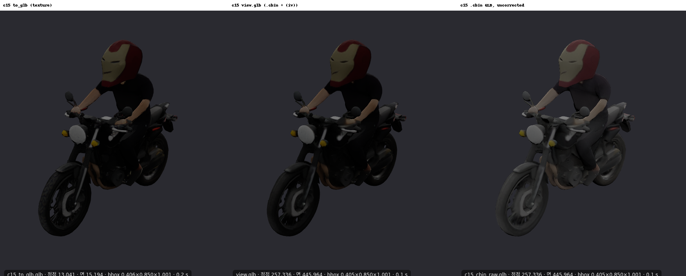

# X. 논문 실험 — a5000 보고서

- 장비: a5000 (RTX A5000 24 GB). 브랜치 `item/X-paper-a5000`(`item/02-R4-a5000` `60c951d` = 경계 스냅 포함에서 분기, main 병합).
- 지시: `ops/tasks/X-paper.md`(계획 원문 `ops/paper/PLAN.md`, 지시서 우선). 편집 시간은 재지 않는다(품질만).
- 경로: **P0** 원저자(재등록 + 25 스텝 + `to_glb`, 인페인팅 A5000 bf16). **P1** 우리(W34 + editcore 15/15 + R4 `.cbin`, 인페인팅 3090 INT4).
  **P2** = P1 + 매 편집 전 150시점 재등록(`X_REREG=1`, 인페인팅 3090 INT4).
- 결과 원자료: `$RUNS_DIR/paper/<실험>/`. 보고서에 sha256.

## 0. 준비 상태 (2026-10-26)

- **연결:**
  - 3090 → A5000:8082 는 성공했다(3090 이 04L 워커로 트랙 A 종단 요청 20건을 보냈다, 10:5x–11:18).
  - A5000 → 3090 은 3090 임시 리스너를 기다린다(X3 P1·P2 인페인팅을 A5000 이 직접 부를 수 있는지가 여기에 달렸다).
- **X2-B 데이터(실측):** A5000 `ASSETS_DIR/Edit3D-Bench/data` 에 다음이 있다. **내려받을 것은 없다.**
  - GSO 50 모델 · PartObjaverse-Tiny 50 모델
  - 모델마다 원본 GLB(`source_model/model.glb`)와 프롬프트 3개
  - 프롬프트마다 `3d_edit_region.glb`(3D 마스크)·`2d_render`·`2d_mask`·`2d_edit`. 텍스트는 `metadata.json`(source_prompt, prompt_1–3).
- **04L 워커:** 3090 종단 요청이 11:18 에 끝난 뒤, GPU 를 X4 에 쓰려고 11:29 에 내렸다. 04L 코드(assets_track_a.json·인증 끔·e2e 복제 자산)는 병행한다.
- **채점 일시정지(사용자 지시 16:2x):** X3 회차가 CPU 경합으로 늘어(지프 P1 1회차 328 s 중 조건 렌더 85 s·editcore 211 s, 부하 평균 61 — X0·X4 채점의 Bench Blender 렌더 2개가 32코어 중 약 28개 사용, 실측) X0·X4 채점을 **2026-10-26 16:23:27 에 SIGSTOP** 했다.
  - PGID 4039842 = `tools/paper/x4_score.py`(PID 4039842, Blender 자식 4134352)
  - PGID 4064024 = `x0_r23.sh` → `tools/paper/x0.py`(PID 4064024·4064025, Blender 자식 4134529)
  - X3 45회차가 끝나면 `~/vhl-runs/paper/resume_scoring.sh` 가 SIGCONT 한다. 그 사이에도 X3 자산 하나(P0·P1·P2 5회차)가 끝날 때마다 그 자산의 X3 채점(`tools/paper/x3_score.py <자산>`)은 돌린다. 기록 `$RUNS_DIR/paper/paused.json`, `/paper` 상단 표시.

## 1. 채점 도구 `tools/paper_metrics.py` (코드확인, CPU 테스트 통과)

정의는 코드 상단 주석과 같다.

- **좌표:** 자산마다 v0 메시 bbox 로 정한 변환 하나(중심 원점, 최대 변 1) = N 좌표다. 포크 `normalize_scene` 과 같은 식이다.
  - P0 출력은 이미 N 이다(원저자 경로가 입력을 normalize_scene 해서 인코딩).
  - editcore·R4 출력(raw 프레임)은 raw → v0 저장 좌표(트랙 A `glb_normalize`, 트랙 B 항등) → N 으로 옮긴다.
  - 64³ 셀은 raw 프레임 기준이고, T1 뷰어 `voxelToWorld` 와 같은 식이다.
- **표면 샘플:** 면적 비례 100,000점, 면 법선, seed 0.
- **보존 점:** 점의 64³ 셀이 `dilate_cells(제외 셀, 2)` 밖이다.
- **지표 식:**
  - CD = ½(mean_R min_G + mean_G min_R)
  - NC = 최근접 쌍 |n·n| 양방향 평균
  - F1@0.01 = 정밀도(R→G)·재현율(G→R) 조화평균
- **점유:** `eval/rkeep.py`(E18).
- **PSNR·SSIM·LPIPS(M):** Bench `render.py` 16시점(N 좌표 메시, 정점색은 (iv) 보정)으로 렌더한다.
  - 제외 마스크 = 제외 셀 ∪ halo 2 를 같은 카메라로 투영한 실루엣이다.
  - 비교 화소 = (참조 알파 ∪ 결과 알파) − 제외 마스크다.
  - 계산은 Bench `eval_modules/image_metrics.py` 메서드 그대로다(회색 127 합성, 512², LPIPS alex spatial — Bench 와 같게 [0,1] 입력).
- **DINO-I·CLIP-T:** 편집 시점(포크 v → Bench {0:2,1:1,2:0,3:7,4:6}) 결과 렌더 vs 2d_edit·프롬프트. Bench 모델(DINOv2-base, CLIP ViT-B/32)을 쓴다.
- **CPU 테스트 `tests/cpu/test_paper_metrics_cpu.py` 4 passed:**
  - 같은 메시는 CD 0·NC 1·F1 1
  - 평면 평행이동 t = 0.004 는 CD ≈ t·F1 1, 0.02 는 F1 0
  - 셀 ↔ N 왕복, 보존 마스크
  - **A-S1 마스크 셀 실루엣(포크 v1) vs 동결 2d_mask IoU ≥ 0.9**
- **실데이터 1건 확인(A-M1 c15 r1 P1-glb vs v0, 1 m 40 s):**
  - 보존 CD 0.0024, NC 0.941, F1 0.989
  - PSNR(M) 32.2, SSIM 0.965, LPIPS 0.022, DINO-I 0.778, CLIP-T 0.269
  - 정렬 확인(v0 셀 → v0 메시 1셀 이내) 0.843 — T1 V-2 moto 값과 같다(to_glb mincut 이 가려진 면을 지움).

## 2. X4 무편집 재등록 체인

**예상(실행 전):**
- **P0 1회차:** 점유 IoU 가 원문의 0.800–0.959 범위로 떨어진다. 회차마다 150시점 렌더·`to_glb`(단순화 0.95 + mincut)를 다시 거치므로 셀이 조금씩 줄고, CD 가 커지고 PSNR(M) 이 떨어질 것이다.
  - 다만 2회차부터는 입력이 이미 `to_glb` 메시라 손실 폭이 1회차보다 작을 수 있다(포화).
- **P1:** 회차와 무관하게 일정하다. 디코더 1e-7 차이만 있고, 지표는 같은 값이 5번 나온다.
- 빈 마스크 editcore 는 거절될 가능성이 크다(마스크 셀 0 → 편집 컨텍스트 생성 단계). 거절되면 사유를 적는다.

(결과는 실행 뒤 기입)

## 3. X0 재채점

**예상(실행 전):**
- 25 대 15(editcore W34 경로): 보존 영역 CD·NC·F1 은 거의 같다. 보존 셀은 비트 동일이라 차이는 경계·마스크 밖 신규 셀 몫이다.
- PSNR(M)·DINO-I·CLIP-T 차이는 E2a §5·E19 재판정과 같은 방향일 것이다(c15 허용치 안).
- `P1-cbin` 은 `P1-glb` 보다 보존 CD·F1 이 나쁘게 나올 수 있다(가려진 내부 면, R4 3-8 B4 Chamfer).

**결과(실측, a5000 CPU, 14건 r1, `tools/paper/x0.py`·`x0_cbin.py`, 커밋 4c430b2):**

- 입력: base = 0-1 이식본 25 스텝 port-r1(`to_glb`), c15-glb = E2a c15 r1(`to_glb`), c15-cbin = **같은 c15 r1 slat_tgt** 를 R4(R11 + 경계 스냅)로 다시 디코딩한 정점색 GLB(chief 검토 1a, 14건 모두 스냅 뒤 정점 틈 중앙값 0). 참조 = v0(생성 텍스처 GLB / 데이터셋 GLB).
- 원자료 `$RUNS_DIR/paper/x0/x0.json` sha256 `bc6978850eda1072dfa3820a89000e120167f2290961b7a411e8ad3cc58d2ec7`.

| 시나리오 | 설정 | 보존 CD | NC | F1 | PSNR(M) | SSIM(M) | LPIPS(M) | DINO-I 1 | CLIP-T 1 | DINO-I 16 | CLIP-T 6 | 신규(R_keep) |
|---|---|---|---|---|---|---|---|---|---|---|---|---|
| A-M1 | base | 0.0023 | 0.945 | 0.991 | 33.89 | 0.9698 | 0.0178 | 0.7819 | 0.3299 | 0.9808 | 0.3159 | 93 |
| A-M1 | c15-glb | 0.0024 | 0.941 | 0.989 | 32.18 | 0.9651 | 0.0218 | 0.7775 | 0.2694 | 0.9857 | 0.3020 | 129 |
| A-M1 | c15-cbin | 0.0046 | 0.916 | 0.879 | 28.98 | 0.9138 | 0.0456 | 0.7574 | 0.2724 | 0.9806 | 0.2986 | 129 |
| A-M2 | base | 0.0022 | 0.946 | 0.998 | 35.90 | 0.9853 | 0.0076 | 0.8464 | 0.2483 | 0.9850 | 0.2379 | 43 |
| A-M2 | c15-glb | 0.0023 | 0.946 | 0.997 | 29.41 | 0.9748 | 0.0170 | 0.8329 | 0.2489 | 0.9850 | 0.2386 | 44 |
| A-M2 | c15-cbin | 0.0048 | 0.922 | 0.866 | 27.55 | 0.9291 | 0.0338 | 0.8209 | 0.2438 | 0.9824 | 0.2395 | 44 |
| A-S1 | base | 0.0068 | 0.955 | 0.944 | 22.21 | 0.8734 | 0.1252 | 0.6647 | 0.3310 | 0.9283 | 0.3394 | 2037 |
| A-S1 | c15-glb | 0.0033 | 0.978 | 0.992 | 33.96 | 0.9657 | 0.0246 | 0.7398 | 0.3544 | 0.9373 | 0.3438 | 354 |
| A-S1 | c15-cbin | 0.0033 | 0.978 | 0.992 | 31.88 | 0.9538 | 0.0369 | 0.6926 | 0.3498 | 0.9443 | 0.3430 | 354 |
| A-S2 | base | 0.0025 | 0.983 | 1.000 | 44.37 | 0.9874 | 0.0046 | 0.8803 | 0.2628 | 0.9958 | 0.2650 | 1 |
| A-S2 | c15-glb | 0.0025 | 0.984 | 1.000 | 43.91 | 0.9863 | 0.0046 | 0.8758 | 0.2635 | 0.9955 | 0.2652 | 6 |
| A-S2 | c15-cbin | 0.0026 | 0.984 | 1.000 | 38.16 | 0.9726 | 0.0160 | 0.8715 | 0.2635 | 0.9927 | 0.2662 | 6 |
| A-C1 | base | 0.0026 | 0.976 | 0.994 | 29.85 | 0.9721 | 0.0207 | 0.8358 | 0.2940 | 0.9737 | 0.2918 | 118 |
| A-C1 | c15-glb | 0.0027 | 0.970 | 0.989 | 28.28 | 0.9619 | 0.0197 | 0.8563 | 0.2913 | 0.9769 | 0.2877 | 186 |
| A-C1 | c15-cbin | 0.0032 | 0.960 | 0.962 | 27.23 | 0.9405 | 0.0290 | 0.8655 | 0.2888 | 0.9762 | 0.2884 | 186 |
| A-C2 | base | 0.0024 | 0.982 | 1.000 | 40.70 | 0.9903 | 0.0050 | 0.8867 | 0.3067 | 0.9940 | 0.3092 | 18 |
| A-C2 | c15-glb | 0.0024 | 0.983 | 1.000 | 39.20 | 0.9881 | 0.0070 | 0.8951 | 0.3072 | 0.9935 | 0.3085 | 36 |
| A-C2 | c15-cbin | 0.0030 | 0.970 | 0.970 | 36.93 | 0.9681 | 0.0187 | 0.8954 | 0.3067 | 0.9850 | 0.3081 | 36 |
| B1 | base | 0.0041 | 0.958 | 0.993 | 18.19 | 0.6709 | 0.0881 | 0.8488 | 0.3366 | 0.9268 | 0.3272 | 107 |
| B1 | c15-glb | 0.0041 | 0.958 | 0.995 | 18.14 | 0.6697 | 0.0896 | 0.8426 | 0.3244 | 0.9328 | 0.3227 | 113 |
| B1 | c15-cbin | 0.0044 | 0.948 | 0.979 | 18.27 | 0.6670 | 0.1004 | 0.8383 | 0.3399 | 0.9292 | 0.3205 | 113 |
| B2 | base | 0.0064 | 0.930 | 0.915 | 18.08 | 0.6645 | 0.1466 | 0.7872 | 0.2620 | 0.9147 | 0.2905 | 4830 |
| B2 | c15-glb | 0.0066 | 0.927 | 0.915 | 17.70 | 0.6449 | 0.1596 | 0.7662 | 0.2631 | 0.9197 | 0.2842 | 3999 |
| B2 | c15-cbin | 0.0066 | 0.925 | 0.914 | 17.82 | 0.6447 | 0.1672 | 0.7767 | 0.2707 | 0.9189 | 0.2825 | 3999 |
| B3 | base | 0.0021 | 0.972 | 0.999 | 20.81 | 0.7438 | 0.0775 | 0.6595 | 0.3317 | 0.9873 | 0.3228 | 61 |
| B3 | c15-glb | 0.0020 | 0.974 | 1.000 | 21.00 | 0.7495 | 0.0741 | 0.6546 | 0.3376 | 0.9844 | 0.3227 | 29 |
| B3 | c15-cbin | 0.0036 | 0.955 | 0.918 | 21.03 | 0.7354 | 0.0838 | 0.6559 | 0.3379 | 0.9791 | 0.3216 | 29 |
| B4 | base | 0.0168 | 0.870 | 0.869 | 15.24 | 0.6526 | 0.1115 | 0.9466 | 0.2781 | 0.8575 | 0.2682 | 989 |
| B4 | c15-glb | 0.0085 | 0.898 | 0.935 | 15.92 | 0.6700 | 0.1030 | 0.9406 | 0.2722 | 0.8723 | 0.2640 | 892 |
| B4 | c15-cbin | 0.0118 | 0.889 | 0.891 | 16.12 | 0.6789 | 0.1040 | 0.9535 | 0.2833 | 0.8707 | 0.2665 | 892 |
| B5 | base | 0.0029 | 0.969 | 0.969 | 17.31 | 0.7310 | 0.1212 | 0.7649 | 0.2988 | 0.9590 | 0.2924 | 268 |
| B5 | c15-glb | 0.0022 | 0.983 | 0.990 | 20.17 | 0.8253 | 0.0595 | 0.7630 | 0.2940 | 0.9652 | 0.2859 | 91 |
| B5 | c15-cbin | 0.0039 | 0.974 | 0.934 | 20.26 | 0.8271 | 0.0676 | 0.7467 | 0.2962 | 0.9601 | 0.2865 | 91 |
| B6 | base | 0.0023 | 0.978 | 1.000 | 20.38 | 0.8262 | 0.0824 | 0.8206 | 0.2459 | 0.9701 | 0.2564 | 4 |
| B6 | c15-glb | 0.0023 | 0.978 | 1.000 | 20.06 | 0.8190 | 0.0854 | 0.8136 | 0.2457 | 0.9558 | 0.2569 | 3 |
| B6 | c15-cbin | 0.0033 | 0.965 | 0.960 | 20.27 | 0.8156 | 0.0970 | 0.8248 | 0.2419 | 0.9560 | 0.2586 | 3 |
| B7 | base | 0.0031 | 0.986 | 0.988 | 15.90 | 0.6835 | 0.1150 | 0.8511 | 0.2637 | 0.8201 | 0.2657 | 168 |
| B7 | c15-glb | 0.0031 | 0.987 | 0.992 | 16.08 | 0.6902 | 0.1126 | 0.8509 | 0.2683 | 0.8223 | 0.2647 | 173 |
| B7 | c15-cbin | 0.0046 | 0.973 | 0.926 | 15.95 | 0.6829 | 0.1156 | 0.8522 | 0.2654 | 0.8256 | 0.2653 | 173 |
| B8 | base | 0.0028 | 0.974 | 0.998 | 22.61 | 0.8064 | 0.1128 | 0.7330 | 0.2275 | 0.8358 | 0.2276 | 69 |
| B8 | c15-glb | 0.0028 | 0.974 | 0.999 | 22.37 | 0.8007 | 0.1162 | 0.7294 | 0.2381 | 0.8393 | 0.2342 | 74 |
| B8 | c15-cbin | 0.0033 | 0.972 | 0.994 | 22.39 | 0.7828 | 0.1534 | 0.7517 | 0.2423 | 0.8363 | 0.2321 | 74 |
| **평균** | base | 0.0042 | 0.959 | 0.976 | 25.39 | 0.8255 | 0.0740 | 0.8077 | 0.2869 | 0.9378 | 0.2864 | 8806 |
| **평균** | c15-glb | 0.0034 | 0.963 | 0.985 | 25.60 | 0.8365 | 0.0639 | 0.8099 | 0.2842 | 0.9404 | 0.2844 | 6129 |
| **평균** | c15-cbin | 0.0045 | 0.952 | 0.942 | 24.49 | 0.8223 | 0.0764 | 0.8074 | 0.2859 | 0.9384 | 0.2841 | 6129 |

정의(표 아래, chief 지시 1):
- 보존 CD·NC·F1@0.01: 마스크 ∪ halo 2 밖 표면 점(각 100,000점 중), N 좌표(v0 bbox 변환 하나).
- PSNR·SSIM·LPIPS(M): Bench 16시점, 비교 화소 = (참조 ∪ 결과 알파) − 마스크 ∪ halo 2 실루엣.
- **DINO-I 1·CLIP-T 1 = 지시서 정의:** 편집 시점 결과 렌더 1장 vs 2d_edit / 프롬프트.
- **DINO-I 16·CLIP-T 6 = E2a(Bench eval_main) 정의:** DINO-I = 결과 16시점 vs 참조(v0) 16시점 평균, CLIP-T = 정면 6시점(0,1,7,8,9,15) 평균.
- 신규(R_keep) = 마스크 ∪ halo 2 밖에서 새로 점유된 64³ 셀(E18). 소실은 세 설정 모두 0.

**1b 원인 확인(chief 검토 1b, 실측):** A-M1 CLIP-T base 0.330 → c15 0.269 는 **정의 차이**다. 같은 GLB 의 paper_metrics 렌더와 e2a_metrics 렌더는 화소 동일(평균 |차| 0.0, 시점 0·7)이고, 같은 렌더에 E2a 정의를 걸면 0.3159 / 0.3020 로 E2a 값(0.3159 / 0.3021)과 4자리 일치한다. 단일 시점 값은 1장이라 흔들림이 크다. E2a r1–r3 표준편차는 1e-4 수준이라 회차 차이는 원인이 아니다. 고친 것: 두 정의를 모두 기록(위 표).

**해석:**
- c15-glb 대 base(14건 평균): 보존 CD 0.0042 → 0.0034, F1 0.976 → 0.985, PSNR(M) 25.39 → 25.60, 신규 셀 8806 → 6129. 예상("거의 같다")보다 c15 가 좋게 나온 것은 base 쪽 A-S1(마스크 밖 생성, E12 표시)·B4 단발 값이 크기 때문이다(시나리오별 표). 단발 1회라 base·c15 의 run 잡음을 가를 수 없다(추론).
- E19 절대 허용치를 넘는 칸(c15-glb − base): PSNR 4, SSIM 6, LPIPS 2, CD 0, CLIP-T 6 0, DINO-I 16 0, CLIP-T 1 1, DINO-I 1 1.
- c15-cbin 대 c15-glb: 같은 SLat 인데 보존 CD 0.0034 → 0.0045, F1 0.985 → 0.942, NC 0.963 → 0.952, PSNR(M) −1.1 dB. 예상대로 R4 메시의 가려진 내부 면(`to_glb` 가 지우던 면)과 정점색 렌더 차이 몫이다. E19 넘는 칸(c15-cbin − base): PSNR 5, SSIM 10, LPIPS 10, CD 2, CLIP-T 6 1, DINO-I 1 3. 논문에 어느 메시를 쓸지는 사용자 결정(지시서 보정 1).
- 정렬 확인(v0 셀 → v0 메시 1셀 이내) 평균 0.975.

## 8. 보기용 GLB(view.glb)와 웹 뷰어 색 처리 (chief 15:2x 4)

**a. view.glb (코드확인):**
- P1·P2(.cbin → glbbuild 정점색 GLB) 결과마다 `view.glb` = `editcore/render.py:vertex_color_render_glb` (iv) 보정본. COLOR_0 sRGB → 선형 float32, 재질이 없는 프리미티브에 to_glb 와 같은 재질(baseColor 1, roughness 1, metallic 생략 = 1.0).
- P0 는 to_glb 결과를 그대로 쓴다(`view.glb` → `output.glb` 링크).
- 위치: X3 회차 폴더마다(`runs/paper/x3/<경로>/<자산>/r0..r5/view.glb`, 새 회차는 `tools/paper/x3.py:write_view` 가 자동으로 만든다), X0 c15-cbin `runs/paper/x0/cbin/<시나리오>/[r2|r3/]view.glb`(`tools/paper/x0_cbin.py`).
- 파일 확인(실측): glbbuild 원본 COLOR_0 = uint8 정규화(componentType 5121), view.glb = float32(5126).

**b. 뷰어·평가 페이지가 그리는 방식 (코드확인):**
- **T1 뷰어 항목 페이지(`tools/viewer/view.html`):** 기본 모델을 `view.glb` 로 바꿨다(`?model=` 로 고를 수 있다).
- **T1 시나리오 페이지(`scenario.js`):** 정점색을 화면에서만 선형으로 바꾸던 처리를, COLOR_0 이 이미 float32 인 GLB(view.glb)에는 건너뛰게 했다(두 번 어두워지는 것을 막음).
- **색 공간:** three.js r160 기본값 — `renderer.outputColorSpace = SRGBColorSpace`, GLTFLoader 가 baseColor 텍스처를 `SRGBColorSpace` 로, COLOR_0 은 규격대로 선형으로 읽는다. 톤 매핑 없음(NoToneMapping).
- **조명:** 환경맵 없이 HemisphereLight 1.6 + DirectionalLight 1.6·0.6(`common.js:addLights`)이 모든 GLB 에 같다. 카메라는 bbox 로 잡는다(`common.js:frame`). P0 와 P1·P2 의 재질이 같아(metallic 1.0, roughness 1) 같은 조건으로 그려진다.
- **x3-eval·캡처 시트:** GLB 를 브라우저에서 그리지 않고 Bench `render.py`(Blender) 16시점 렌더 PNG 를 쓴다. P1·P2 는 렌더 전에 같은 (iv) 보정을 거친다(`tools/paper_metrics.py:n_frame_glb`). 세 경로가 같은 카메라·조명이다.

**c. 확인 한 건 (실측, T1 뷰어 항목 페이지, 같은 시점 — bbox 0.406 vs 0.405 로 카메라가 같다):**

- to_glb(텍스처)와 view.glb((iv))는 색·밝기가 같은 쪽이다.
- 보정 없는 .cbin GLB 는 밝고 옅다(sRGB 값을 선형으로 읽은 결과).
- R4 3-8 Blender (iv) 시트와 같은 방향이다.
